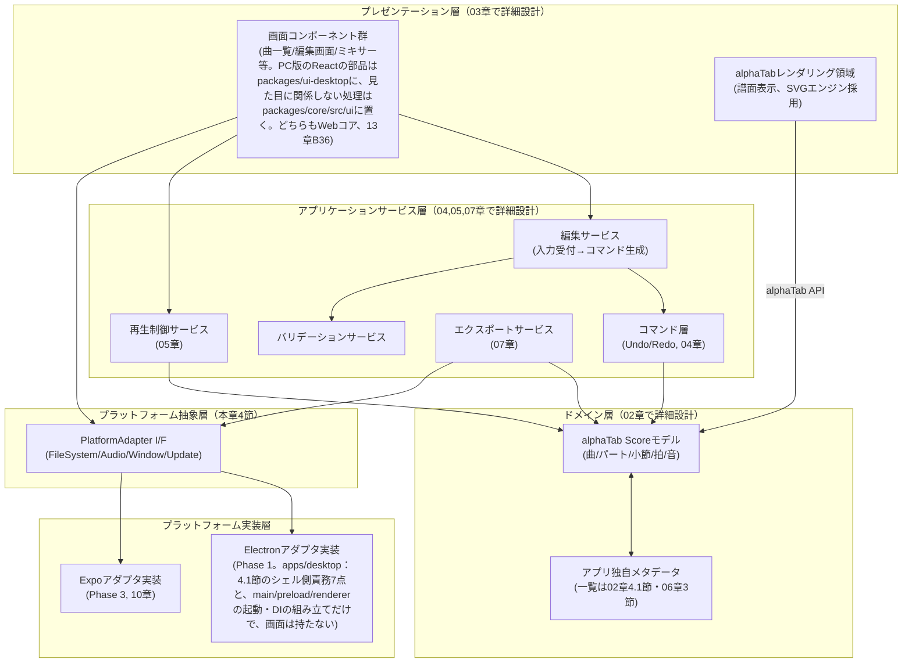
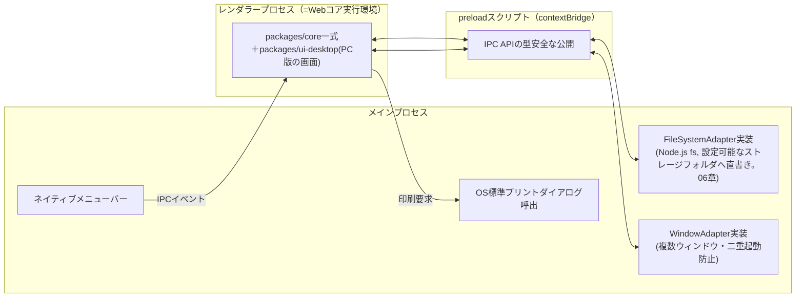

# アーキテクチャ設計書

対応要件：要件定義書 3章（スコープ・方針転換）、5.5節（保守性・移植性）、6章（システム構成）、8章リスク#8

## 1. 目的

Webコア（プラットフォーム非依存）とプラットフォームラッパー（Electron／将来Expo）の境界を明確に定義し、「PC版開発中にElectron依存コードがWebコアに紛れ込む」（要件書リスク#8）を構造的に防止する。あわせて、実装言語・フレームワーク・パッケージ構成という、要件定義書では未確定だった技術選定を基本設計として確定する。

**本書の記述レベルについて**：本書はV字モデル（[[15_development_process.md#1.1]]）における「基本設計」段階の成果物であり、モジュール／レイヤーの責務分担と外部インターフェース契約（何を受け取り、何を返すか、という概念レベルの取り決め）までを扱う。具体的なメソッドシグネチャ（引数・戻り値の型、例外仕様等）やクラス構成は詳細設計段階（[[15_development_process.md#1.2]]、作業パッケージ単位の`detailed_design/`文書）で確定する（[[13_design_decision_points.md#3]]B13）。

## 2. 全体レイヤー構成



**層ごとの許可される依存方向**：上位層は下位層に依存してよいが、逆方向の依存（L3がL1を知る等）は禁止。L1〜L3を「Webコア」、L4を境界、L5を「ラッパー層」と呼ぶ（要件書6章の呼称に対応）。PC版の画面の部品を置く`packages/ui-desktop`はL1（Webコア）に属し、L5の`apps/desktop`には画面を置かない（2026-09-26 本人決定、13章B36）。この依存規則をESLintで機械的に強制し、リスク#8（Electron依存混入）をレビュー任せにしない（具体的なルール構成は旧詳細設計 `web-core-foundation.md` §6（`2759936` 時点）で確定）。

**要件6章の「ロジック層」との対応（2026-09 追記）**：要件定義書6章の構成図は Webコアの内訳を4つで描いており、そのうち1つを「ロジック層（コマンド層／Undo/Redo履歴管理／バリデーションの3要素）」と、**3要素で閉じて**書いている。本書のL2は5つの箱を持つが、これは同じものを細かく割っただけで数の食い違いではない。**要件が言う「ロジック層」に当たるのは次の3つに限られる。**

| 要件6章の3要素 | 本書での所在 |
|---|---|
| コマンド層 | L2の`コマンド層`（[[04_editing_core.md#8]]） |
| Undo/Redo履歴管理 | 同じく`コマンド層`の内側（`CommandHistory`、[[04_editing_core.md#8.2]]）。要件は独立した要素として挙げているが、本設計では履歴をコマンド層の内部状態として持つ |
| バリデーション | L2の`バリデーションサービス` |

L2の残り2つ（`編集サービス`・`再生制御サービス`）と`エクスポートサービス`は、要件6章では「ロジック層」ではなく、それぞれ画面UIからの入力経路・alphaTab統合（`PLAY`）・エクスポート（要件4.4）として別に数えられている。この対応づけ（残り3つをロジック層の外に置く）は、要件6章がロジック層を3要素で閉じていることから本書で当てはめたもので、要件定義書に対応表が書かれているわけではない。違うと判断する場合は本表と下の1文を書き換えれば済む。

したがって、**L2に箱を足すときは、それが要件の言う3要素のどれかに当たるのか、当たらないのかを先に決める。** 当たらないものを「ロジック層」と呼ばない。

## 3. 主要アーキテクチャ決定（AD）

### AD-1：ドメインモデルはalphaTabのScoreモデルを基盤とし、アプリ独自メタデータは並行ストアで管理する

alphaTabは譜面レンダリング・合奏再生に加え、Guitar Pro形式相当の豊富なデータモデル（`Score > Track > Staff > Bar > Voice > Beat > Note`、チューニング・カポ・拍子/テンポ変更・章立て（Section）・繰り返し記号・各種奏法エフェクトを内包）を標準で持つ。これを自前で再定義するとPDF/alphaTex/MIDIエクスポートや再生でのモデル変換コストが二重に発生するため、**Score系オブジェクトをそのままアプリの永続化対象データモデルの中核として採用する**。

一方、alphaTabのモデルが持たない、あるいは本アプリ固有の情報は、Score本体を汚さず**「サイドカーメタデータ」**としてScoreの外に保持する。**何をどこに置くかの一覧は1か所にだけ書く**：曲のファイルに入れるものは[[02_data_model.md#4.1]]の`appMeta`、アプリの側に置くもの（曲のファイルに入れないもの）は[[06_file_io_persistence.md#3]]のファイル構成を正とし、情報を足すときはその一覧に足して、本節は直さない（2026-09-27 本人決定、本節に一覧を並べていたころ02章・06章と数が食い違ったため）。この分離により、alphaTab側のバージョンアップでScore構造が変わってもサイドカー部分は影響を受けにくい。

- 影響：02章（データモデル）、07章（エクスポート）、05章（再生）
- 対応方針：確定

### AD-2：編集操作はすべてコマンドパターンを介してScoreモデルを変更する

要件書4.5節「Undo/Redoは全パート横断の単一操作履歴」と、**メモリ予算に基づく実務上十分な履歴の深さ**（[[13_design_decision_points.md#4]]C11：`CommandHistory` インスタンスあたり80MB・直近200件の下限保証）を満たすため、UIから直接Scoreモデルを変更することを禁止し、必ず「コマンドオブジェクト（実行操作と、それを打ち消す取り消し操作の対を持つもの）」を介する。**2026-09-10 是正（監査 MJ-A6）**：本節は当初「セッション内無制限」を設計ドライバとして引用していたが、この要件は C11（要件変更履歴#12、[[../tab_app_requirements.md#10]]）で撤回済みであり、[[04_editing_core.md#8]]は是正されていたのに本節だけが古いままだった。コマンド層はUIにもalphaTabにも依存しない純粋ロジックとし、自動テスト対象の中心に据える（11章）。具体的なコマンドの型・メソッド構成は詳細設計（04章の詳細設計書）で確定する。**2026-09-01追記**：alphaTab自体には専用の編集コマンドAPIが存在しないことを確認した（[[13_design_decision_points.md#2]]A1解決）。コマンドはScoreモデルを直接変えるだけで描き直しは頼まず、描き直しは`CommandHistory`が実行・取り消し・やり直しのあとにまとめて頼む（各コマンドが後処理まで行うと、取り消したときに譜面が元に戻りきらないため、[[13_design_decision_points.md#3]]B33）。将来Apple Pencil等の新しい入力手段を追加する場合も、UIがコマンドを生成する経路さえ用意すれば済むため、この分離が拡張性の要となる（[[10_extensibility_future.md#4.4]]参照）。

- 影響：04章（編集コア）で詳細設計
- 対応方針：確定

**2026-09-10 追記（AD-2 の適用範囲を機械的に検算する）**：本 AD が「すべての Score 変更はコマンド経由」と定めている以上、**モデルの変更可能フィールドには必ず対応するコマンドが存在しなければならない**。しかし実際には、要件4.1 の記譜要素のうち 6 件（テンポ〈G2〉・拍子・繰り返し記号・アクセント・チョーキング等の奏法・付点／連符）で「モデルはあるがコマンドが無い」状態が繰り返し発生した（[[../review/design_audit_2026-09-10.md]] BL-1〜BL-6）。AD-2 の充足は宣言ではなく検算で担保するものとし、対応表を[[12_traceability.md#6]]に置いて空欄を許さない運用とする。

### AD-3：プラットフォーム差異はPlatformAdapterインターフェースで吸収する

ファイルI/O・オーディオセッション制御・ウィンドウ管理・自動更新チェックの4系統について、Webコアからは抽象インターフェースのみを参照し、具象実装（ElectronアダプタまたはExpoアダプタ）は起動時に注入する（依存性逆転）。各アダプタの責務は以下の通り。具体的なメソッドシグネチャ（引数・戻り値の型、非同期／同期の別、エラー時の扱い）は各アダプタが対応する作業パッケージの詳細設計書で確定する（[[13_design_decision_points.md#3]]B13）。

| Adapter | 責務（概念レベル） | 主に関わる要件・章 |
|---|---|---|
| FileSystemAdapter | 曲データの読み込み・アトミック書き込み（06章の一時ファイル→リネーム方式に従う）・一覧取得・ゴミ箱への移動、および現在の保存先ルートの取得・保存先の移行を担う。保存先はローカル/iCloud Drive/Google Drive等の中から設定可能な「フォルダパス」として扱い、Adapter自体はどの実体にも依存しない（06章、要件変更対応） | 06章 |
| AudioSessionAdapter | バックグラウンド音楽アプリとの音声共存設定を担う。PC版はno-op実装、iPhone版のみ実処理を持つ（要件3.2） | 05章、10章 |
| WindowAdapter | 曲ウィンドウのオープン、既存ウィンドウの前面化（同一曲の二重起動防止、要件5.6）を担う | 03章 |
| UpdateCheckAdapter | 更新確認を担う。現時点はダミー実装（要件5.6） | 10章 |

- 影響：06章、08章、10章
- 対応方針：確定。これにより「不要」と判定された機能（自動更新のサーバー配信、認証層等）も、アダプタの差し替えのみで将来追加できる（要件書4.5節・5.6節の横断的設計原則に対応）

### AD-4：実装言語・UI技術スタック

| 項目 | 選定 | 理由 |
|---|---|---|
| 言語 | TypeScript | データモデル・コマンド層の複雑性に対し型安全性が保守性に直結する。alphaTab自体もTypeScript製でAPI型定義が充実 |
| UIフレームワーク | React | Electron同梱を前提としたエコシステムの厚み、コンポーネント単位での画面分割（03章の画面群）との相性、Claude Codeでの実装支援の受けやすさ |
| 状態管理 | 軽量ストア（Zustand相当）＋コマンド層は独自実装 | Redux的なボイラープレートを避けつつ、Undo/Redo対象（Scoreモデル）とUI状態（選択範囲・表示モード等）を明確に分離管理する |
| ビルドツール | Vite（Electron向けテンプレート） | 開発時のホットリロード速度、Claude Codeでの設定変更のしやすさ |
| スタイリング（2026-09 追加、本人決定） | Tailwind CSS v4 系（Vite のプラグインで入れる。細かい版は実装のときに固定する）。[[14_visual_design_system.md]]のトークン（色・文字・余白・角丸・影）を CSS の `@theme` に定義して CSS 変数にし、画面はそのトークンから作られるクラスだけを使う（直値を書かない、[[08_error_logging.md#4]]） | UI の外観を CSS で定義するスタイリング環境を、今の詳細設計と実装に縛られずに選び直した（本人は、今の詳細設計と実装は負債で、適した方法に置き換える前提で選ぶとした）。`@theme` に書いたトークンがそのまま CSS 変数（例：`--color-danger`）になり、08章4節で決めた名前の形（`--color-` ＋表の名前）と一致する。画面側はトークンから作られたクラスしか使わないので直値が混ざりにくい。依存が 1 つ増えることと、JSX のクラス名が長くなることは受け入れる。選ばなかった案：CSS Modules ＋トークン 1 枚（直値を防ぐには別の見張りが要る）、素の CSS だけ |
| alphaTabパッケージ | `@coderline/alphatab`（npm） | 公式配布パッケージ。SoundFontはローカル同梱（要件5.1：外部CDN禁止） |

対応方針：方針確定（レンダリングエンジンはSVGを採用、[[13_design_decision_points.md#2]]A2で2026-09-01確定。8章リスク#3〈メモリ使用量〉の実測結果次第で微調整の余地は残す）

### AD-5：パッケージ構成（モノレポ）

```
tab-app/
├─ packages/
│  ├─ core/              … Webコア本体（L1〜L3）。プラットフォーム固有APIへの直接参照を禁止
│  │  ├─ ui/              画面の見た目に関係しない処理（03章）。Reactの部品はここに置かない（packages/ui-desktop、13章B36）
│  │  ├─ editing/         編集サービス・コマンド層（04章）
│  │  ├─ playback/        再生制御（05章）
│  │  ├─ domain/          Scoreラッパー・メタデータモデル（02章）
│  │  ├─ export/          PDF/alphaTex/MIDI（07章）
│  │  ├─ errors/          エラー/ログ基盤（08章）
│  │  └─ platform/        PlatformAdapterのインターフェース定義（実装は含まない）
│  ├─ ui-desktop/         … PC版の画面の部品（Reactのコンポーネント、03章）。Webコア（L1）に属する（13章B36）
│  └─ shared-types/       … coreと各ラッパーが共有する型定義のみのパッケージ
└─ apps/
   ├─ desktop/            … Electronラッパー（Phase 1）。main/preload/rendererで、4.1節のシェル側責務7点（①から④はAD-3のAdapter実装、⑤から⑦はアダプタを通さない実装）と、レンダラーの起動・DIの組み立て（packages/ui-desktopの画面をここで組み立てる）だけを持ち、画面の部品は置かない（要件6章、13章B36、2026-09-27 本人決定で7点を明記）
   └─ mobile/             … Expo+WebViewラッパー（Phase 3、雛形のみ先行作成も可）
```
開発用サンプルデータ（要件9章）のために`tools/`は設けず、`packages/core/src/testing`に置く（[[11_test_strategy.md#9]]、2026-09-27 本人決定）。

`packages/core` から `electron` や `expo-*` を直接importした時点でビルドが失敗する構成（パッケージの依存関係定義＋lintルール）とし、リスク#8を仕組みで防止する。`packages/ui-desktop` は `packages/core`・`packages/shared-types` とReactに依存してよいが、`electron`・`expo-*`・`apps/**` には依存しない（同じ仕組みで防ぐ）。依存の向きは `apps/desktop` → `packages/ui-desktop` → `packages/core` → `packages/shared-types` とし、逆流させない（2026-09-26 本人決定、13章B36）。

## 4. Electronプロセス構成（PC版・Phase 1）



- **セキュリティ既定値**：`contextIsolation: true` / `nodeIntegration: false` を維持し、Webコア（レンダラー）からNode.js APIへは必ずpreload経由のIPCでアクセスする（Webコアのプラットフォーム非依存性を物理的に担保する意味も持つ）。preloadスクリプトは`contextBridge`でIPCのAPIを型付きでWebコアへ公開する（本節の図）。
- **クラッシュ検知**：メインプロセスが`render-process-gone`イベントを監視し、検知時は直前の自動保存データからレンダラーを再読み込みする（08章で詳細化、要件5.4対応）。
- **右クリックメニュー／ネイティブメニューバー**：メインプロセスの`Menu`/`Menu.buildFromTemplate`で構築し、選択結果はIPCでWebコアへ伝達する（03章で項目を確定）。

### 4.1 シェル側責務の限定列挙（要件6章、2026-09 追記）

上の図はPC版のIPC経路のうち4つを描いたものであって、シェル側責務の全体ではない。要件定義書6章「プラットフォーム間の役割分担」が、担う側を**シェル側だけ列挙し、Webコアを「残り全部」と定義する**形で確定させている。原文：

> Webコア：**下記のシェル側責務を除く全てを担う**（編集ロジック・データモデル・再生エンジンは両プラットフォームで共通とし、画面UIはPC版・iPhone版で別実装とする）。列挙する側を反転させ、Webコア側は「残り全部」と定義する。シェル側の責務は、抽象インターフェース経由で注入する4系統（①ファイルI/O、②オーディオセッション制御（iPhone版のみ）、③ウィンドウ管理、④自動更新チェック）と、OSに直接触れる3点（⑤OS標準ダイアログの呼び出し（印刷・ファイル選択）、⑥ネイティブメニューバー・右クリックメニューの構築、⑦クラッシュ検知）とする。**これ以外はWebコアに置く**

本書もこの7点をシェル側責務の全体とする。**7点のいずれにも当たらない機能は、新旧を問わずWebコア側へ置く。** 7点の外へシェル側責務を足さない。画面（PC版のReactの部品）は7点のどれにも当たらないので、Webコア側の`packages/ui-desktop`に置き、シェルの`apps/desktop`には置かない（2026-09-26 本人決定、13章B36）。

| # | シェル側責務 | 実現方式 | 本設計での所在 |
|---|---|---|---|
| ① | ファイルI/O | 抽象インターフェース経由の注入（AD-3 `FileSystemAdapter`） | 本節の図`MFS`、[[06_file_io_persistence.md#2]]。**main側の`Logger`によるログファイルへの書き出しも①の実装として読む**（rendererから`log:append`で受けてファイルへ書く。[[13_design_decision_points.md#3]]B32、[[08_error_logging.md#1.1]]） |
| ② | オーディオセッション制御 | 同上（AD-3 `AudioSessionAdapter`）。**iPhone版のみが実処理を持つ**（要件6章の但し書き。PC版はOS標準で複数アプリの音声が同時に鳴らせるため、本設計上は特別な対応を行わない） | [[05_playback_audio.md#8]]、[[10_extensibility_future.md#4]] |
| ③ | ウィンドウ管理 | 同上（AD-3 `WindowAdapter`） | 本節の図`MWIN`、[[03_screens_ui_pc.md#2]] |
| ④ | 自動更新チェック | 同上（AD-3 `UpdateCheckAdapter`）。v1はダミー実装 | [[10_extensibility_future.md#1]] |
| ⑤ | OS標準ダイアログの呼び出し（印刷・ファイル選択） | OSへ直接触れる。抽象インターフェース経由にしない | **印刷**＝本節の図`MPRINT`、[[07_export_print.md#3]]／**ファイル選択**＝下記 |
| ⑥ | ネイティブメニューバー・右クリックメニューの構築 | 同上 | 本節の箇条書き、[[03_screens_ui_pc.md#6]]・[[03_screens_ui_pc.md#8]] |
| ⑦ | クラッシュ検知 | 同上 | 本節の箇条書き、[[08_error_logging.md#3]]。**rendererが落ちたあとのクラッシュログの記録（main側の`Logger`と直近履歴の保持）も⑦の実装として読む**。renderer内に置いたLoggerはrendererと一緒に失われ、自分のクラッシュを書けないため（B32） |

**⑤のうちファイル選択ダイアログ**：要件6章は印刷と並べて**ファイル選択**もシェル側責務として名指ししている。本アプリでOS標準のファイル選択ダイアログが要るのは、(a) 保存先フォルダの指定（[[06_file_io_persistence.md#2]]の「カスタムフォルダを選択」）と、(b) 書き出し画面の保存先フォルダの欄の「参照…」で開くフォルダ選択（要件4.4、[[07_export_print.md#2]]、ファイル名は書き出し画面の欄で決め、OSのダイアログでは選ばない）の2つ。どちらも**メインプロセスがOS標準のダイアログを開き、ユーザーが選んだパスだけをIPCでWebコアへ返す**形とし、Webコア側はパス文字列を受け取るだけでダイアログを知らない。⑥⑦と同じく抽象インターフェース経由にはしない（OSのダイアログはウィンドウに紐づくため、注入しても薄い通過層になるだけで、⑤を4系統側へ移す利益が無い）。

## 5. 依存ライブラリと方針

| ライブラリ | 用途 | ライセンス | 備考 |
|---|---|---|---|
| alphaTab | 譜面レンダリング／編集用データモデル／合奏再生シンセ | MPL-2.0 | 要件書リスク#2。Phase 0でライセンスファイルを直接確認 |
| 同梱SoundFont | 楽器音源 | Apache-2.0由来と推定 | Phase 0で最終確認、必要なら代替調達 |
| Electron | PC版シェル | MIT | 6章の選定理由を継承 |
| React | UIフレームワーク | MIT | AD-4 |
| （専用PDFライブラリ、フォールバック用） | PDFエクスポート | 未使用（現状不要） | PDF生成はElectron `webContents.printToPDF()`で確定済み（B6）。alphaTexエクスポートもalphaTabネイティブAPIで確定済み（[[13_design_decision_points.md#2]]A3、2026-09-01）。専用ライブラリはB6のフォールバック条件に該当した場合のみ追加検討する |

**alphaTabに委ねる範囲と、自作する範囲（要件6章、2026-09 追記）**：要件定義書6章は「alphaTabがレンダリング・多弦チューニング・奏法記号・拍子/テンポ変更・合奏再生を標準機能でカバーするため、自作範囲は主にエディタUIとデータモデル、各ラッパー層の統合部分に絞られる。」と、**委ねる側を名指しで挙げている。** カポについては同じ行が「カポは、位置の保持をalphaTabの標準機能（`Staff.capo`）で行い、実音への読み替え（開放弦の音高＋カポ位置＋記譜フレット）は自作して1か所に置く」と定めている（2026-09 改訂。当時の6章はカポも標準機能でカバーする側に挙げていた）。 本設計もこの線をそのまま引く。

| 要件6章がalphaTabの標準機能としている範囲（カポは位置の保持だけ） | 本設計での扱い |
|---|---|
| レンダリング | 譜面の描画はalphaTabのレイアウトエンジンに委ね、符頭・符幹・符尾（連桁）をどう描くかの規則を自前で持たない（要件4.1「記譜スタイル」。SVGエンジンの採用は[[13_design_decision_points.md#2]]A2） |
| 多弦チューニング | `stringPitches`をalphaTabの弦チューニングへ渡す（[[02_data_model.md#3.7]]） |
| 奏法記号 | alphaTabの属性として保持する。Note単位のものはNoteに、**タッピング・スラップ・ポップ・ブラシはBeatに**持つ（alphaTabでもBeatの属性。[[02_data_model.md#3.4]]、[[04_editing_core.md#6]]、[[13_design_decision_points.md#3]]B40） |
| 拍子/テンポ変更 | 小節側の値として保持する（[[02_data_model.md#3.3]]、[[04_editing_core.md#10]]） |
| カポ | **実音への読み替え（開放弦の音高＋`capoFret`＋記譜フレット）は自作し、[[05_playback_audio.md#10]]の1か所に置く。** 再生・MIDI書き出し・コード推定（[[04_editing_core.md#7]]）の3か所がそこを呼ぶ。alphaTabの`Staff.capo`にも値は設定する。自作する理由は2つある。(1) コード推定は自前のコードで構成音の実音を要するので、加算はこちら側に必ず1か所要る。(2) alphaTab 1.8.4 の型定義は`Staff.capo`を「Gets or sets the fret on which a capo is set.」とだけ説明し、再生ピッチへの反映を書いていない（同じ型の`transpositionPitch`は「This applies to rendering and playback.」と明記している）。alphaTabのシンセが`Staff.capo`を再生に反映するかは[[13_design_decision_points.md#2]]A14で確かめる。要件6章もこの形（位置の保持は標準機能、読み替えは自作して1か所）に改められた（2026-09） |
| 合奏再生 | AlphaSynthに委ねる（[[05_playback_audio.md#2]]） |
| タイ | 音価の連結と再生時の1音化をalphaTabの記譜要素として扱い、独自の連結規則を持たない（[[04_editing_core.md#5]]） |
| 再生カーソル | **再生中は、現在の再生位置を示すカーソルを譜面上に表示する。** 表示はalphaTabの再生カーソル（設定`enableCursor`）に委ね、位置の計算を自前で持たない。スクロールの追従はalphaTabの再生位置イベントを購読して行う（[[05_playback_audio.md#5]]） |

自作するのは**エディタUI・アプリ独自のデータモデル・各ラッパー層の統合部分**に限る。上の表の範囲について（カポの実音への読み替えだけは、要件6章自身が自作すると定めている）、**下位設計で自前の描画規則・解釈規則を新たに起こさない。** 標準機能で足りないと判明した場合は、実装を先に書かず[[13_design_decision_points.md]]へ分岐点として起こしてから決める。

**第三者ライブラリ・アセットのライセンス確認の運用（要件4.5節横断原則・5.6、2026-09 追記）**：要件定義書4.5節の「設計原則（横断的・その2）」は、次の3つを逐語で定めている。「第三者ライブラリ・アセット（alphaTab、SoundFont等）を利用する際は、都度ライセンス条項を確認し遵守する」。「必要に応じてアプリ内にクレジット表示画面を設ける」。「この原則は今後新たに採用するライブラリ・アセットにも同様に適用する」。本設計での運用を次の形にする。

| | 内容 |
|---|---|
| いつ | **採用するとき**と、**採用済みライブラリのバージョンを上げるとき**の両方。初回だけで済ませない（要件の「都度」） |
| 何をするか | 配布元のライセンスファイルそのものを開いて条項を読む。要約・孫引きで代えない（要件書リスク#2は alphaTab について「Phase 0でalphaTabリポジトリのライセンスファイルを直接確認して最終確定させる」と、この形を指定している） |
| 何を見るか | (1) 商用利用と商用ソフトへの組み込みが許されるか、(2) 表示義務（著作権表示・ライセンス全文の同梱）の有無、(3) 再配布条件、(4) 自社コードの開示義務の有無 |
| 結論をどこに残すか | 上の依存ライブラリ表の「ライセンス」列と「備考」列。表示義務があるものは[[10_extensibility_future.md#8]]のクレジット画面へ載せる |
| 現時点の判断 | alphaTabはMPL-2.0で商用利用・商用ソフトへの組み込みが可能、自社コードのOSS化は不要。同梱SoundFontはApache-2.0由来と推定され商用利用可能な見込み。**どちらもPhase 0でライセンスファイルを直接確認して確定させる**（要件書リスク#2、Phase 0検証項目#1） |

出荷の条件は「確認した」ではなく、次の2つが揃っていることとする。**上の表の(2)表示義務のあるもの（著作権表示・ライセンス全文）がパッケージに入っていること**と、**(3)再配布条件と(4)自社コードの開示義務のどちらにも反していないこと**（2026-09 是正：当初は(2)だけを出荷の条件にしており、要件が挙げる再配布条件が出荷の条件に入っていなかった）。

**ビルド・配布パイプラインの疎結合方針（要件5.6、2026-09 追記）**：ビルドと配布の手順はアプリのコード側に埋め込まず、ビルドツール（v1 では Electron Builder を用いる）の**設定ファイルとスクリプトだけで完結する形**に保つ。具体的には、(1) パッケージング・インストーラ生成・成果物の配置はすべて設定ファイル側の記述で行い、Webコア／ラッパーのソースからビルド構成を参照しない、(2) 後から足しうる工程——コード署名と、自動更新の配信元指定の 2 つ——は、この設定ファイルにステップを追加するだけで挿し込める位置に置く、(3) したがって署名を導入する判断をしても、コア実装とパッケージ構成（AD-5）には手を入れない。v1 で署名しないという判断と SmartScreen 警告の扱いは[[10_extensibility_future.md#1]]、将来の収益化との関係は同書9節を参照。

## 6. 非機能要件との対応関係

| 非機能要件（要件5.2/5.5） | 本アーキテクチャでの対応 |
|---|---|
| 起動3秒以内 | Electronの遅延初期化（alphaTabとAlphaSynthの初期化を起動シーケンスに入れず、曲を開いた編集ウィンドウで行う。[[05_playback_audio.md#9]]）、詳細は09章 |
| メモリ目標（アイドル150MB等） | 編集ウィンドウ（曲）ごとにレンダラープロセスを分ける（[[09_nonfunctional.md#3]]の目標値は1ウィンドウあたり。1曲が落ちても再読み込みはそのウィンドウだけで済む、[[08_error_logging.md#3]]、2026-09-26 本人決定）。印刷とPDFの生成のあいだだけ、見えない`BrowserWindow`を1つ作る（編集画面を止めず、印刷用の譜面を編集ウィンドウのメモリに載せないため。作る時機と閉じる時機は[[13_design_decision_points.md#3]]B28のキャッシュに合わせ、詳しくは[[07_export_print.md#3]]、2026-09-27 本人決定）。曲一覧ウィンドウ（[[03_screens_ui_pc.md#2]]）とこの2つのほかに子プロセスと`BrowserWindow`は増やさない（1ウィンドウあたりのメモリ目標を守るため）。09章で実測計画 |
| 100小節超での性能維持 | フォーカス表示で描く小節を絞り、独自の全小節同時DOM描画を避ける。alphaTabの遅延描画（画面外の小節の描画を後回しにするしくみ）は使わない（[[13_design_decision_points.md#3]]B30で`core.enableLazyLoading: false`に確定）。大曲の全体表示の速さは[[13_design_decision_points.md#2]]A9で実機を確かめる（2026-09-26 本人決定、09章） |
| 保守性・移植性（Webコア非依存） | 本章AD-3のPlatformAdapter、AD-5のパッケージ境界で担保 |

## 7. 今後の検証事項（Phase 0連動）

- **2026-09-01更新**：alphaTabのAPIが「編集」（ノートの追加・削除・移動）を一次サポートしているかを公式ドキュメント調査で確認した（[[13_design_decision_points.md#2]]A1解決）。専用の編集コマンドAPIは存在せず、アプリ側でScoreオブジェクトを直接操作しモデル更新後に再レンダリングを呼ぶ方式（04章の想定通り）で確定した。ただし「どのプロパティ変更が安全か」の切り分けは04章の詳細設計で扱う残課題である。
- **2026-09-01更新**：alphaTabのレンダリングがCanvasベースかSVGベースかを公式ドキュメント調査で確認した（[[13_design_decision_points.md#2]]A2解決）。実行時に切替可能で、Web環境（Electronレンダラー）では既定でSVGが使われる。本アーキテクチャはSVGエンジンの採用を前提とする。
- 上記2件は実機を要さない文書調査で解消できたため、Phase 0（PC実機での技術検証）に残るのはライセンス確認・メモリ実測・fsアクセス検証等の実機依存項目のみとなった（[[13_design_decision_points.md#2]]参照）。**2026-09-26追加**：パートが0の曲（要件4.2）をalphaTabがそのまま描けるかは確かめていない（未確認）。描けない前提で、パートが0のときはアプリの側で描画を呼ばずに案内を出す（[[03_screens_ui_pc.md#10]]）。描けるかどうかは実装の前に確かめる。
