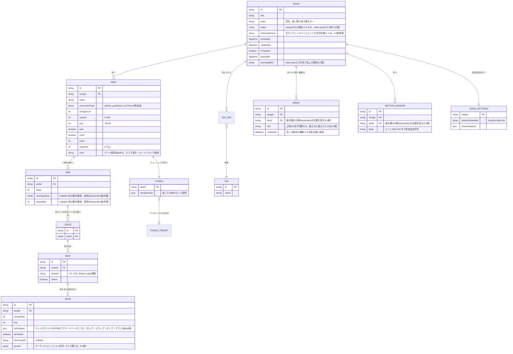

# データモデル設計書

対応要件：要件定義書4.1〜4.4章、5.3節（キャパシティ上限）、5.5節（スキーマ変更方針）

## 1. 設計方針

[[01_architecture.md]] AD-1のとおり、実行時のドメインオブジェクトはalphaTabのScore系モデル（`Score/Track/Staff/Bar/Voice/Beat/Note`）を基盤とする。ただし**永続化フォーマットはalphaTexへの都度変換ではなく、自前で定義・バージョン管理する構造化JSON（スナップショット形式）とする**。理由：

1. alphaTexはテキスト形式であり、数秒間隔の自動保存（要件5.2）のたびにScore⇔テキストの相互変換を行うのは大曲（2048小節、要件5.3）でパフォーマンスリスクが大きい。
2. 要件5.5節「後方互換性を壊さない設計（新フィールドは常にオプショナル）」「自動マイグレーションスクリプト」を実現するには、自前スキーマとして`schemaVersion`を持つ構造の方が制御しやすい。
3. alphaTex書き出し（要件4.4）は「エクスポート操作時にのみ、保存済みJSONから変換生成する」1機能として位置づける（07章）。**2026-09-01追記**：alphaTab v1.7.0以降が持つ`AlphaTexExporter`（[[13_design_decision_points.md#2]]A3で解決）を用いてこの変換を行う。

この方針により、**保存ファイル＝内部データモデルの構造化JSON**、**alphaTex＝エクスポート成果物の一つ**という関係になる。要件4.4「alphaTex形式（内部データそのまま）」という表現は、変換ロスがない（可逆的に近い）ことを指すものとして扱い、07章で変換の完全性を検証する。

## 2. ER図（論理構造）



**注**：alphaTabの実際のクラス設計（`Score`直下の構造、`MasterBar`と`Bar`の分離等）とは項目名を一部意訳している。実装時はalphaTab公式APIリファレンスに合わせて詳細設計（クラスマッピング表）を別途起こす。ここでは「アプリが管理すべき情報の網羅性」を優先した論理モデルとする。

## 3. エンティティ詳細と要件対応

### 3.1 Song（曲）

| フィールド | 型 | 要件対応 | 備考 |
|---|---|---|---|
| id | UUID | - | ファイル名にも使用（06章）。曲のファイルは自分の場所を持たず、場所はidと`index.json`が持つ`songs/`からの相対フォルダ（5節）で決まる |
| title | string | 4.5「並べ替え」の6キーのうち「曲名」／4.1「エクスポートファイル名」 | 曲名。新規曲作成ダイアログのステップ1で入力し（[[03_screens_ui_pc.md#10]]）、曲一覧の右クリック「名前を変更」で編集する（[[03_screens_ui_pc.md#4]]）。書き出すファイルの名前は、この曲名にパート名と日付を足して作る（[[07_export_print.md#2]]） |
| tags | Tag[] | 4.5「タグ付け・カテゴリ分け」／4.5「曲のステータス管理」 | 多対多。総数上限50（要件5.3）。**曲の進捗の区別もこのフィールドが担う**：要件4.5は曲のステータスを専用機能としては「不要」と判定し、進捗の区別はタグで代替すると定めているため、`status` という名前の専用フィールドは持たない。進捗を表すタグはユーザーが自分で作って付ける形とし、アプリ側で既定のステータスタグを 1 つも用意しない（用意すると、要件が避けたステータス専用機能を名前だけ変えて持つことになるため） |
| artist | string（空可） | 4.5「並べ替え」の6キーのうち「アーティスト名」 | 曲一覧の並べ替えキー（[[03_screens_ui_pc.md#4]]）。**タグで代替しない専用フィールド**（2026-09 追記）。新規曲作成ダイアログのステップ1で入力でき、曲一覧の右クリック「名前を変更」で曲名と一緒に編集する。新しいフィールドなので省略可とし、旧ファイルは空として読む（5.5「後方互換性」） |
| thumbnailRef | string | 4.5「曲一覧サムネイル」 | 曲のファイルには持たず、`index.json`の`SongSummary`（5節）だけが持つ、アプリの側に置いた曲一覧用の画像の写しの場所。画像の正は曲のファイルの`appMeta.thumbnail`（4.1節）で、写しはそこから作り直せる（2026-09-28 本人決定）。画像の範囲はalphaTabレイアウトでの最初の1段（[[13_design_decision_points.md#3]]B7で確定。生成タイミングは06章） |
| isTrashed/trashedAt | bool/datetime | 4.5「ゴミ箱機能」 | 保持期間30日後に完全削除（06章、[[13_design_decision_points.md#3]]B9で確定） |
| schemaVersion | string | 5.5「後方互換性」 | セマンティックバージョニング文字列（4.2節）。読み込み時にマイグレーション判定に使用。**2026-09-02修正**：本表・2節ER図はかつて`int`と誤記していたが、4.2節の定義に合わせて`string`に統一した |

### 3.2 Part（パート）

| フィールド | 型 | 要件対応 |
|---|---|---|
| instrumentType | enum | 4.2「MVPはエレキギター・ベースの2種」。**enumはv2のドラム追加を見据え抽象化**（10章）。v2で足す値は、アコースティックギター・クリーンエレキ・歪みエレキの3音色（[[10_extensibility_future.md#3]]）とドラム（[[10_extensibility_future.md#2]]）。要件4.2は「曲の途中でも…音色変更を自由に行える」と定めるため、**本フィールドは編集可能であり変更はコマンド経由**（AD-2）。詳細は下記「音色・弦本数の変更経路」 |
| stringCount, tuning | int, StringPitch[] | 4.1「弦本数・チューニング自由設定」、4.2「弦ごとの自由な音高指定＋弦本数も可変」。**対応する弦本数はギター5〜8弦、ベース3〜6弦**（要件4.2、`docs/tab_app_requirements.md:92`）。範囲外の弦本数は、プリセット適用でも弦本数の単独変更でも受け付けず、コマンドを発行しない（`EDIT-013`、Error）。受け付けてから補正はしない。変更経路は下記「音色・弦本数の変更経路」 |
| volume, pan, solo, mute | number/bool | 4.3「専用ミキサー画面」。パンの実行時制御可否は[[13_design_decision_points.md#2]]A13で検証待ち。音量は0から100の整数、パンは-50から50の整数とする |
| capoFret | int | 4.1「カポ」。**表示は運指基準、実音変換は再生時のみ**（[[05_playback_audio.md#10]]）。要件4.1の2行の解釈は下記「カポの表示規則」。値の0はカポなしを表す |
| order | int | 4.2「パート並べ替え」 |
| color | string(HEX) | 4.5「譜面のパート別色分け表示」（**本基本設計フェーズで必要と決定**）。スコア表示モード・パートリストでの識別色として使用 |

**パート別色分け表示（新規決定）**：要件定義書で複数回未回答だった項目だが、本基本設計で「必要」と決定した。新規パート追加時は既存パートと重複しない色を8色程度の既定パレットから自動割当し、パート管理パネル（[[03_screens_ui_pc.md#10]]）から手動変更も可能にする。**実装方式（2026-09-01確定、[[13_design_decision_points.md#2]]A2解決を受けて）**：alphaTabのレンダリングエンジンはSVGを採用する（Web環境での既定値）。alphaTabのTrackオブジェクトが色属性を持つ場合はそれを利用しつつ、持たない・表現力が不足する場合は、SVGとして出力されたレンダリング結果のDOM要素（該当パートに属するノード群）へCSSスタイル（`stroke`/`fill`）を直接適用してオーバーレイする。SVGは全プラットフォーム（PC版・将来のiPhone版）で共通のため、この着色方式はPhase 3でもそのまま再利用できる。対象要素の特定方法（トラックインデックスと描画領域の対応付け）は旧詳細設計 `view-modes.md` §4.3（`2759936` 時点）で確定する。**2026-09-02修正**：当初「[[04_editing_core.md]]・03章の詳細設計で確定する」としていたが、実際には旧詳細設計 `editing-core.md`（`2759936` 時点）に該当内容がなく、表示モードパッケージの`ScoreRenderHost`拡張が正しい所在だったため申し送り先を訂正した（セルフレビューで発見）。**2026-09-08修正（[[13_design_decision_points.md#3]]B34）**：当初は「`ScoreRenderHost`のSVG出力へ`data-track-index`属性を付与しCSSセレクタで着色」する方式としていたが、alphaTab 1.8.4のSVGレンダラーはフラットなelement tree（path/textの列）を出力しトラック単位のDOM要素を持たないため実装不能だった。本節冒頭の「SVG出力のDOM要素へCSSを直接適用してオーバーレイ」という代替の考え方に沿い、`ScoreRenderHost`がスコア表示時に全パートを描画し、パート別の描画領域はalphaTabの`boundsLookup`（`staffSystems`の矩形）から算出して提供する方式へ変更した。色オーバーレイのDOM/CSS生成自体はパッケージ8（画面群・ナビゲーション、[[03_screens_ui_pc.md#5]]の色分けUI）が担う。パッケージ6は`applyViewMode`／`applyZoom`までを実装済み（[[../detailed_design/00_reference.md#8.1]] G24）。

パート数上限8（要件5.3。想定利用は3から4パートのバンド編成で〈要件4.2〉、8はそれを超えたときに備えた上限。性能の目標値を満たすのは4パートの曲、[[09_nonfunctional.md#2]]）は`Song.parts.length <= 8`をコマンド層（04章）のバリデーションで強制する。下限は0で、最後の1パートも削除できる（2026-09-26、要件4.2）。パートが0になっても、小節の数・拍子・テンポ・リピートと小節メモ（3.6節）とセクションマーカー（3.5節）は曲に残し、次に追加したパートは残っている小節の数で始まる（小節の数・拍子・テンポ・リピートはalphaTabの`Score.masterBars`に残し、パートが0のときは`tracks`だけが空になる。次に足すパートは`masterBars`の数だけ空の小節を持って始まる。パートが0の曲を保存して読み戻せるかは、パートの削除を作る前に確かめる。2026-09-28 本人決定）。各パートは、利用者が自由に付けるパート名（`name`、string）を持ち、書き出すファイルの名前にも使う（[[07_export_print.md#2]]）。

**カポの表示規則（2026-09-10 確定、[[../detailed_design/00_reference.md#8.1]] G46）**：要件4.1は「カポ表示規則｜譜面は運指（as played）表示を基本とし、実音への変換は再生時のみ反映する」と書く一方、同じ表の「カポ｜カポ位置を指定し、**表示**・再生ピッチに反映」とも書いており（当時の文）、表示に反映するのかしないのかが要件内で食い違っていた。**現行の要件4.1は下の判断に合わせて改められ、「カポ位置を指定し、再生ピッチに反映。表示は記譜（フレット番号）を変えず、カポ位置そのものを常時表示することをもって反映とする」（`docs/tab_app_requirements.md:80`）となっている**（2026-09 追記）。本設計は**前者（運指表示）を採用**し、後者の「表示への反映」を次の2つと解釈する。

| 要件の「反映」先 | 本設計での解釈 |
|---|---|
| 表示 | **記譜（フレット番号）は変えない**。カポ位置そのものをステータスバーへ常時表示する（[[03_screens_ui_pc.md#5]]「カポ0」）ことをもって「表示に反映」とする |
| 再生ピッチ | 実音への変換を行う（[[05_playback_audio.md#10]]）。MIDI書き出し（[[07_export_print.md#1]]）も同じ変換式を使う |

理由：記譜側を実音へ書き換えると、カポを付けた状態で採譜した運指がそのまま残らず、要件4.1「カポ表示規則」の本文（運指表示を基本とする）と真正面から矛盾する。カポは「押さえ方を変えずに調を変える」道具であり、運指を保つ側が耳コピの用途に合う。この判断は[[13_design_decision_points.md#3]]B42として登録した。

**音色・弦本数の変更経路（2026-09-10 追加、G49・G50）**：要件4.2は「曲の途中でもパートの追加／削除／並べ替え／**音色変更**を自由に行える」「弦ごとの自由な音高指定＋**弦本数も可変**」と定めている。追加・削除・並べ替えには変更経路があるが、音色と弦本数は本節がフィールドを定義するのみで経路が無かったため、次の通り確定する（AD-2：Scoreへの変更はすべてコマンド経由）。

| 変更対象 | 経路 | 備考 |
|---|---|---|
| `instrumentType`（音色） | パート属性変更コマンド（具象名は旧詳細設計 `part-tuning-management.md` §5（`2759936` 時点）で確定） | MVPは`electric_guitar`／`bass`の2択（要件4.2）。変更しても記譜・チューニングは変えず、再生音色（SoundFontのプログラム）だけが変わる |
| `stringCount`（弦本数） | (a) チューニングプリセットの適用に伴う同期（[[13_design_decision_points.md#3]]B15）／(b) **弦本数の単独変更**（プリセットを使わずに6弦→7弦等へ変える経路） | (b)を設ける。(a)だけでは「目的の弦数のプリセットが存在しない限り弦数を変えられない」という制約が残り、要件4.2の「弦本数も可変」を満たさないため。**(b)で弦を足すとき**は低音側に足し、足した弦の音高は、それまでの最低音弦の完全4度下を初期値にする（後から弦ごとに変えられる。下の`tuning`の行）。**(b)で弦を減らすとき**は最低音側から外す（足すときの逆）。外す弦に音符が残っていれば、(a)のプリセット適用（B15）と同じく**Warning付きで破棄する**（`EDIT-006`）。黙って消すのではなくWarningで知らせ、Undoで外した弦と音符ごと元に戻せるので、データの消失にはならない。(a)の`ApplyTuningPresetCommand`はすでにこの形で、Undoの戻り方は詳細設計が「`execute`/`undo` の対称性は JSON スナップショット往復で C2 検証する」（旧詳細設計 `part-tuning-management.md` §4.5（`2759936` 時点） 4.5.6節）としている（2026-09、経路によって扱いが分かれていたのを揃えた）。どちらの経路も上の範囲（`EDIT-013`）の外へは変えられない（2026-09 追記） |
| `tuning`（各弦の音高、2026-09 追加） | チューニング設定パネル（[[03_screens_ui_pc.md#3]] #7）で弦ごとに音高を指定し、`SetCustomTuningCommand`を発行する。弦本数は変えない | プリセット由来でなくなるため、プリセット名の表示は外れる。入力の形（音名＋オクターブで選ぶか、MIDIノート番号か）と値域は詳細設計で決める（`bd->dd`着手時に受け取る） |
| `capoFret`（カポ、2026-09 追加） | チューニング設定パネル（[[03_screens_ui_pc.md#3]] #7）のカポの数値入力から`SetCapoFretCommand`を発行する。0〜12の範囲外は発行せず`EDIT-007` | カポはパートの属性で、チューニングと同じくパートごとに持つため、同じパネルに置く |

いずれも[[12_traceability.md#6]]の対応表に行を持ち、空欄を残さない。

### 3.3 Bar / Voice / Beat / Note（小節〜音符階層）

alphaTabの標準階層をそのまま採用する理由は、拍子・テンポの小節単位変更（要件4.1）、32分音符・連符（要件4.1）、付点・タイ・スラーの区別（要件4.1）をすべてこの階層のプロパティとして表現可能なため。ボイス（Voice）は1小節に1つを基本とし、低音とメロディのように同時に鳴る別の線を分けて書くために2つ目を置ける（要件4.1、2026-09-28 本人決定）。2つ目の入力・カーソルの動き・コピーと貼り付け・再生の扱いは03・04・05章で決める。

| フィールド | 要件対応 |
|---|---|
| Bar.timeSignature / tempoBpm（nullable＝直前値継承） | 4.1「拍子・テンポの曲途中変更」。小節の挿入・削除時の継承チェーンの扱いは[[04_editing_core.md#10]]（[[13_design_decision_points.md#3]]B5）で規定。拍子とテンポは曲共通で、実体はalphaTabの`MasterBar`が持つ（本表の`Bar.timeSignature`・`tempoBpm`は論理名。3.2節） |
| Beat.duration（分数＋付点フラグ＋連符情報） | 4.1「32分音符・3連符等」。音価は全音符（1/1）から32分音符（1/32）まで |
| Beat.isRest | 4.1「休符：暗黙的休符を基本＋明示編集も可能」→ 音を置かない小節位置は自動的に`isRest=true`のBeatとして生成し、UIからも明示編集可能にする |
| Note.tieToNext（bool） / Note.slurGroupId（string） | 4.1「タイ／スラーを別々の記号として区別」。`slurGroupId`はスラーの無い音符では空（null）でよい。表示では、タイとスラーを別々の記号として描き分ける（要件4.1「別々の記号として区別」）。`tieToNext`・`slurGroupId`は本設計の論理名で、alphaTabの`Note`のどの属性に写して描かせるかは詳細設計で決める |
| Note.techniques | 4.1「奏法記号フルセット」（下記3.4で詳細） |
| Note.accent | 4.1「アーティキュレーション記号（アクセント・スタッカート等）」。対象は本節下の5つで閉じる |

**v2のドラムへの備え（要件4.2、2026-09 追記）**：要件4.2は「v1の時点からパート種別を抽象化して設計し、将来ドラム表記を追加してもデータモデルの作り直しが不要な拡張性を持たせる」と定める。本階層はalphaTabの型をそのまま使うので、打楽器かどうかは`Staff.isPercussion`、打楽器の種類は`Note.percussionArticulation`がすでに持っている。v1で種別の属性を自前で足さず、v2では`Part.instrumentType`に値を足してそのパートの`Staff.isPercussion`を立てる（[[10_extensibility_future.md#2.1]]）。

**重複配置チェック**（要件4.1）：同一Beat内で`stringIndex`が重複するNoteの追加をコマンド層バリデーション（04章）で拒否する。

**2026-09-10 追記（変更可能フィールドとコマンドの対応、AD-2）**：上表の各フィールドは「要件 → モデル」の対応を示すものであり、これだけでは**そのフィールドを変更する経路**が存在することを保証しない。実際、`Bar.timeSignature`・`Note.accent`・`Beat.duration`（付点・連符）は本表に載っていながら対応するコマンドが存在せず、[[../review/design_audit_2026-09-10.md]] で Blocking として検出された（BL-1／BL-3／BL-5／BL-6）。AD-2（[[01_architecture.md#3]]：Score への変更はすべてコマンド経由）を満たすため、**本表の各行は対応するコマンド（または「編集不可」の明示）を必ず持つ**ものとし、その対応は[[12_traceability.md#6]]の対応表で一元管理する。現行の対応は次のとおり。

| フィールド | 変更コマンド | 定義 |
|---|---|---|
| `Bar.timeSignature` | `SetTimeSignatureCommand` | 旧詳細設計 `editing-core.md` §6.5（`2759936` 時点） 6.5.2節 |
| `Bar.tempoBpm` | `SetTempoCommand` | 旧詳細設計 `editing-core.md` §6.4（`2759936` 時点） |
| `Beat.duration`（分数・付点・連符） | `SetBeatDurationCommand`（既存Beat）／`PlaceNoteCommand`・`InsertRestCommand`（新規配置） | 旧詳細設計 `editing-core.md` §6.5（`2759936` 時点） 6.5.4節 |
| `Beat.isRest` | `InsertRestCommand`／`PlaceNoteCommand`。明示休符の削除は音符と同じ手段（[[04_editing_core.md#2]]） | 旧詳細設計 `editing-core.md` §6.4（`2759936` 時点） |
| `Note.tieToNext` / `Note.slurGroupId` | `SetTieCommand`／`SetSlurCommand` | 旧詳細設計 `editing-core.md` §6.4（`2759936` 時点） |
| `Note.techniques`（Note単位） | `SetTechniqueCommand`（`NoteTechniquePatch`） | 旧詳細設計 `editing-core.md` §6.5（`2759936` 時点） 6.5.6節 |
| 奏法記号のうち Beat 単位（スラップ／ポップ／タップ／ブラシ） | `SetBeatTechniqueCommand` | 旧詳細設計 `editing-core.md` §6.5（`2759936` 時点） 6.5.5節 |
| `Note.accent`（アクセント） | `SetTechniqueCommand`（`accentuated` キー） | 旧詳細設計 `editing-core.md` §6.5（`2759936` 時点） 6.5.6節 |
| `Part.instrumentType`（音色、**2026-09-10 追加**：G49） | パート属性変更コマンド（3.2節「音色・弦本数の変更経路」） | 旧詳細設計 `part-tuning-management.md` §5（`2759936` 時点） |
| `Part.stringCount`（弦本数、**2026-09-10 追加**：G50） | チューニングプリセット適用（B15）／弦本数の単独変更（3.2節） | 旧詳細設計 `part-tuning-management.md` §5（`2759936` 時点） |

**アーティキュレーション記号の一覧（2026-09 確定）**：要件4.1はアクセントとスタッカートを挙げたうえで、列挙を閉じていない（`docs/tab_app_requirements.md:66`）。本設計は**次の5つに限る**：アクセント・強いアクセント・テヌート（`Note.accentuated`の`Normal`／`Heavy`／`Tenuto`）、スタッカート（`Note.isStaccato`）、ゴースト（`Note.isGhost`）。この5つは、旧詳細設計 `editing-core.md` §6.5（`2759936` 時点） 6.5.6節の`accentuated`（`None`／`Normal`／`Heavy`／`Tenuto`）と、alphaTab 1.8.4 の型が持つ`isStaccato`・`isGhost`から取った。付ける・外すはどれも`SetTechniqueCommand`（[[04_editing_core.md#6]]）。

### 3.4 Note.techniques の構造（奏法記号）

```json
{
  "bend": { "type": "full|half|oneAndHalf|custom", "curve": [0, 50, 100] },
  "slide": { "type": "shiftSlide|legatoSlide|slideOutDown|slideOutUp" },
  "hammerOnPullOff": true,
  "palmMute": { "range": "note|toNext" },
  "vibrato": true,
  "harmonic": { "type": "natural|artificial|pinch" }
}
```
要件4.1の一覧（チョーキング／スライド／ハンマリング・プリング／パームミュート／ビブラート／ハーモニクス3種／タッピング・スラップ・ポップ）を、上のNote.techniquesと**Beatの属性**で分けて全て網羅する。**タッピング・スラップ・ポップ（とブラシ）はNoteではなくBeatの属性として持つ**（alphaTabでもBeatの属性であるため。3.3節の表の`SetBeatTechniqueCommand`の行、[[13_design_decision_points.md#3]]B40。2026-09 是正：当初は上のJSONに`tapping`をNote側のキーとして載せていて、B40と食い違っていた）。UIでの確定方式（自動候補＋長押し補正）は04章で扱う。上のJSONの値の意味：スライドはシフト・レガート・下へのスライドアウト・上へのスライドアウトの4種、パームミュートの範囲はその音だけか次の音までの2種とする（チョーキングの幅とハーモニクスの種別は[[04_editing_core.md#6.2]]）。

### 3.5 SectionMarker（セクションマーカー）

要件4.1「リピート記号／セクションマーカー」「セクションループ再生」に対応。セクションの名前（`label`）は、イントロ・Aメロ・サビのように利用者が自由に付ける文字列とする。曲共通の小節（`MasterBar`）の位置で持ち（パートを全部消しても残す、3.2節、2026-09-28 本人決定）、ループ再生（05章）はこのマーカー区間を再生範囲として利用する。1つのセクションの区間は、そのマーカーの小節から次のマーカーの小節の手前までとし、最後のマーカーは曲の終わりまでとする（2026-09-29 本人決定）。マーカーの正は`appMeta.sectionMarkers`（4.1節）で、譜面にセクション名を描かせるためにalphaTabの`MasterBar.section`へ写す。写しは正として読まず、曲を開くときに`appMeta`から作り直す。セクションマーカーの追加・編集・削除を行う具象Commandは旧詳細設計 `editing-core.md` §6.4（`2759936` 時点）の`AddSectionMarkerCommand`／`EditSectionMarkerCommand`／`DeleteSectionMarkerCommand`で確定した（**2026-09-02追記**、セルフレビューで発見された未定義コマンドの是正）。

繰り返し記号（リピート）自体はalphaTabのMasterBar属性（`isRepeatStart`／`repeatCount`）を利用する。**2026-09-10 是正**：当初は「そのまま利用する」とのみ記載し、これを変更するコマンドを定義していなかったため、AD-2（Score変更はコマンド経由）に反して**編集経路が存在しない**状態だった（[[../review/design_audit_2026-09-10.md]] BL-2）。`SetRepeatCommand`（旧詳細設計 `editing-core.md` §6.5（`2759936` 時点） 6.5.3節）を追加して是正する。反復回数の範囲・対応する開始リピートが無い場合の扱いは[[13_design_decision_points.md#3]]B39で確定した。

### 3.6 Memo（小節メモ）

要件4.1「小節メモ／注釈」、4.5「テキストのみ対応」、5.3「小節メモの文字数」（上限100文字）に対応。**1小節に複数メモを許容する**方針で確定した（[[13_design_decision_points.md#3]]B1）。データ構造はもともと配列（`SONG ||--o{ MEMO`、MEMOはbarIdで小節を参照するのみで一意制約を設けない）であるため実装コスト差はほぼゼロであり、耳コピ作業では同じ小節に日を跨いで複数の気づきを残すケースが十分想定されるため、上書きより蓄積型を採用する。`createdAt`を追加し、小節メモ一覧パネル（[[03_screens_ui_pc.md#3]]）では作成日時順に表示する。追加・編集・削除を行う具象Commandは旧詳細設計 `editing-core.md` §6.4（`2759936` 時点）の`AddMemoCommand`／`EditMemoCommand`／`DeleteMemoCommand`で確定した（**2026-09-02追記**、セルフレビューで発見された未定義コマンドの是正）。文字数は見た目の1文字で数え（絵文字1つも1文字）、改行も入れられて1文字と数える。100文字を超えても入力は止めずにWarning（`EDIT-004`）を出し、そのメモを保存するときに先頭100文字へ切り詰める（[[13_design_decision_points.md#4]]C13）。100文字を超えるメモを含む古いファイルを開いたときは切り詰めずにそのまま見せ、そのメモを入力・編集して保存したときにだけ切り詰める。ほかの保存ではそのメモに触れない（2026-09-28 本人決定）。小節メモは、パートの小節ではなく曲共通の小節（`MasterBar`）の位置を指す。パートを全部消しても小節メモを残すため（3.2節、2026-09-28 本人決定）。小節メモはテキストだけを持ち、音声は持たない（要件4.5「テキストのみ対応（音声メモは不要）」）。

### 3.7 TuningPreset（チューニングプリセット、Song非依存のグローバルデータ）

要件4.1「定番プリセット標準搭載＋ユーザー独自プリセット追加」に対応。アプリ全体で共有する独立エンティティとし、Partは`presetId`（任意）＋実値のスナップショットを持つ（プリセット削除後も既存曲のチューニングは壊れないようにするため、参照ではなく値のコピー＋出自記録とする）。**2026-09-08修正（パッケージ5実装時）**：`stringPitches` の並びは alphaTab の `stringTuning.tunings` と揃え、**高音弦→低音弦**（先頭＝タブ最上線＝最高音）とする。当初の例は低音弦→高音弦で実装・alphaTab と逆だった。あわせて、演奏時の弦番号 `note.string` は alphaTab 規約で **1＝最低音弦（タブ最下線）**、上へ増加する点に注意（`stringPitches` の index とは逆順の対応）。出自記録（`presetId`）の実装は横断リファレンス[[../detailed_design/00_reference.md#8.1]] G22 参照（当面はプリセット名のみ `stringTuning.name` に記録）。

```json
{ "id": "builtin-guitar-drop-d", "name": "ドロップD", "builtin": true, "stringPitches": [64, 59, 55, 50, 45, 38] }
```

**同梱する標準プリセット（2026-09-10 確定、[[../detailed_design/00_reference.md#8.1]] G47。2026-09 に6種→12種へ拡張）**：要件4.1は当時「定番プリセット（レギュラー／ドロップD／半音下げ等）を標準搭載」と例示するのみで（当時の文。現行の要件4.1は12種を名指しする、`docs/tab_app_requirements.md:81`）、本節も上記のJSON例を1件挙げるだけだったため、**何を同梱するかが決まっていなかった**。当初は6種と定めたが、要件4.1は**ギター8種・ベース4種の計12種**を名指しで求めているため、次の12種を同梱する（`stringPitches`は上記のとおり高音弦→低音弦の並び、値はMIDIノート番号）。

| id | 表示名 | 弦数 | `stringPitches`（高音弦→低音弦） | 備考 |
|---|---|---|---|---|
| `builtin-guitar-standard` | ギター標準（EADGBE） | 6 | `[64, 59, 55, 50, 45, 40]` | 要件の「レギュラー」 |
| `builtin-guitar-drop-d` | ドロップD | 6 | `[64, 59, 55, 50, 45, 38]` | 要件4.1の「Drop D」（`docs/tab_app_requirements.md:81`）。本節冒頭のJSON例と同じ値 |
| `builtin-guitar-dadgad` | DADGAD | 6 | `[62, 57, 55, 50, 45, 38]` | 定番オープン系 |
| `builtin-guitar-half-down` | 半音下げ | 6 | `[63, 58, 54, 49, 44, 39]` | 要件の「半音下げ」。ギター標準の全弦−1 |
| `builtin-guitar-drop-c-sharp` | ドロップC# | 6 | `[63, 58, 54, 49, 44, 37]` | 要件4.1。ドロップDの全弦−1 |
| `builtin-guitar-drop-b` | ドロップB | 6 | `[61, 56, 52, 47, 42, 35]` | 要件4.1。ドロップDの全弦−3 |
| `builtin-guitar-open-g` | オープンG | 6 | `[62, 59, 55, 50, 43, 38]` | 要件4.1 |
| `builtin-guitar-open-d` | オープンD | 6 | `[62, 57, 54, 50, 45, 38]` | 要件4.1 |
| `builtin-bass-standard` | ベース標準（EADG） | 4 | `[43, 38, 33, 28]` | 要件4.1のベース用「4弦レギュラー」（`docs/tab_app_requirements.md:81`） |
| `builtin-bass-drop-d` | ベース ドロップD | 4 | `[43, 38, 33, 26]` | — |
| `builtin-bass-standard-5` | ベース5弦レギュラー（BEADG） | 5 | `[43, 38, 33, 28, 23]` | 要件4.1。低音側にB弦を足した並び |
| `builtin-bass-standard-6` | ベース6弦レギュラー（BEADGC） | 6 | `[48, 43, 38, 33, 28, 23]` | 要件4.1。低音側にB弦、高音側にC弦を足した並び |

- **id 規約**：組み込みは `builtin-<楽器>-<名称>`。ユーザー定義と衝突しないよう `builtin-` を予約接頭辞とする。本節が以前示していた例 `preset-drop-d` は規約前の表記であり、上記に統一した（実装 `BUILTIN_TUNING_PRESETS` と一致、旧詳細設計 `part-tuning-management.md` §4.5（`2759936` 時点））。
- 組み込みプリセットは `tuning-presets.json` には保存せずアプリに同梱し、論理削除の対象外とする。
- 7弦ギターは同梱しない（要件4.2 は弦数可変を求めるが、プリセットとしての同梱までは求めていない）。ユーザー定義プリセット、または3.2節の「弦本数の単独変更」で対応する。**2026-09 改訂**：5弦ベースは、要件4.1が定番プリセットとして名指ししているため上表の `builtin-bass-standard-5` として同梱する（6弦ベースも同様に `builtin-bass-standard-6` として同梱する）。同梱しないのは7弦ギターのみとなった。

## 4. ファイルフォーマット仕様

### 4.1 保存ファイル構造（1曲＝1ファイル）

```json
{
  "schemaVersion": "1.0.0",
  "song": { "...Song本体（Part/Bar/Voice/Beat/Note含む階層データ）" },
  "appMeta": {
    "tags": ["..."],
    "memos": ["..."],
    "sectionMarkers": ["..."],
    "settings": { "defaultViewMode": "focus", "mixerSnapshot": {} },
    "thumbnail": { "encoding": "base64-png", "data": "..." }
  },
  "integrity": { "savedAtMonotonic": 1234567890, "checksum": "sha256:..." }
}
```

`appMeta`（曲のファイルのうちScoreの外に置く情報）に入れるのは、`tags`（曲に付けたタグ）・`memos`（小節メモ）・`sectionMarkers`（セクションマーカー）・`settings`（曲ごとの表示の設定、`SONG_SETTINGS`）・`thumbnail`（曲一覧のサムネイル）の5つに限る。**曲のファイルに入れる情報の一覧は、ここにだけ書く**（[[01_architecture.md#3]]AD-1、2026-09-27 本人決定）。足すときはこの一覧に足し、4.2節の「新フィールドは常にオプショナル＋読み込み時デフォルト値補完」に従う。`settings`の`defaultViewMode`は曲を開いたときの表示モードで、`focus`・`scroll`・`score`の3つ（[[03_screens_ui_pc.md#5]]のフォーカス／全体スクロール／スコア）のどれかとする。`thumbnail`はPNG画像をbase64の文字列にして`data`に持ち、`encoding`は`base64-png`とする。

- `checksum`：アトミック書き込み（06章）の検証や、クラッシュ復旧時に破損ファイルを検知するために付与する。ハッシュ対象の厳密な定義（`integrity`ブロックを除く`{schemaVersion, song, appMeta}`）とハッシュの種類（SHA-256。値は`sha256:`で始まる文字列）は旧詳細設計 `data-model-persistence.md` §3.2（`2759936` 時点）で確定した。
- ファイル拡張子：`.tabapp`（独自形式であることを明示。OS標準のファイル関連付けは要件5.6に対応し、関連付ける対象と拡張子の扱いは[[06_file_io_persistence.md#11]]で確定）。

### 4.2 スキーマバージョニング・マイグレーション方針（要件5.5対応）

| ルール | 内容 |
|---|---|
| バージョン形式 | `schemaVersion`はセマンティックバージョニング文字列（アプリ自体のバージョニングと同期させる必要はなく独立管理） |
| 後方互換の基本方針 | 新フィールドは常にオプショナル＋読み込み時デフォルト値補完。既存フィールドの意味変更・削除は原則行わない |
| マイグレーション実行タイミング | 曲ファイルの読み込み時に`schemaVersion`を検査し、現行バージョンより古ければマイグレーション関数チェーン（`v1→v2→v3...`の逐次適用）を実行してからメモリ上に展開する |
| 保存タイミング | マイグレーション後、次回自動保存時に現行`schemaVersion`で上書き保存される（明示的な一括変換バッチは持たない＝開いた曲から順次更新） |
| 大規模変更時 | 逐次マイグレーション関数で対応しきれない場合も、**同じ読み込み時の経路で自動で実行する**（要件5.5「万が一大きな変更が必要になった場合は自動マイグレーションスクリプトで対応する」。本人が手で走らせる手順は作らない）。実行主体はファイルを読み込むWebコア。**変換前の版を残す**：要件はアトミック書き込み（5.6）とゴミ箱（5.4）でデータを失わないことを優先しており、変換処理の不具合で曲を失わないため。置き場所と保持期間は詳細設計で決める（`bd->dd`着手時に受け取る） |

### 4.3 キャパシティ上限の実装への反映（要件5.3）

| 上限 | 実装箇所 |
|---|---|
| 曲数1000程度 | 曲一覧読み込み時のインデックスファイル（06章）でO(1)近く一覧取得できるようにし、900件で予告のWarning（`SONG-001`）、1000件で新規作成を拒否するError（`SONG-002`）とする（[[13_design_decision_points.md#4]]C12） |
| 小節数2048 | Bar配列の上限としてコマンド層バリデーションで強制 |
| タグ50個 | Tagエンティティ作成コマンドでバリデーション |
| 小節メモ100文字 | 入力は止めず、超えたらWarning（`EDIT-004`）を出し、保存時に先頭100文字へ切り詰める（数え方と古いメモの扱いは3.6節、[[13_design_decision_points.md#4]]C13）。1小節あたりのメモ件数自体には上限を設けない |
| パート8 | 3.2節参照 |
| フレット24 | Note.fret入力コンポーネントのバリデーション |

## 5. 曲一覧用インデックス（別ファイル）

1000曲規模でも起動時間3秒以内（要件5.2）を満たすため、各曲ファイルをフルパースせずに一覧表示できる軽量インデックス`index.json`を別途保持する（`SongSummary`：id/title/artist/createdAt/updatedAt/tags/thumbnailRef、並べ替え用の代表値として先頭パートの楽器種別とチューニング名、`songs/`からの相対フォルダ）。**曲一覧の6つの並べ替えキーとフォルダ分け（[[03_screens_ui_pc.md#4]]）を、曲ファイルを開かずに扱えるようにするため**、この7つと代表値・フォルダを持つ（2026-09 追記。当初は id/title/updatedAt/tags/thumbnailRef の5つだった）。旧詳細設計 `data-model-persistence.md` §3.2（`2759936` 時点）の`SongSummary`は当初の5つのままで、広げた分は`bd->dd`着手時に受け取る。詳細は06章、および具体的な読み書きロジックは旧詳細設計 `data-model-persistence.md` §3.2（`2759936` 時点）の`SongIndexService`で定義する。
