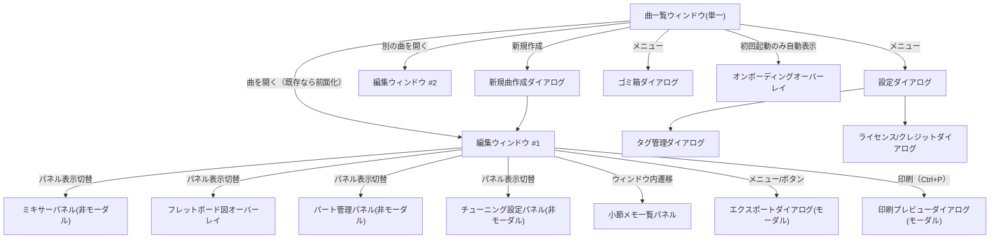

# PC版画面設計書（新規策定）

対応要件：要件定義書7章「【最優先】PC版のUI／操作仕様が未定義」への回答。4.5／4.6節（iPhone版仕様）はタッチ操作前提のため転用せず、本書でマウス・キーボード操作に適した独自仕様を新規に定義する。本書は画面の構造・配置・操作フロー（ワイヤーフレームレベル）を扱う。配色・タイポグラフィ・角丸・影・コンポーネントの見た目といったビジュアルデザインの詳細は[[14_visual_design_system.md]]を参照。

## 1. 設計方針

要件定義書4.5節の「設計原則（横断的・その0）」＝*単一の操作方法に絞らず複数パターンに対応、実装コストが単純に倍化する場合に限って主経路＋補正/エスケープハッチ*を、PC版でも踏襲する。iPhone版の「親指操作前提の下部ツールバー＋ボトムシート」は、PC版では以下のように翻訳する。**この表に行があるものは、PC版として答えを出したものである**——要件定義書4.5／4.6節の該当要求は「Phase 3送り」ではなく、右列の形が本書に実装されているかで判定する。行が無いものは本書では扱わず、[[10_extensibility_future.md#4]]に従いPhase 3着手時に扱う。

| iPhone版の概念（4.5/4.6節） | PC版での翻訳 |
|---|---|
| 下部ツールバー＋カテゴリタブ切替 | 常時表示のドッキングツールバー（画面下部固定）＋キーボードショートカット併用。カテゴリ切替はタブではなく全カテゴリを1つのツールバーに収め、画面幅不足時のみ折り畳み矢印で追加項目を表示 |
| ボトムシート（軽量調整系） | **非モーダルのドッキングパネル**（表示/非表示トグル可能、他操作をブロックしない）。例：ミキサー、パート管理、チューニング設定 |
| フルスクリーンモーダル（重い/複数ステップ系） | **モーダルダイアログ**（OS標準のウィンドウ内ダイアログ）。例：エクスポート、印刷プレビュー、新規曲作成フロー |
| スワイプダウンで閉じる | ダイアログ右上の閉じるボタン／Escキー |
| タップ／長押し | クリック／右クリック（コンテキストメニュー） |
| タップで削除（4.5節「ノート移動・削除」） | **PC版では採らない。** 通常の左クリックはカーソル位置決め（8節）で、これと衝突するため。削除は**右クリック→コンテキストメニューの「削除」**・**消しゴムモード中の左クリック**（ともに8.1節）・`Delete`／`Backspace`キー（7節）で置き換える |
| ピンチズーム | Ctrl+マウスホイール／ズームスライダー（ステータスバー） |
| ドロップダウン／リストでのパート切替 | メインウィンドウ左側のパートリストパネル（常時表示、クリックで切替） |
| 常時表示のタブバーを持たない（ボタン遷移） | メニューバー＋ツールバーを常設。ウィンドウ内遷移はダイアログ／パネルの開閉で表現し、画面全体の「遷移」は最小限にする（曲一覧⇔編集画面のみが画面遷移相当） |

**複数操作パターンの原則の運用（2026-09 確定）**：この原則は要件4.5が「最上位方針」と位置づけている（要件4.5「設計原則（横断的・その0／最上位方針）」）。**他の設計方針と衝突したときは、複数の操作パターンに対応するほうを採る。** 主経路・補正/エスケープハッチの切り分けは、要件のとおり**実装コストが単純に倍化する組に限って**当てる。組ごとの判定は次のとおり。

| 複数対応の組 | 倍化するか | 扱い |
|---|---|---|
| 奏法記号の確定（自動候補＋手動補正） | 判定しない（要件4.1自身が「長押しでの手動補正」と、片方を補正と呼んでいる） | **自動候補＝主経路／手動補正＝補正**。処理経路は、主経路が自動候補の提示→承認（[[04_editing_core.md#6.1]]）、補正が手動補正のポップオーバー（8節）で、どちらも最後は同じ`SetTechniqueCommand`／`SetBeatTechniqueCommand`を発行する |
| フレット入力（クイック選択バー＋テンキー） | 倍化しない | 同格。どちらも`PlaceNoteCommand`を発行し、違いは入口のUIだけ |
| テンポ入力（数値直接入力＋タップテンポ） | 倍化しない | 同格。どちらも同じ`Bar.tempoBpm`更新コマンドへ収束する（[[05_playback_audio.md#6]]） |
| ダイアログの閉じ方（閉じるボタン＋Esc） | 倍化しない | 同格。上の表「スワイプダウンで閉じる」の翻訳で、どちらもダイアログを閉じるだけ |
| 表示の切替（フォーカス／全体／スコア） | 倍化しない | 同格。3つは同じ表示モードの状態の違い（[[12_traceability.md#6]]の`ViewModeController`） |
| ズーム（スライダー＋Ctrl+ホイール） | 倍化しない | 同格。どちらも同じズーム値を変える |
| ノートの削除（右クリック「削除」＋消しゴム＋`Delete`／`Backspace`） | 倍化しない | 同格。入口が違うだけで、消す対象と結果は同じ（8.1節） |

## 2. ウィンドウ構成・複数ウィンドウ方針（要件5.6）

- アプリ起動時は**曲一覧ウィンドウ**（ランチャー的な単一ウィンドウ）を表示する。
- 曲を開くと**編集ウィンドウ**を新規に開く（曲一覧ウィンドウとは別ウィンドウ）。複数の曲を見比べる用途（要件5.6）のため、編集ウィンドウは複数同時に開ける。
- **同一曲の二重起動防止**：曲を開く操作時、`WindowAdapter.focusExistingWindow(songId)`（[[01_architecture.md#3]]AD-3）を先に呼び出し、既に開いていればそのウィンドウを前面化して新規ウィンドウは生成しない。
- ウィンドウサイズ：最小800×600、最大はモニタサイズに追従（要件5.6）。この範囲内でのレイアウト崩れ防止・パネルの縮退方針は[[14_visual_design_system.md#8]]を参照。**編集ウィンドウは曲ごとに、前にその曲を閉じたときの位置と大きさで開く**（2026-09-25 本人決定）：ウィンドウを閉じたときに位置と大きさを自動で記録する。この記録は曲の編集と数えない（未保存の●は付かず、取り消しの対象でもない）。記録した位置が、いまつながっている画面のどれにも入らないときは、画面の中に戻して開く。記録は曲のファイルに入れずアプリの側に置く（置き場所は[[06_file_io_persistence.md#3]]）ので、曲のファイルを別のPCに移すと位置は引き継がれない。初めて開く曲の位置と大きさは詳細設計で決める。
- 設定画面・タグ管理・ゴミ箱・ライセンス画面は曲一覧ウィンドウから開くモーダルダイアログとする（複数ウィンドウにする必要性が薄いため）。
- **アプリの終了条件（2026-09-10 確定、[[../detailed_design/00_reference.md#8.1]] G61）**：要件5.6「システムトレイ常駐｜不要（**ウィンドウを閉じたらアプリも完全終了**）」に従い、**開いているウィンドウが1枚も無くなった時点でアプリのプロセスを終了する**（macOS 的な「全ウィンドウを閉じてもプロセスは残る」挙動は採らない）。複数ウィンドウを持つ以上、終了条件は明示しないと決まらないため本節で確定する。終了時の処理順は次のとおりで、これを完了してからプロセスを終える。
  1. 各編集ウィンドウのクローズ時に`AutoSaveScheduler.flush(songId)`の完了を待つ（未保存の編集を落とさない）
  2. 最後のウィンドウが閉じたのち、進行中のミラーコピーの完了を待つ（[[13_design_decision_points.md#3]]B26、既定タイムアウト15秒。超過時はWarningをログに残して終了を許可する）



## 3. 画面（ウィンドウ／パネル／ダイアログ）インベントリ

| # | 画面 | PC版での種別 | 開き方 |
|---|---|---|---|
| 1 | 曲一覧ウィンドウ | ルートウィンドウ | アプリ起動時 |
| 2 | 新規曲作成ダイアログ | モーダルダイアログ（複数ステップ＝ウィザード形式） | 曲一覧の「新規作成」ボタン／Ctrl+N |
| 3 | タブ譜編集ウィンドウ | メインウィンドウ（複数可） | 曲一覧から開く |
| 4 | ミキサーパネル | 非モーダル・ドッキング/フローティング切替可能パネル | 編集ウィンドウのツールバー／表示メニュー |
| 5 | フレットボード図 | オーバーレイ（編集ウィンドウ内、右下固定） | ツールバートグル |
| 6 | パート管理パネル | 非モーダルパネル（置くものは13節） | 編集ウィンドウのツールバー／表示メニュー |
| 7 | チューニング設定パネル | 非モーダルパネル | パート管理パネルから、またはパート右クリック |
| 8 | セクションマーカー | 譜面上インライン表示・編集（モーダル不要、iPhone版と同様の方針を維持）。**追加・編集・削除のすべてを編集ウィンドウの譜面上で直接行う**（要件4.6「編集画面上に直接インライン表示・操作（モーダル不要）」。別画面・別ダイアログを設けない） | 譜面上で直接操作 |
| 9 | 小節メモ一覧パネル | 非モーダルパネル（編集ウィンドウの右のサイドパネル。行に出すものは13節。2026-10-04 本人決定）。**一覧の行をクリックすると、そのメモが付いている小節へ譜面のカーソルと表示位置を移動する**（要件4.6「タップで該当小節へジャンプ」のPC版への読み替え。1節の翻訳表「タップ／長押し→クリック／右クリック」に従う）。パネルは開いたままにし、続けて別の行へ移動できる。行をダブルクリックすると、そのメモの本文をその場で編集できる（`EditMemoCommand`）。各行の「削除」ボタンでそのメモを消す（`DeleteMemoCommand`） | 編集ウィンドウのツールバー |
| 10 | エクスポートダイアログ | モーダルダイアログ | Ctrl+E／ファイルメニュー |
| 11 | 印刷プレビューダイアログ | モーダルダイアログ | 印刷（Ctrl+P／ファイルメニュー）。エクスポートダイアログからは遷移しない（2026-09-26 本人決定、要件4.4・4.6） |
| 12 | 設定ダイアログ | モーダルダイアログ | 曲一覧の設定ボタン／メニュー |
| 13 | タグ管理ダイアログ | モーダルダイアログ（設定の子） | 設定ダイアログから |
| 14 | ゴミ箱ダイアログ | モーダルダイアログ | 曲一覧のボタン／メニュー |
| 15 | ライセンス／クレジットダイアログ | モーダルダイアログ | 設定ダイアログの「アプリ情報」タブから（2026-10-03 本人決定） |
| 16 | オンボーディングオーバーレイ（新規決定） | 非モーダルの簡易コーチマーク型オーバーレイ | 初回起動時に曲一覧ウィンドウ上へ自動表示。12節参照 |

**方針の根拠**：iPhone版の「ボトムシート＝軽い調整系／フルスクリーンモーダル＝重い系」という重さによる使い分け原則（要件4.5）を維持しつつ、PC版では「軽い系＝非モーダル（他操作と並行可能）」「重い系＝モーダル」という**モーダル性による使い分け**に翻訳している。これはマウス操作ではウィンドウ間の並行参照（例：ミキサーを見ながら譜面編集）が自然であるため。

**列挙されていない画面の振り分け尺度（2026-09 確定）**：要件4.6の2条件をそのまま尺度にする。**プレビューを含むか、複数ステップを含む画面は重い系（PC版ではモーダルダイアログ）、どちらも含まない画面は軽い系（非モーダルのパネル）**とする（要件4.6「モーダルパネルのサイズ（iPhone版）」の「プレビューや複数ステップを含む系は全画面モーダルとする」）。尺度を当てるのは、要件4.6がこの使い分けを「モーダルパネルのサイズ」として書いているとおり、**パネルとダイアログ**である（上の表の種別のうち、ウィンドウとオーバーレイは対象にしない）。例外は、設定・タグ管理・ゴミ箱・ライセンスの4つのダイアログで、2節の理由（曲一覧ウィンドウから開き、複数ウィンドウにする必要性が薄いため）でモーダルとする。

## 4. 曲一覧ウィンドウ レイアウト

```
┌─────────────────────────────────────────────────────────┐
│ ファイル  編集  表示  ヘルプ                                │ ← メニューバー
├─────────────────────────────────────────────────────────┤
│ [新規作成] [並べ替え▾] [グリッド|リスト切替] [設定]│ ← ツールバー
├─────────────────────────────────────────────────────────┤
│  ┌────┐ ┌────┐ ┌────┐ ┌────┐                          │
│  │サムネ│ │サムネ│ │サムネ│ │サムネ│   （グリッド表示例）      │
│  │曲名A │ │曲名B │ │曲名C │ │曲名D │                          │
│  │タグ  │ │タグ  │ │タグ  │ │タグ  │                          │
│  └────┘ └────┘ └────┘ └────┘                          │
│  （右クリック：開く/名前変更/タグ編集/フォルダへ移動/ゴミ箱へ移動/複製）        │
├─────────────────────────────────────────────────────────┤
│ 曲数: 42/1000   [ゴミ箱]                                    │
└─────────────────────────────────────────────────────────┘
```

- グリッド／リスト表示切替は設定画面ではなくツールバーからも直接切替可能とする（要件4.5「設定画面で切替可能」の要件を満たしつつ、頻度の高い操作のため導線を追加）。
- **並べ替えキーは6つ（2026-09 是正）**：ツールバーのドロップダウンで選択する。要件4.5「曲一覧画面」は「並べ替えは**6キー**（曲名／アーティスト名／更新日時／作成日時／パート種別／チューニング名）に対応し、昇順・降順を切替可能」と6つを名指ししているのに対し、本節は当初3つ（作成日／更新日／曲名）しか書いておらず、昇順・降順の切替も落としていた。**6キーすべてと昇順・降順の切替を備える。**

  | # | 並べ替えキー | 値の出どころ |
  |---|---|---|
  | 1 | 曲名 | `Song.title`（[[02_data_model.md#3.1]]） |
  | 2 | アーティスト名 | `Song.artist`（[[02_data_model.md#3.1]]、2026-09 追加）。**タグで代替せず、`Song`に専用フィールドを1つ持たせる**。要件4.5がタグの用途を「アーティスト別等で整理したい」と書いている一方、並べ替えキーとしては曲名と並ぶ独立の軸として挙げているため。タグで代替する判断なら、この行と02章のフィールド追加の2箇所を書き換えれば済む |
  | 3 | 更新日時 | `updatedAt`（[[02_data_model.md#5]]の`SongSummary`。`index.json`の更新は[[06_file_io_persistence.md#10]]） |
  | 4 | 作成日時 | `createdAt`（同上） |
  | 5 | パート種別 | `Part.instrumentType`（[[02_data_model.md#3.2]]）。1曲が複数パートを持つため、並べ替えに使う代表値を**先頭パートの種別**とする。別の取り方（ギターを含む曲をまとめて先に出す形）にするなら、この行を書き換えれば済む |
  | 6 | チューニング名 | パートに記録したプリセット名（当面は`stringTuning.name`。`presetId`の保存は[[../detailed_design/00_reference.md#8.1]] G22、[[02_data_model.md#3.7]]）。代表値の取り方は上と同じく**先頭パート**とする |

  昇順・降順はキーとは独立に切り替えられるものとし、選んだキーと向きは設定として保持する（[[03_screens_ui_pc.md#10]]の曲一覧表示方式の既定値と同じ扱い）。
- **検索・タグ絞り込みUIは画面に置かない（2026-09 是正）**：要件4.5「曲一覧画面」は「検索・タグ絞り込みUIは今後対応（タグ付け自体のデータ構造は先行して用意）」、要件4.5「タグ付け・カテゴリ分け」も「データ構造は用意し、検索・絞り込みUIは今後対応」と、**先行して用意するのはデータ構造だけ**だと2箇所で書いている。本節は当初「検索ボックスの器は先行配置しておく」と書いていたが、**器も置かない**。先行するのはタグのデータ構造（[[02_data_model.md#3.1]]）のみで、画面側には検索ボックスもフィルタも出さない。将来の追加の受け皿は[[10_extensibility_future.md#1]]。
- 右クリックコンテキストメニュー：開く／名前を変更（曲名とアーティスト名を編集する、[[02_data_model.md#3.1]]）／タグを編集／フォルダへ移動（下記「フォルダ分け」）／ゴミ箱へ移動／複製（要件上「不要」だがファイルコピーで実現できるため導線としては残し、実処理は06章のファイルコピーのみで実装）。

**曲一覧で提供する整理手段（要件4.4・4.5、2026-09 追記）**：要件定義書4.4節は「ローカル保存（自動保存に加え、新規作成・一覧・削除・並べ替え・フォルダ分けの5操作）」と5つで閉じて挙げ、4.5節は「曲一覧の一括操作 | 不要（1曲ずつの操作で十分）」と一括操作を外している。本画面が提供する整理手段はこの5つとし、これ以外を足さない。

| 要件4.4の5操作 | 本設計での所在 |
|---|---|
| 新規作成 | 曲一覧ツールバーの「新規作成」／Ctrl+N（3節 #2） |
| 一覧 | 本節のグリッド／リスト表示 |
| 削除 | 右クリックメニューの「ゴミ箱へ移動」（[[06_file_io_persistence.md#7]]） |
| 並べ替え | 本節の6キー＋昇順・降順 |
| フォルダ分け | **下記** |

**フォルダ分け**：要件4.4がタグとは別に5操作の1つとして挙げているため、タグで代替せずに提供する。実現方式を、**保存先フォルダ（[[06_file_io_persistence.md#3]]の`TabApp/songs/`）の下にユーザーが作るサブフォルダへ曲ファイルを置く形**として扱う。ファイルの実体がそのまま整理単位になるので、保存先をクラウド同期フォルダにした場合もOS側の同期とずれない。**曲一覧はこのサブフォルダ構造をそのまま階層表示する。** **操作（2026-09 追記）**：曲一覧の中でフォルダを作る・名前を変える・削除する（中が空のときだけ）の3つと、曲を別のフォルダへ移すこと（曲の右クリック「フォルダへ移動」、または曲をフォルダへドラッグ）を提供する。移動は曲ファイルを`songs/`の下で動かし、`index.json`の所属フォルダを差分更新する（[[06_file_io_persistence.md#10]]）。この操作の一覧も本書で当てはめたもので、要件定義書はフォルダ分けの操作手段を書いていない。 この方式は本書で当てはめたもので、要件定義書は実現方式を書いていない。別案（`Song`に所属フォルダ名のフィールドを1つ持たせ、ファイル配置はフラットのままにする）を採るなら、この段落と[[06_file_io_persistence.md#3]]のディレクトリ構造の2箇所を書き換えれば済む。

**一括操作は提供しない**：複数の曲をまとめて削除・タグ付け・移動する機能を置かない。曲一覧に対する操作は、選択した1曲に対してのみ行える形とする（要件4.5）。複数選択そのものをUIに持たせない。

## 5. タブ譜編集ウィンドウ レイアウト

```
┌───────────────────────────────────────────────────────────────┐
│ ファイル 編集 表示 再生 パート ツール ヘルプ                        │ ← メニューバー
├───────────────────────────────────────────────────────────────┤
│ [保存●] [Undo][Redo] | [再生][停止][ループ][メトロノーム] | [ミキサー][パート][チューニング][フレットボード][メモ一覧] │ ← ツールバー
├───────────┬───────────────────────────────────────────────────┤
│ パートリスト │  表示モード: [フォーカス|全体|スコア]                    │
│ ▶🟦Gt1 🔊🎚 │──────────────────────────────────────────────────│
│  🟧Gt2 🔊🎚 │                                                    │
│  🟩Bs1 🔊🎚 │        （alphaTabレンダリング領域：タブ譜表示）        │
│ [+パート追加]│        セクションマーカーはここに直接インライン表示       │
│           │                                                    │
│           │                                                    │
├───────────┴───────────────────────────────────────────────────┤
│ [音価パレット: ♩♪♬...] [フレット: 0-12クイック|テンキー] [奏法記号▾] [移動][消しゴム]│ ← 入力ツールバー（下部固定）
├───────────────────────────────────────────────────────────────┤
│ 小節12/64  拍子4/4  テンポ120  カポ0  ズーム:[-|====|+]  [Info/Warning/Errorトースト表示域] │ ← ステータスバー
└───────────────────────────────────────────────────────────────┘
```

- **上部（ツールバー）の保存ボタン（2026-09 追記、本人決定）**：`[保存●]` の●は、**まだ保存されていない編集がある**ことを示す印で、保存されると消える。ボタンにマウスを乗せると、最後に保存した時刻をツールチップに出す（8節のホバーの行）。**書式（2026-09 追記、本人決定。書式の定義は本節が正で、詳細設計はここを参照する）**：保存したのが今日なら「最終保存 14:32:05」（時・分・秒）、今日より前で同じ年なら「最終保存 9/23 14:32:05」（月/日を足す）、年が違えば「最終保存 2025/9/23 14:32:05」（年/月/日を足す）。時・分・秒は2桁、月・日は0を付けない。「今日」と「年」はPCの時計の日付で決める。ゴミ箱の削除日時と小節メモ一覧の日時も、この書式で出す（「最終保存」の語は付けない。2026-09-27 本人決定）。ボタンを押すと Ctrl+S と同じく、すぐに保存する（7節）。自動保存でも、Ctrl+S やこのボタンで保存したときも、保存の完了はトーストで知らせない（●が消えるのが合図。[[08_error_logging.md#1]]）。
- **左パネル（パートリスト）**：常時表示。各行の先頭に[[02_data_model.md#3.2]]で決定したパート識別色のスウォッチ（🟦🟧🟩等の色丸）を表示し、ミュート／ソロの簡易トグルと音量ミニスライダーを配置（詳細な調整は非モーダルの「ミキサーパネル」で行う二段構え。要件4.3「専用ミキサー画面」を満たしつつ、日常操作の摩擦を減らす）。**ウィンドウ幅に応じてアイコンのみへ自動的に縮退させることはしない**（[[13_design_decision_points.md#3]]B10で確定）。パート名はアイコンだけでは判別できず、自動縮退は誤操作リスクを増やすため、対応ウィンドウ幅（800px〜）の範囲では常にラベル付き表示を維持する。画面領域を広げたい場合は、パネル境界のドラッグによる手動リサイズ（最小幅目安120px、識別色スウォッチとミュート/ソロアイコンが判読できる下限）で対応する。
- **中央（譜面表示領域）**：表示モード切替（フォーカス／全体スクロール／スコア、要件4.1）はタブ状のセグメントコントロールで即時切替。音符を入れたり直したりできるのはフォーカスと全体スクロールで、どちらも1パートを出す。スコア表示は見るだけで、編集はしない（2026-10-03 本人決定）。ズームは要件4.5同様「全曲俯瞰〜1音符単位」をスライダー＋Ctrl+ホイールの両対応とする。ズームのスライダーはステータスバーに置く（2026-10-03 本人決定）。倍率の具体的な上下限は、要件4.5のとおり**Phase 0〜1で技術的に微調整して決める**（要件4.5「ズーム範囲」の「具体的な閾値はPhase 0〜1で技術的に微調整」）。**スコア表示モード（全パート縦並び）では各パートの段にパート識別色の半透明の帯を重ねて見分け、パート判別を容易にする**（新規決定、[[02_data_model.md#3.2]]参照。帯を重ねる形は2026-10-01 本人決定）。フォーカスビュー（1パートずつ表示）では単色表示のままとし、色分けの効果が出る場面（合奏確認時）に限定する。
- **下部（入力ツールバー）**：iPhone版の「カテゴリタブ切替」に代えて、PC版は画面幅に余裕があるため**音価・フレット入力・奏法記号を横並びで同時表示**する。右端に、ノートの移動・削除の手段を示す「移動」「消しゴム」のトグルボタンを置く（[[03_screens_ui_pc.md#8.1]]。消しゴムを押している間が消しゴムモード）。画面幅が狭い場合のみ折り畳む（要件4.5の複数操作パターン対応の原則、はみ出し防止の具体的な折り返しルールは[[14_visual_design_system.md#8.2]]参照）。フレット入力は要件4.1の「クイック選択バー（0〜12）＋テンキー展開のハイブリッド」をそのまま採用。音価パレットの隣に「休符」ボタンを置き、押すとカーソル位置に休符を置いて次の拍へ進む（`InsertRestCommand`。[[04_editing_core.md#2]]の「音価選択→『休符』ボタン」に合わせる。キーでは7節の Enter）。音価パレットに付点（なし／付点／複付点）と連符（なし／3連符／5連符／任意）の切り替えも置く。連符の「任意」を選ぶと、何連符かを入れる小さな欄を出し、2から12までを受け付ける（2026-10-03 本人決定）。入力ツールバーに「ボイス 1／2」の切り替えを置く（キーと、カーソル・コピーの扱いは13節）（2026-10-03 本人決定）。範囲選択が有るときにパレットで選ぶと、選んだ拍の音価・付点・連符をまとめて変える（`SetBeatDurationCommand`、[[04_editing_core.md#2]]の「既存Beatの音価変更」）。範囲選択が無いときは、次に置く音の音価を選ぶ。音価はキーでも選べる（13節、2026-10-04 本人決定）。「タイ」ボタンを置く。直前と同じ高さの音を続けて置いたときに出るタイの候補（[[04_editing_core.md#5]]）を確定するほか、カーソル位置の音符にタイを付ける・外すのにも使う（`SetTieCommand`。キーは13節、2026-10-04 本人決定）。「スラー付与」ボタンを「タイ」とは別に置く。範囲選択した拍の音符にスラーを付ける（`SetSlurCommand`。[[04_editing_core.md#5]]の「範囲選択…に対し『スラー付与』操作」「UI上でも別ボタン」に合わせる。キーは13節、2026-10-04 本人決定）。
- **ステータスバー**：小節位置／拍子／テンポ／カポの常時表示に加え、08章で定義するInfo/Warningのトーストと、Errorのメッセージの表示域とする（Errorは11節の表の赤枠〈譜面の該当箇所、または操作した入力欄や一覧〉と併せてここにメッセージを出す。Criticalはモーダルのため別途。2026-09 是正：当初「Error/Criticalは譜面上ハイライトやモーダルのため別途」と書いていて、11節の表の「ステータスバーにメッセージ」と食い違っていた）。数値表示の書体は[[14_visual_design_system.md#4]]の等幅フォントルールに従う。**テンポ表示はクリックで数値直接入力に切り替わる**（要件4.1「テンポ入力｜数値直接入力＋タップテンポのハイブリッド」の数値側の導線。タップテンポ側は[[05_playback_audio.md#6]]。**2026-09-10追加**、[[../detailed_design/00_reference.md#8.1]] G44）。**拍子表示もクリックで分子・分母の入力に切り替わる**（要件4.1「拍子・テンポ｜曲の途中での変更に対応」の拍子側の導線。テンポ表示と同じ操作の形にそろえる。2026-09 追記、本人決定）。確定すると、カーソルのある小節に拍子を設定するコマンド（`SetTimeSignatureCommand`、[[04_editing_core.md#10]]の2026-09-10追記）を発行し、その小節から拍子が変わる。入力には「前の小節に合わせる」も置き、選ぶとその小節の拍子の指定を外して継承に戻す（`null`＝直前値を継承）。分子・分母が範囲外のときはコマンドを発行せず、`EDIT-010`（[[08_error_logging.md#1]]）を出す。拍子の変更は Undo／Redo の対象とする。カポ表示はカポ位置そのものを示すもので、記譜のフレット番号は変えない（[[02_data_model.md#3.2]]「カポの表示規則」）。

**記譜形式（2026-09-10 追加、G45）**：要件4.1「記譜形式｜タブ譜のみを表示（五線譜との併記は行わない）」に従い、**譜面表示領域はタブ譜のみを描画し、五線譜（標準記譜）は併記しない**。全表示モード（フォーカス／全体スクロール／スコア）・印刷プレビュー・PDF出力（[[07_export_print.md#3.1]]）で共通とする。alphaTabは既定で五線譜とタブ譜の併記も可能なため、既定のまま実装すると要件に反する点に注意する（レンダリング構成で明示的にタブ譜のみを指定すること）。

**譜面の段組み（2026-09-10 追加、G56）**：要件4.6「譜面の段組み（共通原則）」に従い、**1段あたりに表示する小節数は固定せず、画面幅に応じて自動調整する**。この原則はフォーカスビュー・全体スクロールビュー・スコア表示・印刷プレビュー・PDF出力（[[07_export_print.md#3.1]]）を含む**全ての譜面表示箇所で共通**であり、alphaTabの標準レイアウト挙動に委ねる。従来は07章（PDF）にしか書かれておらず、要件が「全ての表示箇所で共通」と明示した原則が片側にしか降りていなかった。

## 6. メニューバー構成

| メニュー | 主な項目 |
|---|---|
| ファイル | 新規曲作成／開く／保存／名前を付けて保存／エクスポート(Ctrl+E)／印刷(Ctrl+P)／閉じる |
| 編集 | 元に戻す(Ctrl+Z)／やり直す(Ctrl+Y)／切り取り／コピー／貼り付け／削除／全選択／選択モード切替／小節を削除（カーソルのある小節を全パートから消す。`DeleteBarCommand`、[[04_editing_core.md#10]]。キーは13節の Ctrl+Delete（2026-10-04 本人決定））／リピート記号（カーソルのある小節に「リピート開始」「リピート終了（回数）」を付ける・外す。`SetRepeatCommand`、[[02_data_model.md#3.5]]）。リピート終了を選ぶと回数を入れる小さな欄を出し、0（なし）か2から10までを受け付け、範囲外は`EDIT-011`とする（[[13_design_decision_points.md#3]]B39）（2026-10-03 本人決定） |
| 表示 | フォーカスビュー／全体スクロールビュー／スコア表示／ズームイン・アウト／ズームを100%に戻す／フレットボード図表示切替／コードネーム表示切替 |
| 再生 | 再生/停止(Space)／区間ループ設定／セクションループ／ソロ再生／減速再生／メトロノームON-OFF／カウントインON-OFF／タップテンポ |
| パート | パート追加／削除／並べ替え／チューニング設定／音色の変更（エレキギター／ベースから選ぶ。パート属性変更コマンド、[[02_data_model.md#3.2]]の`instrumentType`の行）／パート管理パネルを開く |
| ツール | ミキサー／小節メモ一覧／セクションマーカー管理／設定。**「セクションマーカー管理」は別画面・ダイアログを開かない**：カーソルのある小節へセクションマーカーを1つ追加し、そのラベルを譜面上でその場で入力できる状態にする入口である。編集・削除は譜面上のマーカーで直接行う（3節 #8。要件4.6の画面遷移図も`セクションマーカー管理`を「モーダル」のラベル無しで編集画面につないでいる） |
| ヘルプ | ヘルプ画面（使い方とキーボードショートカット一覧、13節）（2026-10-03 本人決定）／ライセンス／クレジット／バージョン情報 |

メニューバー自体はOS標準（Windowsのアプリケーションメニュー相当）のテキストメニューとし、装飾を加えず視認性を最優先する（[[14_visual_design_system.md#7.1]]）。ツールバーのアイコングループ分け・アイコン密度の視覚的な扱いも[[14_visual_design_system.md#7.2]]を参照。

## 7. キーボードショートカット一覧（要件5.6「標準的なOS慣習」）

| 操作 | ショートカット | 有効になる画面／フォーカス状態 |
|---|---|---|
| 元に戻す／やり直す | Ctrl+Z／Ctrl+Y（Ctrl+Shift+Zも許容） | 編集ウィンドウ全体（テキスト入力欄にフォーカスがある間は、その欄の取り消しに回す） |
| コピー／切り取り／貼り付け | Ctrl+C／Ctrl+X／Ctrl+V | 編集ウィンドウの譜面にフォーカスがあるとき（テキスト入力欄では通常の文字列操作） |
| 保存 | Ctrl+S（自動保存と併用、明示保存は即時フラッシュのトリガーとして機能） | 編集ウィンドウ全体 |
| 新規作成 | Ctrl+N | 曲一覧ウィンドウ・編集ウィンドウの両方 |
| エクスポート | Ctrl+E（3節「エクスポートダイアログ」・6節メニューバー「ファイル」に対応、2026-09-06追加） | 編集ウィンドウ全体 |
| 印刷 | Ctrl+P（3節「印刷プレビューダイアログ」・6節メニューバー「ファイル」に対応、2026-09-26 本人決定で、印刷プレビューダイアログを開く入口はこのキーとメニューの「印刷」だけとし、エクスポートダイアログでPDFを選んでも遷移しない、要件4.4・4.6） | 編集ウィンドウ全体 |
| 再生／停止 | Space | 編集ウィンドウの譜面にフォーカスがあるとき（テキスト入力欄では空白文字の入力） |
| カーソル移動 | 矢印キー（左右＝拍単位、上下＝弦単位） | 編集ウィンドウの譜面にフォーカスがあるとき |
| 音符削除 | Delete／Backspace | 編集ウィンドウの譜面にフォーカスがあるとき |
| ズーム | Ctrl+ホイール／Ctrl+ +／Ctrl+ -／Ctrl+0（100%に戻す） | 編集ウィンドウの譜面表示領域 |
| 全選択 | Ctrl+A（現在パート内） | 編集ウィンドウの譜面にフォーカスがあるとき（テキスト入力欄では欄内の全選択） |
| フレット数値入力 | 0-9キー直接入力（テンキー展開なしでも常時受付）。押した数字のフレットにすぐ音を置いて鳴らし、1秒以内に次の数字を押して2桁が10から24になるときは、置いた音をその2桁のフレットに書き換える（2026-10-03 本人決定） | 編集ウィンドウの譜面にフォーカスがあるとき |
| 選択モード切替 | Shift+クリックで範囲選択開始（トグルモードも併設） | 編集ウィンドウの譜面にフォーカスがあるとき |
| ダイアログを閉じる／操作を取り消す | Esc | 開いているモーダルダイアログ・ポップオーバー（無ければ範囲選択の解除） |
| ヘルプ | F1 | 全ウィンドウ（開く先は13節のヘルプ画面（2026-10-03 本人決定）） |
| 小節の先頭／末尾へ | Home／End | 編集ウィンドウの譜面にフォーカスがあるとき（テキスト入力欄では行頭・行末） |
| 曲頭／曲末へ | Ctrl+Home／Ctrl+End | 編集ウィンドウの譜面にフォーカスがあるとき |
| 1画面送り | PageUp／PageDown | 編集ウィンドウの譜面表示領域 |
| 次／前の拍へ | Tab／Shift+Tab | 編集ウィンドウの譜面にフォーカスがあるときのみ。ダイアログ・パネル・テキスト入力欄では従来どおりフォーカス移動とする。譜面と各パネルの間の移動はF6（Windowsのペイン移動の慣習）に割り当て、譜面にフォーカスがある状態でもキーボードだけで抜けられるようにする |
| 譜面とパネルの間を移動 | F6／Shift+F6 | 編集ウィンドウ全体（譜面 → ツールバー → 開いているパネル → 譜面 の順に巡回） |
| 区間ループのON／OFF | Ctrl+L | 編集ウィンドウ全体（6節メニューバー「再生」の「区間ループ設定」に対応） |
| メトロノームのON／OFF | Ctrl+M | 編集ウィンドウ全体（6節メニューバー「再生」の「メトロノームON-OFF」に対応） |
| 曲頭から再生 | Shift+Space | 編集ウィンドウの譜面にフォーカスがあるとき |
| 表示モード切替 | Ctrl+1／Ctrl+2／Ctrl+3 | 編集ウィンドウ全体（フォーカスビュー／全体スクロールビュー／スコア表示、6節メニューバー「表示」に対応） |
| フレットボード図の開閉 | Ctrl+B | 編集ウィンドウ全体（6節メニューバー「表示」の「フレットボード図表示切替」に対応） |
| 選択範囲を複製 | Ctrl+D | 編集ウィンドウの譜面にフォーカスがあり、選択範囲があるとき（無いときは何もしない）。写しは選んだ範囲のすぐ後ろに挿入し、クリップボードは変えない（2026-10-03 本人決定） |
| 小節を挿入 | Insert | 編集ウィンドウの譜面にフォーカスがあるとき（カーソルのある小節の直前に挿入） |
| 休符を置いて次の拍へ | Enter | 編集ウィンドウの譜面にフォーカスがあるとき（[[04_editing_core.md#2]]の「Enter/矢印キーでの明示スキップ」。入力ツールバーの「休符」ボタンと同じ、5節） |

**この表と13節のボイスの切り替え（Ctrl+Shift+1／Ctrl+Shift+2）と13節の小節の削除・音価・タイ・スラーのキーをショートカットの全集合とする（2026-09 確定。ボイスの切り替えは2026-10-03、小節の削除・音価・タイ・スラーのキーは2026-10-04 本人決定）**：要件5.6は「標準的なOSの慣習（Ctrl+Z/Y、Ctrl+C/V等）に対応する」と例示で終わっており、どこまでを対象にするかが閉じていなかった。本節で次のとおり線を引く。

- **OS慣習として対象にするもの**：Windows のアプリケーションが一般に持つ編集系（元に戻す／やり直す／切り取り／コピー／貼り付け／全選択）、ファイル系（新規作成／保存／エクスポート／印刷）、ダイアログ系（Esc で閉じる）、ヘルプ（F1）、移動系（Home／End／Ctrl+Home／Ctrl+End／PageUp／PageDown／Tab／F6）、ズーム系（Ctrl+ホイール／Ctrl+ +／Ctrl+ -／Ctrl+0）。上表はこの範囲を尽くしている。
- **慣習の割り当てを変えている箇所は無い**。Ctrl+Y を「やり直す」に当てているのは Windows の慣習どおりで、Ctrl+Shift+Z も併せて受けるのは他ツールからの移行者向けの上乗せである。
- **アプリ固有として上乗せするキーと、その理由**：Windows の慣習に対応するものが存在しない操作のうち、編集中に繰り返し使うものだけをキーに割り当てる。Ctrl+L（区間ループ）＝耳コピでは同じ数小節を繰り返し聴くため、再生中に手を止めずに入切できる必要がある。Ctrl+M（メトロノーム）＝同上、入力と試聴で入切の頻度が高い。Shift+Space（曲頭から再生）＝Space が「その場から再生」なので、対になる操作として Shift を足した形にした。Ctrl+1／2／3（表示モード切替）＝3つのモードを行き来しながら編集する設計（旧詳細設計 `view-modes.md`（`2759936` 時点））であり、メニューを開かずに切り替えられる必要がある。番号はメニューの並び順と一致させた。Ctrl+B（フレットボード図）＝押弦位置を確かめる場面が入力中に頻発するため。Ctrl+D（選択範囲を複製）＝Ctrl+C→Ctrl+V の2打鍵と貼り付け位置の指定を1打鍵に畳む。Insert（小節を挿入）＝挿入という語の直訳であり、他に割り当てが無い。Ctrl+Shift+1／Ctrl+Shift+2（ボイスの切り替え、13節）＝1節の複数の操作パターンに対応する原則に従い、入力ツールバーの「ボイス 1／2」と並べてキーでも切り替える（2026-10-03 本人決定）。小節の削除・音価・タイ・スラーのキーの理由は13.6節に書く（2026-10-04 本人決定）。
- **Tab を譜面上で「次の拍へ」に使うことの補償**：Tab は本来フォーカス移動のキーであるため、譜面上でこれを奪うとキーボードだけで譜面から抜けられなくなる。そこで譜面と各パネルの間の移動を F6／Shift+F6（Windowsのペイン移動の慣習）に割り当てる。Tab の再定義は譜面にフォーカスがある場合に限り、ダイアログ・パネル・テキスト入力欄では従来どおりフォーカス移動とする。
- **Ctrl+Insert／Shift+Insert は再定義しない**。Windows の旧来のコピー／貼り付けとして OS の既定挙動のまま受ける。上表の Insert は修飾キーを伴わない場合だけを指す。
- **対象外とするものとその理由**：Ctrl+O（開く）＝曲は曲一覧から開く設計で、ファイルダイアログを主経路にしないため（4節）。Ctrl+F（検索）＝曲一覧の検索UIがv1では対象外のため（4節）。Ctrl+W／Alt+F4（閉じる）＝Electron と OS の既定挙動をそのまま使い、アプリ側で再定義しないため（2節の終了条件）。Ctrl+Shift+S（名前を付けて保存）＝6節のメニューには在るが、自動保存が既定で働くため頻度が低く、キーを割り当てないため。
- 上表と13節に無いキーは**割り当てない**。新しいショートカットが必要になった場合は上表に行を足し、本節の線引きも同時に見直す。

**2026-09-06追記（レビュー是正、[[../review/design_review_2026-09-04.md]]B-2）**：3節「画面インベントリ」・6節「メニューバー構成」にはエクスポート(Ctrl+E)・印刷(Ctrl+P)のショートカットが既に記載されていたが、本表への反映が漏れていた。上表に2行追加して解消した。

## 8. マウス操作パターンの使い分け方針

要件7章で問われていた「クリック／ホバー／右クリックの使い分け」を以下に確定する。

| 操作 | 用途 |
|---|---|
| 左クリック（単発） | カーソル位置決め、パレット上の値選択、ボタン操作、ステータスバーのテンポ表示・拍子表示を入力に切り替える（5節。2026-09 追記） |
| 左クリック＋ドラッグ | 音符の移動、範囲選択（選択モード時）、ミキサースライダー操作 |
| ダブルクリック | 音符の詳細編集ポップオーバー表示（奏法記号の手動補正＝iPhone版の「長押し」に相当する操作をPC版ではダブルクリックに割り当てる）。譜面上のコード名（表示中のとき）をダブルクリックすると、その場で文字入力に切り替わり、確定で手動の値にする（`SetChordNameCommand`）。空にして確定すると手動の値を外し、自動の候補表示に戻る（[[04_editing_core.md#7]]の「未設定なら自動表示、値があれば手動値を優先表示」） |
| 右クリック | コンテキストメニュー。**譜面上で開いたときの項目は次の7つで閉じる（2026-09 確定。要件5.6「コピー／削除等」の「等」をここで解消する）**：切り取り／コピー／貼り付け／削除／全選択（現在パート内）／奏法記号候補一覧／小節メモ追加。選択範囲が無いときは切り取り・コピー・削除を無効表示にする。曲一覧で開いたときの項目は4節の一覧（開く／名前を変更／タグを編集／フォルダへ移動／ゴミ箱へ移動／複製）による。これら以外の項目は置かない |
| ホバー | ツールチップ表示（コード名候補、奏法記号名、ショートカットヒント、保存ボタンの最終保存時刻〈5節〉） |
| ホイール | 縦スクロール（全体スクロールビュー）。Ctrl+ホイールでズーム、Shift+ホイールで横スクロール（フォーカスビューは譜面が横方向に伸びるため） |

奏法記号の確定方式（要件4.1「自動候補表示＋長押しでの手動補正のハイブリッド」）はPC版では「自動候補表示（入力直後にポップオーバーでハイライト）＋右クリックまたはダブルクリックでの手動補正」に翻訳する。自動候補は**最大2件**を並べて出す（[[04_editing_core.md#6.1]]）。

**手動補正の引き金としきい値（2026-09 確定）**：PC版の引き金は、音符のダブルクリックまたは右クリック（1節の翻訳表「タップ／長押し→クリック／右クリック」）。**しきい値時間はアプリ側で持たない**（ダブルクリックの判定はブラウザの`dblclick`イベントに任せる）。iPhone版の長押しのしきい値はPhase 3で決める。開いたポップオーバーに出す選択肢は、その音符に付けられる奏法記号とアーティキュレーションの全部（[[04_editing_core.md#6]]のNote単位・Beat単位の2行、[[02_data_model.md#3.3]]のアーティキュレーション5つ）と「外す」とする。

### 8.1 ノートの移動・削除の出し方（要件4.5、2026-09 追記）

要件4.5は「ノート移動・削除 | 複数手段に対応（ドラッグで移動、タップ/長押しで削除、専用の消しゴムモードも用意）、UI上に明示的なボタン/ヒントとして提示」と、**用意する手段を閉じた形で挙げている。** 1節の翻訳表（タップ／長押し→クリック／右クリック）に従ってPC版へ読み替えると次のとおり。

| 要件4.5の手段 | PC版での形 | 本設計での所在 |
|---|---|---|
| ドラッグで移動 | 左クリック＋ドラッグ | 上表 |
| タップで削除 | **PC版では採らない**（通常の左クリックはカーソル位置決めで衝突するため。1節の翻訳表に1行として明記した） | 1節 |
| 長押しで削除 | **右クリック→コンテキストメニューの「削除」**＝削除の手段2 | 上表の右クリック行（7項目の中に在る） |
| 専用の消しゴムモード | ツールバーのトグルで入切し、**モード中の左クリックで削除**＝削除の手段3（下記）。手段2とは**独立した別の手段**として残す | 8.1節 |
| （要件が挙げていない、PC版で補う手段） | **`Delete`／`Backspace`キー**＝削除の手段1 | 7節のショートカット表 |
| UI上の明示的なボタン | ツールバーに「移動」「消しゴム」のトグルボタンを置く | 5節のツールバー |
| UI上のヒント | 上記ボタンのホバーでツールチップを出し、そこに対応するキー操作（Delete／Backspace、右クリック）を併記する | 上表のホバー行、7節 |

**消しゴムモード**：ツールバーのトグルで入切する。モード中は**左クリックが「その音符を削除」になり、カーソル位置決めは行わない**。モード中であることはカーソル形状とツールバーボタンの押下状態で示す。Esc でモードを抜ける。

**削除の手段は次の3つで閉じる（2026-09 確定）**：(1) `Delete`／`Backspace`キー、(2) 右クリック→コンテキストメニューの「削除」、(3) 消しゴムモード中の左クリック。要件4.5は「タップ/長押しで削除」と「専用の消しゴムモードも用意」を**別々の手段として並べて**いる。この2つを同じものと見なすと手段が1つ減り、同じ行の「複数手段に対応」に反する。したがって(2)と(3)は独立した手段として両方を用意する。PC版では素の左クリックがカーソル位置決め（上表）なので、**「タップで削除」だけはそのままの形では採らない**。この読み替えは1節の翻訳表にも1行として載せた（**翻訳表に行があるものは判定する**という同節の決まりに従うため）。

**移動・削除の手段はこの表で閉じる。** ここに無い手段を足さない。

## 9. 誤削除対策・視覚的フィードバック（要件4.5）

- **音符配置時のハイライト**（配置直後0.2秒程度、色はテーマトークンで定義、[[14_visual_design_system.md#3]]の配色トークンと統一）。要件4.5は「入力時の視覚的フィードバック | 必要。**配置した音符が一瞬ハイライトする**、これ1種のみとする（振動・効果音・アニメーションは用意しない）」と定めており、**このハイライトが要件の言う1種そのもの**である。したがって**入力時のフィードバックはこれ以外に用意しない**——効果音も、振動も、これ以外の動きを伴う演出も足さない（2026-09 是正：本行は当初「ハイライトアニメーション」と書いていたが、要件が用意しないと定めた「アニメーション」と同じ語になっていて読み分けられなかったため、語を「ハイライト」に改め、閉じの一文をここに置いた）。**ここで言う効果音は、配置操作に応じて鳴る音高を持たない音を指す。置いた音符そのものの発音（要件5.2「タップから音／画面反映まで100ms以内」）と、入力中のメトロノームのクリック（要件4.1「入力時のクリック音」、[[05_playback_audio.md#6]]）はフィードバックではなく、これに含まない**。
- ゴミ箱機能：曲単位（要件4.5）に加え、譜面上の削除操作もUndo（Ctrl+Z）でカバーされるため、譜面内の個別ノート用ゴミ箱は設けない（曲一覧のゴミ箱と、セッション内Undo履歴の二重構造で誤削除に対応する）。

## 10. その他画面の要点

| 画面 | PC版での要点 |
|---|---|
| 新規曲作成ダイアログ | ウィザード形式（要件4.5「最初に全パート構成を決めてから編集開始」）。ステップ1：曲名・アーティスト名（空可）・パート数・楽器、ステップ2：各パートのチューニング（既存パートのチューニングをコピーする選択肢を含む、要件4.5）。**パート識別色は既定パレットから自動割当し、このステップで一覧確認・変更も可能にする**（作った後の色の手動変更はパート管理パネル。パート管理パネルは13.1節） |
| パート追加（編集中、2026-09 追記） | パートリストの「+パート追加」とパートメニューの「パート追加」でも、新規曲作成のステップ2と同じく**既存パートのチューニングをコピーする選択肢**を出す（要件4.5「パート追加時のチューニング｜既存パートのチューニングをコピーする選択肢を用意」。新規曲作成に限っていない）。**パートの操作の扱い（2026-09-26、要件4.2）**：パートの追加・削除・並べ替え・音色変更に回数や順序の制約は設けない。最後の1パートも削除できる。パートが0の曲では、譜面の場所に譜面を描かず、「パートがありません」の案内と[パートを追加]ボタンを出す。再生・書き出し（PDF／alphaTex／MIDI）・印刷のボタンとメニューは押せないようにし、マウスを乗せると「パートがありません」と出す。再生中にパートの追加・削除・並べ替え・音色変更をしたときは、再生を止めてから行う（[[05_playback_audio.md#3.2]]） |
| チューニング設定パネル（2026-09 追記） | 対象パートの各弦の音高を弦ごとに指定する（[[02_data_model.md#3.2]]の`tuning`の行）。あわせて**カポ位置の数値入力を1つ置く**（0〜12、`SetCapoFretCommand`。カポはパートの属性で、チューニングと同じくパートごとに持つため）。パネルの上部にチューニングのプリセットの選択を置き、選ぶとそのプリセットを当てる（`ApplyTuningPresetCommand`。弦本数もプリセットに合わせて変わる、[[13_design_decision_points.md#3]]B15）。プリセットの選択の横に「保存」と「削除」を置き、今の弦の音に名前を付けて自分のプリセットとして保存する・自分のプリセットを消す。消した直後にパネルに「元に戻す」を出す（[[13_design_decision_points.md#3]]B27）。定番プリセットは消せない（2026-10-03 本人決定）。弦本数の数値入力も置き、プリセットを使わずに弦本数だけを変えられる（[[02_data_model.md#3.2]]の「弦本数の単独変更」。弦を足したときの音高の初期値もそこに従う。範囲外は`EDIT-013`） |
| ミキサーパネル | 全パートを横並びのチャンネルストリップで表示。音量／パン／ソロ／ミュートのみ（EQ等なし、要件4.5）。各チャンネルの見出しにパート識別色を表示 |
| エクスポートダイアログ | 要件4.4の書き出し画面（2026-09-26 本人決定）。1つの画面に、形式（PDF/alphaTex/MIDI）・書き出すパート・書き出す範囲・形式ごとの設定・ファイル名の欄（自動生成値をプレースホルダー表示、編集可能、要件4.1）・保存先フォルダの欄と「参照…」ボタン（OS標準のフォルダ選択を開く、[[01_architecture.md#4.1]]の⑤）・書き出したらフォルダを開くかどうかの切り替え・中身のプレビュー（PDFはページ、alphaTexは文、MIDIは試しに鳴らす）・書き出すボタンを置く。書き出す範囲は曲全体・譜面で選んでいる小節・小節番号で指定した範囲・ループの区間・セクションの5つから選び、譜面で選んでいる小節・ループの区間・セクションが無いときはそれを選べない。形式ごとの設定は、PDFが譜面の大きさ（拡大率）とコード名・小節メモを入れるかどうか、MIDIがメトロノームとカウントインを含めるかどうかとミキサーの音量・パンを入れるかどうかで、alphaTexには設定を置かない。PDFを選んで書き出しても印刷プレビューダイアログへは移らない（2026-09-26 本人決定、要件4.4）。保存先フォルダの欄の最初の値と、同じ名前のファイルがあるときの扱いは[[07_export_print.md#2]]、プレビューの作り方は[[07_export_print.md#1]] |
| 印刷プレビューダイアログ | A4段組みプレビュー＋OS標準プリントダイアログ呼び出しボタン（要件4.5） |
| ゴミ箱ダイアログ | 一覧＋復元／完全削除ボタン、復元可能期間（既定30日、設定ダイアログで変更可）の残り日数表示 |
| フレットボード図オーバーレイ（**2026-09-10 追加**、[[../detailed_design/00_reference.md#8.1]] G55） | 要件4.5「ネック上の押弦位置を視覚的に表示する」に対し、**何を描くか**を確定する。(1) 描画対象＝**カーソル位置のBeatに属するNote群**（和音ならその全音）。選択範囲やコード推定結果ではなく、いま編集している拍の押弦位置を示す。(2) 弦数・チューニングは現在パートの値（[[02_data_model.md#3.2]]）に従い、6弦以外のパートでは弦の本数も変える。(3) **カポは帯として描き、記譜フレット番号の位置に丸を置く**（実音へ読み替えない。[[02_data_model.md#3.2]]「カポの表示規則」と一貫させる）。(4) 表示範囲は0〜24フレット（要件5.3）。(5) 読み取り専用で、図から音を入力する経路は設けない（要件は「表示する機能」までしか求めていない）。(6) [[04_editing_core.md#7]]のコードネーム推定結果（手動指定があればその値）を図の見出しに**併記する**（**2026-09 確定**。従来は「併記してよい」と書いており、するともしないとも決まっていなかった）。同章7節でコードネーム表示をオフにしている間は、見出しからも消す |

### 設定ダイアログ（最終確定：13項目、[[13_design_decision_points.md#4]]C3）

要件4.5の候補項目に、保存先の複数バックエンド対応（[[06_file_io_persistence.md]]）で追加された項目を加え、以下の13項目で最終確定した（13項目目の「チューニングプリセット」は2026-10-03 本人決定で足し、中身は13節）。タブ形式で整理し、タブは「編集」「再生」「保存先」「その他」「アプリ情報」の5つとする。各タブに置く項目は、タブの並びの順に、1・3・13／2・4・5・6／9・10・12／7・11／8とする（2026-10-03 本人決定）。

| # | 項目 | 補足 |
|---|---|---|
| 1 | チューニング/音色の初期値 | 新規パート作成時のデフォルト |
| 2 | メトロノーム音量・音色 | 音色は複数プリセットから選択（[[05_playback_audio.md#6]]、[[13_design_decision_points.md#4]]C1） |
| 3 | 譜面のデフォルトズームレベル | 各表示モード（フォーカス/全体スクロール/スコア表示）ごとに独立保持されるズーム値（旧詳細設計 `view-modes.md` §3.2（`2759936` 時点）、B16）の初期スケールに対する倍率調整（既定100%）。モードごとの目安値そのものを1つの数値に統合するものではない（**2026-09-02修正**：単一ズーム値という当初の含意とB16のモード別独立保持方針との矛盾をセルフレビューで発見し是正） |
| 4 | カウントインの長さ | 既定＝現在の拍子1小節分。1小節／2小節を選択可能（[[13_design_decision_points.md#4]]C2） |
| 5 | タップテンポの感度 | BPMを出すのに使う直近のタップの回数（2回から8回、既定4回。[[05_playback_audio.md#6]]）（2026-10-03 本人決定） |
| 6 | パート別デフォルト音量 | エレキギターとベースの2種類ごとに、新しいパートの音量の初期値（0から100の整数）を持つ（2026-10-03 本人決定） |
| 7 | タグ管理 | タグ管理ダイアログへの導線（永続化対象の設定値は持たない）。ダイアログで行える操作は**一覧表示・新規追加・名前の変更・削除の4つ**とし、これ以外は置かない。一覧には各タグと、そのタグが付いている曲数を並べる。タグを削除すると、そのタグが付いていた曲からタグが外れる（曲そのものは消えない）。総数上限50（[[02_data_model.md#3.1]]、要件5.3）に達している間は新規追加を受け付けず、その旨を表示する |
| 8 | アプリ情報 | バージョン、ログフォルダを開く、オンボーディング再表示（12節）、ライセンス／クレジットダイアログを開く（2026-10-03 本人決定） |
| 9 | 保存先設定 | ローカル／iCloud Drive／Google Drive／カスタムフォルダの4択からの選択・切替（[[06_file_io_persistence.md#2]]）。**2026-09 是正**：本項目は当初3択と書いていたが、[[06_file_io_persistence.md#2.1]]が「見つからない場合は『カスタムフォルダを選択』で任意のフォルダを指定可能」として任意フォルダ選択を復活させており（要件4.5の変更、[[12_traceability.md#3.2]]）、同書3節のディレクトリ構造も4種を前提にしているため、4択に揃えた |
| 10 | ミラー先設定 | 追加のバックアップ先フォルダの設定（[[06_file_io_persistence.md#4]]） |
| 11 | 曲一覧の表示方式既定値 | グリッド／リストのデフォルト |
| 12 | ゴミ箱保持期間 | 既定30日、変更可能（[[06_file_io_persistence.md#7]]） |

## 11. エラー表示のUI配置（詳細は08章）

| レベル | PC版での配置 |
|---|---|
| Info | ステータスバー付近に自動消滅トースト |
| Warning | 同トースト＋アイコン、操作継続可 |
| Error | 譜面上の該当箇所を赤枠ハイライト＋ステータスバーにメッセージ（モーダルなし）。譜面の小節を指せない Error（`barIndex` を持たないもの。タグ数上限の `TAG-001` が該当）は、その操作をした入力欄や一覧を赤枠にしてメッセージを添える（2026-09 追記、[[08_error_logging.md#1]]）。赤枠を付ける入力欄や一覧も無い再生の失敗（`PLAY-001`・`PLAY-002`）は、ステータスバーのメッセージだけにする（2026-09 追記） |
| Critical | モーダルダイアログ（確認必須） |

画面に出さない設定のコード（[[08_error_logging.md#1.1]]。例：起動時の音源の先読みの失敗`PLAY-003`）は、上表のどこにも出さず、ログにだけ書く（2026-09 追記）。

## 12. 初回起動オンボーディング（新規決定）

要件定義書7章の未決事項「初回起動時のチュートリアル／操作説明の要否」について、**簡易なものを用意する**方針とする（本人開発・本人利用のアプリのため、詳細なチュートリアルUIは過剰と判断）。

| 項目 | 設計 |
|---|---|
| 形式 | 曲一覧ウィンドウ上に重ねる非モーダルのコーチマーク型オーバーレイ（5ステップ、矢印＋短文で主要導線を示す。2026-10-03 本人決定） |
| 提示内容 | ①新規曲作成ボタンの場所、②曲を開く操作、③設定・ゴミ箱の場所、④並べ替え、⑤グリッド／リストの切り替えの5つとし、これ以外は示さない（2026-10-03 本人決定） |
| 表示条件 | 初回起動時のみ自動表示。「スキップ」「次へ」ボタンで進行し、いつでも中断可能 |
| 再表示 | 設定ダイアログの「アプリ情報」タブから手動で再表示できるようにする（一度スキップしても後から見返せる） |
| 実装コスト方針 | 編集画面（タブ譜編集ウィンドウ）内の詳細操作までは対象にせず、曲一覧レベルの導線提示に留めることで実装コストを抑える |

## 13. 本人決定で足した画面と操作（2026-10-03・2026-10-04 本人決定）

既にある表に行を足すと、その下の行の番号がずれるため、2026-10-03 と 2026-10-04 の本人決定で足した画面と操作は本節にまとめて書く。3節・5節・6節・7節・10節の表と文からは「13節」で指す。

### 13.1 パート管理パネル

- パートごとの行に、名前・色・音色・チューニング設定を開くボタン・並べ替え・削除を置く（2026-10-03 本人決定）。パネルにも「パート追加」を置き、中身は10節のパート追加の行と同じで、既存パートのチューニングをコピーする選択肢を出す（2026-10-04 本人決定）。
- パートの色の手動変更（[[02_data_model.md#3.2]]）は本パネルで行う。
- 左のパートリスト（5節）はパートの切り替え・ミュート／ソロ・音量を受け持ち、パートの属性を変えるのは本パネルとする。

### 13.2 ヘルプ画面

- 「使い方」と「キーボードショートカット一覧」を持つヘルプ画面を置く（2026-10-03 本人決定）。
- F1キー（7節）を押したときと、メニューバーの「ヘルプ」（6節）でヘルプ画面を選んだときに開く。ネットにつながない状態でも表示する。
- キーボードショートカット一覧には、7節の表のキーと13.4節・13.6節のキーをすべて載せる。「使い方」に書く中身の細かさは詳細設計で決める。
- 画面の種別は、3節の「列挙されていない画面の振り分け尺度」に従い、プレビューも複数ステップも含まないので非モーダルのパネルとする。

### 13.3 設定ダイアログの13項目目「チューニングプリセット」

- 自分で作ったチューニングプリセットを一覧に出し、そこで作る・消すを行う（2026-10-03 本人決定）。作るときは、弦本数と各弦の音高と名前を入れる。
- 作ったプリセットは、チューニング設定パネル（10節）のプリセットの選択にも出る。消すと、一覧とパネルの選択の両方から消える。
- 消した直後に「元に戻す」を出す（[[13_design_decision_points.md#3]]B27）。定番プリセットは消せない。
- 置くタブは「編集」とする（10節の設定ダイアログ。1項目目の「チューニング/音色の初期値」と同じタブ）。

### 13.4 ボイスの切り替え

- 1小節に置けるボイスは2つまでとする（[[02_data_model.md#3.3]]）。入力ツールバー（5節）の「ボイス 1／2」の切り替えと、キーの Ctrl+Shift+1（ボイス1）・Ctrl+Shift+2（ボイス2）のどちらでも切り替える。キーは編集ウィンドウの譜面にフォーカスがあるときに受け付ける（2026-10-03 本人決定）。
- カーソルは、選んだボイスの拍の上だけを動く。もう一方のボイスの音符は薄く表示する。
- コピーと貼り付けは、選んだボイスの拍だけを写し、貼るのも選んだボイスへ貼る。
- キーの選び方：7節の表に Ctrl+Shift と数字の組み合わせは無く、Ctrl+1／Ctrl+2／Ctrl+3（表示モード切替）と Shift の有無で分かれる。

### 13.5 小節メモ一覧パネル

- 小節メモ一覧パネル（3節 #9）は、編集ウィンドウの右のサイドパネルとして出す（2026-10-04 本人決定）。
- 一覧の行には、小節番号・本文の先頭（1行に収まる分）・日時を出す（2026-10-04 本人決定）。日時はそのメモを作った日時（[[02_data_model.md#3.6]]の`createdAt`）で、5節の保存ボタンの書式で出す（「最終保存」の語は付けない）。

### 13.6 小節の削除・音価・タイ・スラーのキー

| 操作 | ショートカット | 有効になる画面／フォーカス状態 |
|---|---|---|
| 小節を削除 | Ctrl+Delete | 編集ウィンドウの譜面にフォーカスがあるとき（テキスト入力欄では右の単語の削除のまま）。6節の編集メニューの「小節を削除」と同じ（`DeleteBarCommand`） |
| 音価を選ぶ | Alt+1（全音符）／Alt+2（2分音符）／Alt+3（4分音符）／Alt+4（8分音符）／Alt+5（16分音符）／Alt+6（32分音符） | 編集ウィンドウの譜面にフォーカスがあるとき。5節の音価パレットで選ぶのと同じ（範囲選択が有るときは選んだ拍の音価をまとめて変え、無いときは次に置く音の音価を選ぶ） |
| タイ | Ctrl+T | 編集ウィンドウの譜面にフォーカスがあるとき。5節の「タイ」ボタンと同じ（`SetTieCommand`） |
| スラー付与 | Ctrl+Shift+T | 編集ウィンドウの譜面にフォーカスがあるとき。5節の「スラー付与」ボタンと同じ（`SetSlurCommand`） |

- 上表の4行は2026-10-04 本人決定。小節の削除のキーは Ctrl+Delete と本人が決め、音価・タイ・スラーのキーは次の理由で選んだ。
- Ctrl+Delete（小節を削除）＝7節の Insert（小節を挿入）と対になり、7節の Delete（音符削除）に Ctrl を足して小節ごとの削除と分ける。Windows のテキスト編集では Ctrl+Delete が右の単語の削除なので、テキスト入力欄ではそちらのまま受ける。
- Alt+1からAlt+6（音価）＝数字キーはフレット数値入力、Ctrl+1／Ctrl+2／Ctrl+3は表示モード切替（ともに7節）、Ctrl+Shift+1／Ctrl+Shift+2はボイスの切り替え（13.4節）に使っているので、残っている Alt と数字の組を当て、長い音価から順に1から6とした。
- Ctrl+T（タイ）・Ctrl+Shift+T（スラー付与）＝T はタイ（tie）の頭文字で、スラーも音符をつなぐ弧なので Shift を足した組にした（7節の Space と Shift+Space と同じ対の作り方）。[[04_editing_core.md#5]]の「別ボタン／別ショートカット」のとおり、タイとスラーは別のキーになる。
- ぶつからないことの確かめ：7節の表と13.4節に、Ctrl+Delete・Alt と数字の組・Ctrl+T・Ctrl+Shift+T は無い。Windows のキーボードショートカットの一覧では、Alt と数字の組は Windows キーと合わせたとき（タスクバー）だけで、Ctrl+T はエクスプローラーの中の新しいタブだけ、Ctrl+Shift+T は載っていない。Electron のメニューの役割（role）の既定のキーにも、この4つは無い。
