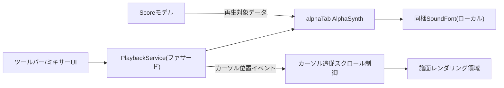
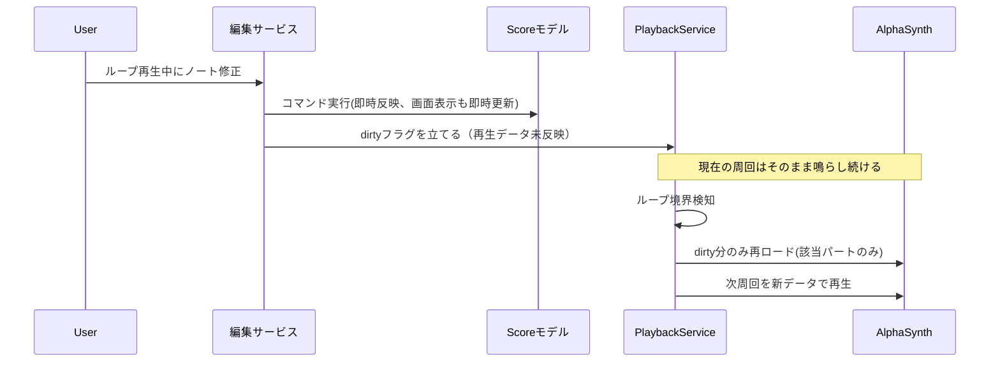

# 再生・オーディオエンジン設計書

対応要件：要件定義書4.3節（再生機能）、5.2節（パフォーマンス目標）、8章リスク#1・#7

## 1. 全体構成

alphaTab同梱の音源エンジン（AlphaSynth、SoundFont2ベース）をそのまま採用し、独自シンセは実装しない。再生制御サービス（[[01_architecture.md]]L2層）はalphaTabの再生APIを呼び出す薄いファサードとして設計し、UIからは「再生」「停止」「シーク」「ループ範囲設定」「テンポ倍率」「パート別ミュート／ソロ」「音量／パン」という抽象操作のみを公開する。書き出し画面でMIDIを試しに鳴らすとき（[[07_export_print.md#1]]）も、別の音源を持たずこの`PlaybackService`とAlphaSynthで、書き出す範囲・パートとMIDIの設定を反映して鳴らす（2026-09-26 本人決定、要件4.4）。メトロノーム・カウントイン・入力時のクリック（6節）も、別の音源を持たずAlphaSynthで鳴らす（上の7つの再生の操作とは別の働き）。

**音源の音質要件（要件4.3、2026-09 追記）**：要件4.3は合奏再生を「サンプル音源によるリアルな楽器音」と規定している。これは**同梱する SoundFont の選定条件**として本章が引き受ける。条件は次の2つとする。(1) v1で使う音色（エレキギター、ベース）が、実楽器を録音したサンプルを収録したものであること（波形合成だけで作られた音色を使わない）。(2) 同梱するファイルのサイズが、通常編集時400MB以内というメモリ目標（[[09_nonfunctional.md#3]]）の内側に収まること。可否の判定は、この2条件を満たす候補を Phase 0 で実際に鳴らして本人が聴いて決める。[[01_architecture.md#5]]の「同梱SoundFont」行はライセンス面の確認事項であり、音質面の確認は本条件による。



## 2. 合奏再生・パート別ソロ再生（要件4.3）

- 既定は全パート合奏再生。PlaybackServiceがパート単位のミュート／ソロ状態を切り替えるAPIを公開し、UI（ミキサーパネル）からパート単位でON/OFFを指定できるようにする（具体的なメソッドシグネチャは詳細設計書［[[15_development_process.md#1.2]]、`detailed_design/`］で確定する）。パートが0の曲では再生を始めない（再生ボタンとメニューを押せないようにする、2026-09-26、要件4.2、[[03_screens_ui_pc.md#10]]）。
- ソロ指定パートが1つ以上ある場合、AlphaSynth側の対応するトラックチャンネルのみをアクティブにし、それ以外は内部的にミュート扱いとする。**同一トラックに明示ミュート（`Part.mute`）とソロ（`Part.solo`）が両方指定された場合は、明示ミュートを優先して無音とする**（明示ミュートは「このトラックは鳴らさない」という絶対操作であり、ソロは「ソロ対象以外を内部ミュートする」機能としてユーザーの明示ミュートを上書きしない。一般的なDAWの挙動に揃える。[[13_design_decision_points.md#3]]B35、旧詳細設計 `playback-integration.md` §4.3（`2759936` 時点））。
- ミキサーパネル（[[03_screens_ui_pc.md#10]]）の音量・パンは各パートのMIDIチャンネルのControl Change（Volume/Pan）へ即時反映する。

## 3. 区間ループ再生・セクションループ（要件4.3、リスク#7）

### 3.1 基本ループ

- ループ範囲は「小節番号の開始・終了」で指定する（区間ループ）。セクションマーカー（[[02_data_model.md#3.5]]）を選択した場合は、そのマーカーが示す小節範囲を自動的にループ範囲として設定する（要件4.1「セクションループ再生」）。
- **マーカー由来のループ範囲はマーカーへ追従する（2026-09 追記）**：要件4.1は「セクションマーカーと連動し、「サビだけ」等を指定したループ再生に対応」と定めており、**連動は設定した瞬間だけでなく、その後マーカーが動いたときにも続く**。したがってセクションマーカーを選んで設定したループ範囲は、**マーカーの位置が変わったらループ範囲も同じだけ動かす**。具体的には次の3つ。
  - ループ範囲を「開始小節・終了小節の番号」ではなく、**参照したマーカーのid**（[[02_data_model.md#3.5]]）として保持する。小節番号は再生のたびにマーカーから引き直す。
  - マーカーの位置が変わった場合（マーカーの移動、および[[04_editing_core.md#10]]の小節挿入・削除による再採番）、次の周回から新しい範囲でループする。再生中に切り替わることでノイズが出ないよう、切り替えはループ境界で行う（3.2節の反映タイミングと同じ扱い）。
  - 参照していたマーカーが削除された場合は、**その時点の小節番号を固定値として引き継ぎ、区間ループへ降格させる**（ループが黙って止まるのを避けるため）。降格したことはWarningで知らせる（[[08_error_logging.md#1]]）。マーカー削除時にループをどうするかは要件定義書に書かれていないため、本書で当てはめた。「ループを解除する」という別案を採るなら、この1行を書き換えれば済む。
  - 開始・終了を手で入力して作った区間ループは、マーカーを参照していないので追従しない。
- ループ境界に到達したら、再生位置を開始小節の先頭にシークし直して再生を継続する。

### 3.2 ループ再生中の同時編集（リスク#7：最重要の技術的難所）

**方針**：ループ再生中の編集操作（ノート追加・修正）は、通常時と同じコマンド層（[[04_editing_core.md#8]]）を経由してScoreモデルへ即時反映するが、**再生中のAlphaSynthへの反映は、ループ再生中はループの頭（次周回の先頭）まで、ループしていない普通の再生では次の小節の頭まで遅延させる**（2026-10-09 本人決定、譜面の見た目はどちらもすぐ変わる）。理由：再生中の1小節の途中で発音データを書き換えると、シンセ内部の発音キュー不整合やノイズ（クリック音）の原因になりやすいため。パートの追加・削除・並べ替え・音色変更はこの遅れて反映する扱いにせず、再生を止めてから行う（2026-09-26、要件4.2）。入力したときの試しの音（ノートオン）は遅らせない。遅らせるのは曲の再生データへの反映だけとする（要件5.2が発音にも100msを掛けているため、再生中でも置いた音はすぐ鳴る、[[09_nonfunctional.md#1]]）。



- **画面表示（譜面）は即時反映**し、ユーザーは編集結果をすぐ視認できる（要件の「その場で修正」というUX意図を損なわない）。「音」の反映のみ境目（ループ再生中はループの頭、普通の再生では次の小節の頭）まで遅延する点をUI上インジケーター（例：小節に「変更待ち」マーク）で明示する。
- 変更対象パートのみを部分的に再ロードすることで、大曲でも境界での遅延を最小化する（09章のパフォーマンス目標と連動）。曲全体に掛かる変更（テンポ・拍子・小節の挿入と削除）は、全パートの再生データを作り直す。
- カテゴリA（技術検証待ち）の分岐点：alphaTabのAlphaSynth APIが「再生中の部分差し替え」をどこまでサポートするかはPhase 1でのプロトタイプ検証が必要（要件書リスク#7、[[13_design_decision_points.md#2]]A4）。サポートが薄い場合の代替案：ループ境界で一旦停止し即座に新データで再開する（境界での数十msの空白は許容するフォールバック）。

## 4. 減速再生（要件4.3）

alphaTabはMIDIベースのシンセ再生であり、テンポ変更は音声の時間伸縮（タイムストレッチ）ではなく**再生テンポ数値そのものを変更**することで実現するため、ピッチ変化やアーティファクトは発生しない。PlaybackServiceが再生テンポの倍率を指定するAPIを公開し、Barの基準テンポに対する倍率として再生する（具体的なメソッドシグネチャは詳細設計書で確定する）。

## 5. カーソル自動追従スクロール（要件4.3）

**再生中は、現在の再生位置を示す再生カーソルを譜面上に表示する**（要件4.3。表示はalphaTabの再生カーソルを使い、設定`enableCursor`を有効にする。位置の計算と描画を自前で持たない、[[01_architecture.md#5]]）。そのうえで、alphaTabの再生位置イベント（Beat単位で発火）を購読し、現在フォーカスビュー外に再生カーソルが出た場合のみスクロール位置を更新する（過剰な自動スクロールによるちらつきを避けるため、カーソルが表示領域内にある間はスクロールしない）。

## 6. メトロノーム・カウントイン・タップテンポ（要件4.1、4.3）

未決事項#5・[[13_design_decision_points.md#4]]C1/C2で以下の通り確定した。

| 機能 | 設計 |
|---|---|
| メトロノーム音色 | **複数音色プリセットを用意し、設定画面（[[03_screens_ui_pc.md#10]]）から選択可能にする**。MVPでは最低でもアコースティック系（木質的なクリック音）1種＋電子系（電子的なビープ音）1種を同梱する。いずれの音色でも、1拍目の強調は共通してピッチを上げる方向で実装する（アクセントは、同梱のSoundFontの音で1拍目に高い音を鳴らし、1節のとおり別の音源を持たない） |
| カウントイン | 再生開始前に、**現在の拍子の1小節分**のクリック音を鳴らしてから再生を開始する`CountInController`を既定動作とする。設定画面で「1小節分／2小節分」の倍率を選択できるようにする |
| タップテンポ | UIボタンの連続クリック間隔（直近のタップの平均。平均に使う回数は設定ダイアログで2回から8回、既定4回。[[03_screens_ui_pc.md#10]]、2026-10-03 本人決定）からBPMを算出し、`Bar.tempoBpm`更新コマンドを発行 |
| テンポの数値直接入力（**2026-09-10追加**、[[../detailed_design/00_reference.md#8.1]] G44） | 要件4.1「テンポ入力｜**数値直接入力＋タップテンポ**のハイブリッド」の数値側。ステータスバーのテンポ表示（[[03_screens_ui_pc.md#5]]）をクリックすると数値入力に切り替わり、確定でタップテンポと**同一のコマンド**（`Bar.tempoBpm`更新）を発行する。2経路が同じコマンドへ収束することで、Undo/Redoとテンポ継承（`null`＝直前値を継承、[[04_editing_core.md#10]]）の扱いが1系統で済む。入力可能なBPMの範囲は実装時に確定してよい詳細とする。拍子の変更も同じ操作の形（ステータスバーの拍子表示をクリックして入力、[[03_screens_ui_pc.md#5]]）とする（2026-09 追記、本人決定） |
| 入力時のクリック音（**2026-09-10追加**、[[../detailed_design/00_reference.md#8.1]] G48） | 要件4.1「メトロノーム／カウントイン｜**入力時のクリック音**、再生開始前のカウントイン、**両方必要**」の前者。**再生していない編集中も**、メトロノームがONのときは現在のテンポ・拍子でクリックを鳴らし続ける（ステップ入力のリズムの拠り所にする用途）。再生していない間にAlphaSynthでクリックだけを鳴らせるかは未確認で、実装の前に確かめる。従来は本表が再生時のメトロノームしか扱っておらず、要件が挙げた2つの用途の片方が落ちていた。ON/OFFは[[03_screens_ui_pc.md#6]]の「再生」メニューのメトロノーム項目と共用し、音色・音量は下記の設定項目を共用する。**これは入力へのフィードバックではない**（配置操作に応じて鳴るのではなく、メトロノームがONの間は拍に合わせて鳴り続ける）。入力時のフィードバックは[[03_screens_ui_pc.md#9]]のハイライト1種だけである |
| 設定項目 | メトロノーム音量・音色、カウントインの長さ（倍率）、タップテンポの感度は設定ダイアログ（[[03_screens_ui_pc.md#10]]）で調整可能にする |

## 7. ミキサー実装（要件4.3「専用ミキサー画面」）

ミキサーパネルの音量／パン／ソロ／ミュートは、[[02_data_model.md#3.2]]のPartエンティティに永続化される値をそのままAlphaSynthのチャンネル制御へバインドする単方向データフローとする（UI操作→コマンド→モデル更新→AlphaSynthへ反映、の順で必ずモデルを経由し、UIから直接シンセを操作しない）。

## 8. バックグラウンド音楽アプリとの共存（要件4.3、3.2節）

- **PC版**：OS標準で複数アプリの音声が同時に鳴らせるため、本設計上は特別な対応を行わない（要件どおり）。
- **iPhone版（Phase 3）**：AudioSessionAdapter（[[01_architecture.md]]AD-3）がiPhone版ラッパーでのみ実処理を持ち、AVAudioSessionの`mixWithOthers`オプションを設定する。WebView内の音声がこの設定を継承するかは未検証（要件書リスク#1）であり、10章で拡張設計時に詳細化する。

## 9. パフォーマンス目標との対応（要件5.2）

| 目標 | 対応 |
|---|---|
| 再生開始レイテンシ200ms以内 | 曲を開いたら、その編集ウィンドウでAlphaSynthの初期化と音源（SoundFont）の読み込みを始め、読み終わるまで再生ボタンは「音源を読み込み中」と出して押せないようにする（曲一覧だけのときは読まない、[[09_nonfunctional.md#3]]）。押せない間は押下が起きないので、要件5.2の「再生ボタン押下から発音まで200ms以内」は、再生ボタンを押せるようになってからの目標としてこれで満たす（2026-09-26 本人決定） |
| ノート入力反応100ms以内 | 3.2節のとおり、画面反映とシンセ反映を分離し、画面反映（体感速度に直結）を優先して即時実行する |

## 10. カポの実音変換（要件4.1、2026-09-10 追加）

[[02_data_model.md#3.2]]は`capoFret`について「**表示は運指基準、実音変換は再生時のみ**（05章で実装）」と本書へ申し送っていたが、本書には長らくカポに関する記述が1件も無く、**申し送り先に受け口が無い**状態だった（[[../detailed_design/00_reference.md#8.1]] G43）。本節で受け取る。

**変換式**：再生用のノートデータを生成する時点でのみ、次の加算を適用する。

```
実際に鳴らすMIDIピッチ ＝ （その弦の開放弦チューニングピッチ） ＋ capoFret ＋ （記譜されたフレット番号）
```

- **譜面表示（記譜フレット番号）は一切変更しない**。カポは「押さえ方を変えずに調を変える」道具であり、運指を保つことが要件4.1「カポ表示規則」の趣旨である（要件4.1のカポ2行の解釈は[[02_data_model.md#3.2]]「カポの表示規則」、判断は[[13_design_decision_points.md#3]]B42）。
- `capoFret`の範囲は0〜12（[[13_design_decision_points.md#3]]B14）。`capoFret = 0`（カポなし）のときは加算が0になるだけで、経路を分岐させない。
- **同じ変換式をMIDI書き出しでも使う**（[[07_export_print.md#1]]）。再生とエクスポートで鳴る音が食い違わないよう、式は1箇所に置いて双方から呼ぶ（詳細設計での抽出は旧詳細設計 `playback-integration.md` §3.2（`2759936` 時点）、[[13_design_decision_points.md#3]]B18）。
- コードネームの推定（[[04_editing_core.md#7]]）も構成音の実音を必要とするため同じ式を使う。
- 変換はチューニング（`stringPitches`）とカポにのみ依存し、拍子・テンポ・奏法記号には依存しない純粋な加算である。
