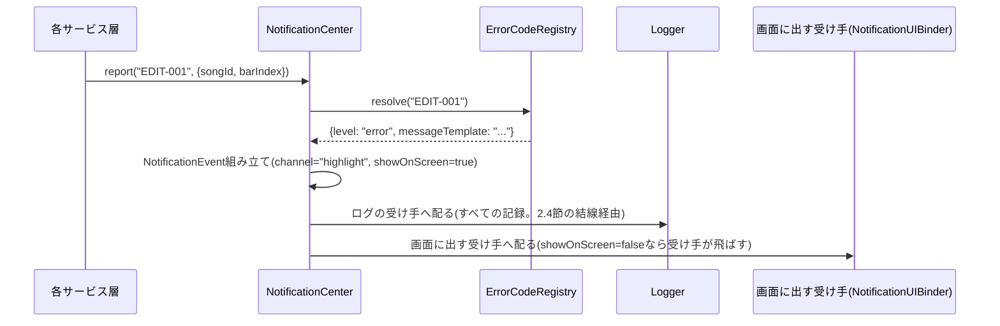
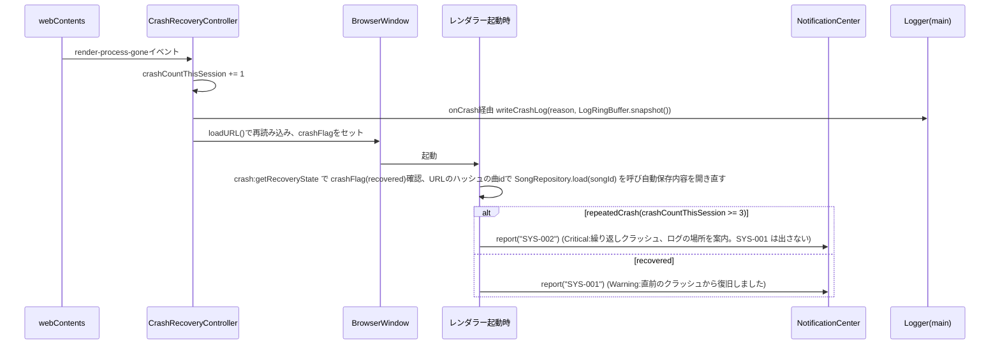
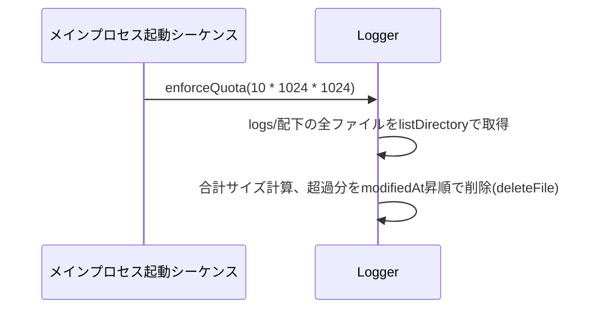

# 詳細設計書：エラー・ログ基盤

> **下書き**（08 の試走で直した文。章ごとに確かめ直す）。作り直す前の本書（`2759936` 時点）をそのまま写したもの。基本設計のどの節が本書のどこに降りるかは、[[00_reference.md#1]] の受け先表にある

- **対応作業パッケージ**：要件定義書9章「エラー・警告基盤」（S）＋「ログ基盤」（S）、実施順序3（[[../basic_design/13_design_decision_points.md#3]]B11。2件のSサイズパッケージを合わせて先に片付ける方針） <!-- req 12:0527f8e6.fa0a --> <!-- req 12:0527f8e6.7350 -->
- **作業パッケージ全体の実施順**：基本設計 13 章 B11 で並べ替えた 8 つの作業パッケージの順は、反映先が基本設計 15 章 4.1 節なので、15 章の回に書く。書いた先は [[web-core-foundation.md#15]] の 15.4 節 <!-- req 13:ad1be9c7.ccdf --> <!-- req 12:cf19dbab.3d91 -->
- **ブランチ名**：`feature/error-logging-foundation`
- **前提とする基本設計書**：[[../basic_design/08_error_logging.md]]、[[../basic_design/06_file_io_persistence.md#3]]（`logs/`フォルダ。**2026-09-02修正**：セルフレビューで発見、当該定義は同書§1ではなく§3にあるため訂正）、[[../basic_design/11_test_strategy.md#4]]
- **前提とする詳細設計書**：旧詳細設計 `web-core-foundation.md`（`2759936` 時点）（`FileSystemAdapter`）、旧詳細設計 `data-model-persistence.md`（`2759936` 時点）（`FileSystemAdapterFactory`、現アクティブルート用アダプタ）
- **本書の位置づけ**：[[../basic_design/15_development_process.md#1.2]]に基づく詳細設計書。

---

## 1. 目的・スコープ

[[../basic_design/08_error_logging.md#1]]の4段階メッセージ方式（Info/Warning/Error/Critical）を実装する`NotificationCenter`と、[[../basic_design/08_error_logging.md#2]]のログ基盤（日次ローテーション・10MB共有クォータ）を実装する。あわせて、前2パッケージ（旧詳細設計 `web-core-foundation.md`（`2759936` 時点）・旧詳細設計 `data-model-persistence.md`（`2759936` 時点））が「暫定ログ出力／例外をそのまま伝播」としていた箇所を、本パッケージの成果物に置き換える（9節）。 <!-- req 08:d74a5a9c.7bd1 --> <!-- req 08:54439272.3889 --> <!-- req 08:91bd2a77.d03c -->

**スコープ外**：トースト・ハイライト・モーダルの実際のReact表示コンポーネント（→画面群・ナビゲーション。本パッケージは`NotificationCenter`が発行するイベントの契約までを定義し、購読側の見た目は次々パッケージ以降で実装する）。 <!-- req 08:a574fad7.e6de -->

## 2. クラス／インターフェース構成

### 2.1 `packages/core/src/errors`（新設）

| クラス/型 | 責務 | 主要メソッド/フィールド |
|---|---|---|
| `NotificationCenter` | 4段階のメッセージ方式の唯一の窓口。プラットフォーム非依存の純粋ロジック（[[../basic_design/08_error_logging.md#1.1]]） | `report(code: string, context?: Record<string, unknown>): void`／`subscribe(handler: (event: NotificationEvent) => void): () => void`（戻り値は購読解除関数）／`getRecentBuffer(maxEntries: number): NotificationEvent[]`（renderer の中の直近の記録を返す。クラッシュログに添える直近の記録は main の `LogRingBuffer.snapshot()`（2.4 節・3.2 節）から取り、こちらは使わない。renderer の記録はクラッシュで renderer ごと失われるため。2026-10-29 決定 X4）。**2026-09-24 改訂**：`report()` は記録（`NotificationEvent`）を 1 つ作って受け手へ配るだけにする（下の「受け手を分ける」）。**2026-10-29 追加（本人決定 K5）**：`relay(event: NotificationEvent): void`（main から `notify:fromMain` で届いた記録を、作り直さずに画面に出す受け手へ配る。2.6 節）と、`subscribe` の 2 つ目の引数 `options?: { relayed?: boolean }`（省略時 `true`。`false` で登録した受け手には `relay` の記録を配らない）。どちらも公開シグネチャの非破壊追加 <!-- req 08:a574fad7.f0f9 --> <!-- req 08:0b4c734d.b22f --> |
| `NotificationEvent`（型） | 発行されるイベント | `level: 'info'\|'warning'\|'error'\|'critical'`／`channel: 'toast'\|'highlight'\|'modal'`／`code: string`／`message: string`／`context?: Record<string, unknown>`／`timestamp: string`。**2026-09-24 追加**：`showOnScreen: boolean`（そのコードの `ErrorCodeDefinition.showOnScreen`、省略時 `true`。表示の受け手が見る）。`stack?: string`（Error／Critical のときだけ `report()` が取る。取り方は 2.2節「スタックトレースの取得元」） |
| `ErrorCodeRegistry` | エラーコード（`{ドメイン}-{連番}`）ごとに、固定のレベル・メッセージテンプレートを保持する（[[../basic_design/08_error_logging.md#1.2]]。チャンネルは持たず、レベルから決まる。2026-11-01 決定で 29 行にそろえた） | `register(code: string, def: ErrorCodeDefinition): void`／`resolve(code: string): ErrorCodeDefinition`（未登録コードで呼ばれた場合は`UnknownErrorCodeError`を投げる＝開発時に気づけるようにする）。**2026-09-24 追加**：`showOnScreen: false` なのに `logOnlyReason` が空の定義は `InvalidErrorCodeError` で拒否する（レベルは問わない。出さない理由を必ず書かせるだけ） <!-- req 08:e629ad5c.357c --> |
| `ErrorCodeDefinition`（型） | フィールド：`level`（`channel` はフィールドに持たず、`report()` が `level` から `LEVEL_TO_CHANNEL` で導き出す。2026-11-01 決定で、前の「`channel`（自動導出するため実質 `level` のみ登録すればよい）」を今のコードと一致する形にそろえた）、`messageTemplate: string`（`{context.xxx}`形式のプレースホルダ埋め込みに対応）。**2026-09-24 追記**：Critical のコードは、さらに `title: string`（見出し＝何が起きたか）と `buttons: { confirm: string; cancel?: string }`（肯定・否定をはっきりさせたボタンの文言。「OK」だけにしない）を持ち、`messageTemplate` を本文（原因の要約と選択肢）として使う（[[../basic_design/08_error_logging.md#5]]）。`NotificationEvent` にも `title?`・`buttons?` を載せてモーダルへ渡す。**2026-09-24 追加（本人決定）**：`showOnScreen?: boolean`（画面に出すか。**省略時 `true`＝今までどおりレベルから `LEVEL_TO_CHANNEL` で決まるチャンネルへ出す**。`false` ならログにだけ書く。レベルを問わず指定できる）と `logOnlyReason?: string`（`showOnScreen: false` のときの、出さない理由。[[00_reference.md#5]]の表にも同じ理由を書く） | - <!-- req 08:a086e507.62cd --> <!-- req 08:a086e507.4876 --> <!-- req 08:a086e507.550a --> <!-- req 08:e551a8f8.a9bf --> <!-- req 08:e551a8f8.fce1 --> <!-- req 08:e551a8f8.fee1 --> <!-- req 08:e551a8f8.df44 --> |
| `LEVEL_TO_CHANNEL`（定数表） | レベル→表示チャンネルの固定対応 | `info→toast`／`warning→toast`／`error→highlight`／`critical→modal`（[[../basic_design/08_error_logging.md#1]]の表をそのままコード化） <!-- req 08:94bf7784.2c07 --> |

**2026-09-02確定（基本設計からの実装レベルの精緻化）**：[[../basic_design/08_error_logging.md#1.1]]の図は`report(level, code, context)`という呼び出し例を示していたが、本パッケージでは**`report(code, context)`のみ**とし、`level`は`ErrorCodeRegistry`がコードから引く設計に変更する。理由：同じコードに呼び出し側ごとに異なるレベルを渡せてしまうと「重複配置は常にError」といった一貫性が呼び出し側の規律に依存してしまう。コードとレベルを1対1に固定することで、レベルの誤指定というクラスのバグをそもそも起こせない設計にする。 <!-- req 08:e4a02740.98b0 --> <!-- req 08:e4a02740.f88d -->

**2026-09-24 追記（bd->dd の試走で是正、[[../basic_design/08_error_logging.md#1]]）**：
- **レベルごとの操作の扱い**（全コード共通）：Info・Warning は操作を止めない。Error は該当する操作だけを拒否し、他の操作は続けられる（モーダルを出さない）。Critical は応答するまで他の操作を受け付けない。表示の仕方は [[screens-navigation.md#13.2]] の表示規則 <!-- req 08:d74a5a9c.9119 --> <!-- req 08:31d3875f.0418 --> <!-- req 08:94bf7784.ca02 --> <!-- req 08:54439272.2ead --> <!-- req 08:456057c8.c141 -->
- **ドメインは 8 つに限る**：`EDIT`・`PLAY`・`FILE`・`EXPORT`・`SYS`・`RENDER`・`TAG`・`SONG`（[[../basic_design/08_error_logging.md#1.2]]）。`ErrorCodeRegistry.register` はこれ以外のドメインのコードを `InvalidErrorCodeError` で拒否する（未登録コードの `UnknownErrorCodeError` と同じく、開発時に気づけるようにする）。採番の規則は [[00_reference.md#5]] の「エラーコードの採番規則」 <!-- req 08:f663d675.ff1a --> <!-- req 08:f663d675.8139 --> <!-- req 08:f663d675.d52a --> <!-- req 08:f663d675.3c43 --> <!-- req 08:f663d675.81d5 --> <!-- req 08:f663d675.20a4 --> <!-- req 08:f663d675.f67c -->
- **文脈情報**：発生源に曲や小節があるときは、`report()` の `context` に `songId`・`barIndex`（パートがあれば `trackIndex`）を必ず入れる。曲や小節を発生源に持たない通知（`SYS-001` が該当）は入れなくてよい <!-- req 08:e629ad5c.8a28 --> <!-- req 08:2e5f87bb.06fa -->

**2026-09-24 追記（ログに書く受け手と画面に出す受け手を分ける、本人決定、[[../basic_design/08_error_logging.md#1.1]]）**：
- `report(code, context)` は、`ErrorCodeRegistry` から定義を引いて `NotificationEvent` を 1 つ作り（`showOnScreen` を載せる）、`subscribe` で登録された受け手へ登録順に配る**だけ**にする。受け手ごとの振る舞いを `report()` に書かない。受け手が増えても `report()` は変えない <!-- req 08:a086e507.5f6e -->
- **ログの受け手**：`showOnScreen` を見ずに、すべての記録を受け取る。renderer の `errorLoggingBootstrap` のログ転送（2.4節の結線：`toLogEntry` → `log.append` → main の `Logger.append` と `LogRingBuffer.push`）と、`NotificationCenter` の直近バッファ（`getRecentBuffer`。renderer の中だけの記録で、クラッシュログには使わない。クラッシュログに添えるのは main の `LogRingBuffer.snapshot()`、2026-10-29 決定 X4）・`setLogSink` の注入先がこれに当たる。直近バッファと `setLogSink` は、今は `report()` の中で直接書いている（`NotificationCenter.ts` の `this.recent.push(event)`・`this.writeToLog(event)`）ので、コンストラクタで登録する受け手に移す <!-- req 08:a086e507.9d27 -->
- **画面に出す受け手**：`NotificationUIBinder`（[[screens-navigation.md#13.2]]）。`showOnScreen: false` の記録は、どのチャンネル（toast／highlight／modal）へも渡さずに飛ばす <!-- req 08:a086e507.fe83 -->
- 画面に出さないコードの一覧と理由は [[00_reference.md#5]] の表が正（印「**画面に出さない**」をレベルの欄に付ける）。最初の例は `PLAY-003`（旧詳細設計 `playback-integration.md` §10.4（`2759936` 時点））

### 2.2 `packages/core/src/errors`（ログ基盤）

| クラス/型 | 責務 | 主要メソッド |
|---|---|---|
| `Logger` | `NotificationCenter`が発行する全イベントを永続ログとして記録する（[[../basic_design/08_error_logging.md#2]]）。ファイル I/O は、使うメソッド（`readFile`・`writeFile`・`listDirectory`・`ensureDirectory`・`deleteFile`・`getRootPath`）だけを並べた形 `LogFileStore` で受ける。渡すのは `FileSystemAdapter`（旧詳細設計 `data-model-persistence.md` §3.3（`2759936` 時点）でルート解決済みのインスタンス）のままで、`FileSystemAdapter` はこの形をそのまま満たす。`errors` は `platform` を import しない（[[web-core-foundation.md#2]] の 2.1 節）ので、型の名前ではなく形で受ける。**ログの組み立て（レベル・書式）は行わず、受け取った `LogEntry` を書き出すだけ**（2026-09-24 追記、[[../basic_design/08_error_logging.md#1.1]]。組み立ては 2.4節の結線どおり Webコア側） | `append(entry: LogEntry): Promise<void>`／`writeCrashLog(reason: string, recentBuffer: LogEntry[]): Promise<void>`／`enforceQuota(maxTotalBytes: number): Promise<void>`（`logs/`フォルダ合計サイズが上限を超えたら最終更新日時の古いファイルから削除）／`getLogFolderAbsolutePath(): string`（設定画面「アプリ情報」からエクスプローラーで開く用） <!-- req 08:74b61426.b329 --> <!-- req 08:ec1e68ba.8d57 --> <!-- req 08:91bd2a77.7928 --> <!-- req 08:91bd2a77.ba8c --> <!-- req 08:91bd2a77.831b --> <!-- req 08:91bd2a77.c512 --> <!-- req 12:f1bbd82c.02f2 --> |
| `LogEntry`（型） | フィールド：`timestamp`、`level`、`code`、`message`、`context`、`stack?: string`（Error/Critical時のみ） | - <!-- req 08:e629ad5c.3fbb --> <!-- req 08:2e5f87bb.2ee5 --> <!-- req 08:2e5f87bb.4004 --> <!-- req 08:2e5f87bb.1043 --> <!-- req 08:2e5f87bb.28f6 --> |
| スタックトレースの取得元（2026-09-24 追記、[[../basic_design/08_error_logging.md#2]]） | `report(code, context)` は Error を引数に取らないので、`stack` は `report()` が記録（`NotificationEvent`）を作るときに決める。レベルが Error／Critical のときだけ、(1) `context.error` が `Error` なら、その `stack` を使う（呼び出し側が捕まえた例外の発生地点）、(2) そうでなければ `report()` の中で `new Error().stack` を取る（`report()` を呼んだ地点）。取った値を `NotificationEvent.stack?` に載せ、`toLogEntry` はそれを `LogEntry.stack` へ写すだけにする（受け手の中で取ると、受け手自身の呼び出し地点になってしまうため）。`context.error` は JSON に書けないので、`toLogEntry` が `context.error` を `{ name, message }` に置き換えてから書く。Info／Warning では `stack` を持たない | - <!-- req 08:2e5f87bb.d533 --> |
| ファイル命名規則 | 通常ログ：`logs/app-YYYYMMDD.log`（1行1JSON、追記形式）。クラッシュログ：`logs/crash-YYYYMMDD-HHMMSS.log` | - <!-- req 08:8838e677.da52 --> <!-- req 08:ec1e68ba.c288 --> <!-- req 08:91bd2a77.118d --> |
| クラッシュログの書式（2026-09-24 追記） | `writeCrashLog(reason, recentBuffer)` は、1 行目にクラッシュ理由（`render-process-gone` の `details.reason` と検知時刻）を書き、2 行目以降に `recentBuffer` の `LogEntry` を古い順に 1 行 1 JSON で書く | - <!-- req 08:91bd2a77.58a3 --> <!-- req 08:91bd2a77.0e68 --> <!-- req 08:fae6b18c.a483 --> |
| 容量の枠（[[../basic_design/13_design_decision_points.md#3]]B8） | 通常ログとクラッシュログは容量の枠を分けず、1 つのローテーション枠で管理する。`enforceQuota` は、`logs/` に置いた通常ログとクラッシュログの合計で上限（2.4節の `DEFAULT_LOG_QUOTA_BYTES`）を見て、どちらの種類かを区別せずに古い順に消す | - <!-- req 13:d5be190a.5ea6 --> |

**`NotificationCenter`と`Logger`の結線**：`Logger`自体は`NotificationCenter`の一機能ではなく独立したクラスとする。**2026-09-24 改訂**：`NotificationCenter.report()` は記録を作って受け手へ登録順に配るだけで（2.1節「ログに書く受け手と画面に出す受け手を分ける」）、`Logger` へはログの受け手（renderer のログ転送 → `log:append` → main の `Logger.append`、2.4節）を通して届く。同じプロセスで書く場合（テスト）は `setLogSink` の注入先がログの受け手になり、そこへモックの `Logger` を渡す。改訂前は「`report()`内部で、購読者への通知と`Logger.append()`呼び出しの両方を行い、`NotificationCenter`が`Logger`インスタンスを保持する」と書いていた。**2026-10-29 追記（本人決定 K5）**：main で出たエラーは、renderer を通さずに main の `MainErrorLogger`（2.6 節）から `Logger.append` に届く。

### 2.3 `apps/desktop/src/main`（クラッシュ検知・復旧）

| クラス | 責務 | 主要メソッド |
|---|---|---|
| `CrashRecoveryController` | レンダラークラッシュの検知・再読み込み・繰り返しクラッシュの判定を行う（[[../basic_design/08_error_logging.md#3]]、[[../basic_design/06_file_io_persistence.md#9]]） | `attach(window: BrowserWindow): void`（`webContents.on('render-process-gone', ...)`を登録。`reason==='clean-exit'`はクラッシュ扱いしない。クラッシュ時は`crashCountThisSession`を+1し、破棄済みでなければ`webContents.loadURL()`（起動時と同じ URL）で再読み込みし、`onCrash({reason, crashCountThisSession})`フックを呼ぶ（main がレンダラーのクラッシュを見つけ <!-- req 06:3f05b32f.cda1 -->、そのウィンドウを読み込み直す <!-- req 06:3f05b32f.cbdb -->、[[../basic_design/06_file_io_persistence.md#9]]）。**2026-09-24 改訂**：再読み込みの手段を基本設計 08:53 の方針どおり `loadURL` にそろえた。現行の実装は `webContents.reload()` で、実装の段で直す）／`consumeRecoveryState(window: BrowserWindow): CrashRecoveryState`（renderer起動時にIPCで1回呼ばれ、`{recovered, repeatedCrash, logFolder}`を返し`recovered`フラグを消費する。`repeatedCrash`は`crashCountThisSession >= REPEATED_CRASH_THRESHOLD(=3)`）／constructor は `{threshold?, onCrash?, getLogFolder}` を受ける。`crashCountThisSessionValue` getter（診断用）。`reloadAfterRenderError(window: BrowserWindow): void`（2.5 節の代わりの画面の「画面を開き直す」から IPC で呼ばれ、`crashCountThisSession` を足さず `recovered` も立てずに、起動時と同じ URL で `webContents.loadURL()` を呼ぶ。2026-10-14 追加、本人決定）。**通知（SYS-001/SYS-002）自体は出さず、renderer の `errorLoggingBootstrap` が状態を見て `report()` する**。**2026-09-24 追記（フラグの寿命、[[../basic_design/08_error_logging.md#3]]の「メインプロセスがセッション内で保持」）**：`recovered` フラグと `crashCountThisSession` は `CrashRecoveryController` のインスタンスの中（main プロセスのメモリ）にだけ持ち、ファイルにも設定にも書かない。アプリを終了すると消え、次に起動したときは `recovered: false`・回数 0 から始まる（クラッシュの記録として残るのは 2.2節のクラッシュログだけ）。**2026-10-29 追記**：`CrashRecoveryController` は main に 1 つ置き、`recovered` と `crashCountThisSession` は窓の id（`BrowserWindow.id`）ごとに分けて持つ。`consumeRecoveryState` は窓を受け、`crash:getRecoveryState` の受け口が送り手の窓（`BrowserWindow.fromWebContents(event.sender)`）を渡す。`repeatedCrash` はその窓の回数で決める。診断用の getter も窓ごとの値を返す。窓が閉じたらその窓の分を消す（決定 L2）。返す `CrashRecoveryState` にログフォルダの場所 `logFolder: string` を 1 項目足し、constructor の `getLogFolder: () => string`（`main.ts` は `() => logger.getLogFolderAbsolutePath()` を渡す）から取る（決定 O3）。誰が呼ぶか：窓を作るたびに main の `WindowManager` が `attach(window)` を呼ぶ。印刷用の見えないウィンドウには呼ばない（決定 T2） <!-- req 08:7638dca0.0678 --> <!-- req 08:3d173934.fa74 --> <!-- req 08:2e686495.2335 --> <!-- req 08:2e686495.f96c --> <!-- req 08:5be43f6b.607f --> <!-- req 12:f1bbd82c.6574 --> |

**2026-09-02確定（基本設計の記述を具体化）**：[[../basic_design/08_error_logging.md#3]]は「同一操作で3回等」と書いていたが、「同一操作」を判定するには編集コマンド層（タブ譜編集コアパッケージ、まだ未実装）が持つ「直前の操作種別」の情報が必要になる。本パッケージの時点ではその情報がないため、**暫定的に「同一ウィンドウ・同一アプリセッション内で3回」**に簡略化して実装する。タブ譜編集コアパッケージ完了後、直前操作のコンテキストを`CrashRecoveryController`に渡せるようになった時点で、要件通りの「同一操作で3回」判定に精緻化することを次パッケージ以降へ申し送る（9.4節）。数えるのは main に 1 つの `CrashRecoveryController` で、窓の id ごとに分けて数える（2.3 節の表、2026-10-29 決定 L2）。 <!-- req 08:fae6b18c.f676 -->

**2026-09-24 追記（フリーズの検知、[[../basic_design/08_error_logging.md#3]]、[[../basic_design/13_design_decision_points.md#3]]B43、[[00_reference.md#8.1]] G57）**：基本設計は `render-process-gone`（クラッシュ）に加えて、フリーズ（プロセスは生きているが応答しない）を `webContents.on('unresponsive', ...)` で検知し、`responsive` で解除することを定めている。`CrashRecoveryController.attach` はこの 2 つのイベントも購読する。**未実装**（「Phase 1 完成・製品化」サブ機能 I1、G57）。 <!-- req 08:841b2018.daad --> <!-- req 08:46032927.f750 -->

**2026-09-24 改訂（フリーズの扱い、本人決定：案 A・5 秒）**：扱いの正は基本設計 08 §3 の表で、本書はその実現手段を決める。
- `unresponsive` を受けても再読み込みはせず、main が `FREEZE_CONFIRM_DELAY_MS`（=5000）のタイマーを始める。フリーズ中は renderer に何も出さない（ウィンドウには OS の「応答なし」が出るだけ） <!-- req 08:5be43f6b.6584 --> <!-- req 08:5be43f6b.a7a7 -->
- `responsive` を受けたらタイマーを止め、renderer へ `freeze:recovered` を送る。renderer の `errorLoggingBootstrap` がこれを受けて `notificationCenter.report('SYS-003')`（Warning「一時的に応答が停止していました」）を出す <!-- req 08:46032927.2736 --> <!-- req 08:9fe5e375.a61e --> <!-- req 08:a03b8010.1a1a -->
- タイマーが満了したら、main が `dialog.showMessageBox` で Critical のネイティブダイアログを出す（ボタン「待つ」「再読み込み」、既定は「待つ」）。「待つ」ならタイマーを始め直し、さらに 5 秒応答が無ければもう一度出す。「再読み込み」なら `recovered` を立てて `loadURL()` で再読み込みする <!-- req 08:f6277b5f.210e --> <!-- req 08:f6277b5f.dd6c --> <!-- req 08:f6277b5f.6f1f --> <!-- req 08:f6277b5f.ec1c --> <!-- req 08:f6277b5f.ed6a -->
- **ダイアログの中身（2026-09-24 追記、本人決定：基本設計 08 §5 に沿う）**：`dialog.showMessageBox(window, options)` に親のウィンドウを渡し、`options` は次のとおり。`message`（見出し）＝「画面が応答していません」。`detail`（本文）＝「画面の処理が 5 秒以上止まっています。大きな曲の描画や保存など、重い処理の途中で一時的に止まっているだけのこともあります。このまま待つか、画面を再読み込みしてください。再読み込みすると最後に自動保存した内容で開き直すため、自動保存されていない直前の編集は失われます。」。`buttons`＝`['待つ', '再読み込み']`、`defaultId: 0`、`cancelId: 0`（Esc は「待つ」＝再読み込みしない側）、`noLink: true`（Windows でボタンをコマンドリンクに変えない）、`title`＝アプリ名。見出し・本文・ボタンの文言は、メニューの項目の名前（[[screens-navigation.md#8]] の 8.3 節）と同じく `packages/ui-desktop` に文字のデータとして置き、main はそれを import して `options` に入れる（画面の文言を書いてよい所を 2 か所に限る [[screens-navigation.md#1]] の決まり。基本設計 09 章 4 節のローカライズの行）
- **表示中に応答が戻ったとき（2026-09-24 追記、本人決定の案 A「5 秒タイマーと出しているダイアログを止める」）**：ダイアログを出すたびに `AbortController` を 1 つ作り、その `signal` を `options.signal` に渡す。`responsive` を受けたら、タイマーを止めるのに加えて `controller.abort()` でダイアログを閉じ、`freeze:recovered` を送る。閉じられたダイアログの Promise は `cancelId`（0＝「待つ」）で解決するので、`showMessageBox` の戻りを見る処理は**先に `controller.signal.aborted` を確かめ**、真なら「待つ」として扱わずに何もしない（タイマーを始め直さない・再読み込みしない）。確かめた根拠：実装で使っている Electron 44.2.0 の型定義 `electron.d.ts` の `MessageBoxOptions` に `signal?: AbortSignal;` があり、説明は「Pass an instance of AbortSignal to optionally close the message box, the message box will behave as if it was cancelled by the user. On macOS, `signal` does not work with message boxes that do not have a parent window」。親のウィンドウを渡すので、macOS（Phase 3）でもこの制限には当たらない
- 再読み込み後の復元はクラッシュ時と同じ経路：renderer が起動時に `crash:getRecoveryState` を引き、`recovered` なら下記の復元手順と `SYS-001` に入る（`repeatedCrash` が真なら `SYS-001` の代わりに `SYS-002` だけを出す、2.4 節、2026-10-29 決定 X5） <!-- req 08:ab75c1e3.c3ae -->
- 無確認では再読み込みしない（基本設計 08 §3、B43） <!-- req 13:ffe87661.ad4f -->

**2026-09-24 追記（再読み込み後の復元手順、[[../basic_design/08_error_logging.md#3]]の 3.）**：main の `WindowManager`（旧詳細設計 `screens-navigation.md` §4.9.8（`2759936` 時点））はウィンドウごとに開いている `songId` を持っている。再読み込み後の renderer は、`crash:getRecoveryState` の結果が `recovered` のとき、自分のウィンドウの `songId` を URL のハッシュ（`#edit/<songId>`、[[screens-navigation.md#4]] の 4.5 節）だけで受け取り（2026-10-29 決定 X1。前は `window:getSongId` の IPC で受け取ると書いていた）、`SongRepository.load(songId)` で自動保存済みの内容を開き直す。戻すもとは直前の自動保存の内容とし <!-- req 06:3f05b32f.db46 -->、今の主ストレージの `songs/{サブフォルダ/}{id}.tabapp`（サブフォルダは `index.json` の `folder`、[[data-model-persistence.md#15]]）を読む。 <!-- req 06:3f05b32f.92d4 --> 自動保存されていなかった編集は戻らない（クラッシュ時はプロセスが失われているため）。**未実装**（`SongRepository.load` の renderer 結線そのものが G31 で未。I1）。 <!-- req 08:2e686495.e07a -->

### 2.4 プロセス配置と結線（2026-09-08確定、[[../basic_design/13_design_decision_points.md#3]]B32）

基本設計 [[../basic_design/08_error_logging.md#1.1]] は `NotificationCenter` を「Webコア内シングルトン」とだけ述べていたが、`Logger` が `FileSystemAdapter` を要する（2.2節）ため、Electron の main/renderer 分割上の実体を実装時に確定した。

| 要素 | プロセス | 実体 |
|---|---|---|
| `NotificationCenter` | renderer（Webコア） | `packages/core/src/errors` の共有シングルトン `notificationCenter`（[[00_reference.md#5]] で登録パッケージが 1〜3 のコードを登録済みの `errorCodeRegistry` を保持。数はパッケージが進むたびに古くなるので書かない（2026-11-01 決定）。前は「コア8コード」、2026-10-29 決定 X3 の後は「4 節の表の 13 コード」と書いていた）。テストは `NotificationCenter` クラスを直接 `new` する。main で出たエラーは、このシングルトンではなく、main の `MainErrorLogger`（2.6 節）が中に持つ別の `NotificationCenter` で記録を作る（2026-10-29 本人決定 K5） <!-- req 08:a574fad7.118e --> <!-- req 08:0b4c734d.268c --> <!-- req 08:74b61426.1be1 --> <!-- req 08:74b61426.3adc --> <!-- req 13:4b9eb3c7.f334 --> <!-- req 13:52a52920.7104 --> |
| `Logger` | main プロセス | `apps/desktop/src/main/main.ts` が `ElectronFileSystemAdapterFactory` のアクティブルート用アダプタを注入して生成。起動シーケンスで `enforceQuota(DEFAULT_LOG_QUOTA_BYTES=10MB)` を1回呼ぶ（3.3節）。保存先を動いている途中で変えたとき（[[data-model-persistence.md#12]]）は、main が `shared:changed` の `storage` の知らせ（[[web-core-foundation.md#6]] の 6.3 節）を受け、`Logger` の書き先を新しい主ストレージのアダプタ（その `logs/`）に替える（2026-10-29 本人決定 K1）。終了のときは、終了の順の最後に main が `flush()` を呼ぶ（下の `flush` の段落、2026-10-29 決定 T1） <!-- req 08:74b61426.526d --> <!-- req 13:4b9eb3c7.2200 --> <!-- req 13:4b9eb3c7.20fd --> <!-- req 13:52a52920.dd0e --> |
| 結線 | — | renderer の `errorLoggingBootstrap` が `notificationCenter.subscribe(...)` で全イベントを受け、`toLogEntry(event)`（`packages/core/src/errors`）で `LogEntry` に組み立ててから `window.riffLineApi.log.append(entry)` へ送る。main の `registerLogHandlers` は受けた `LogEntry` をそのまま `Logger.append(entry)` と `LogRingBuffer.push(entry)` に渡すだけで、組み立ては行わない。`setLogSink` は同一プロセス（テスト・将来）向けに `NotificationCenter` へ残す。**2026-09-24 追記**：このログ転送は 2.1節の「ログの受け手」なので、`showOnScreen` を見ずにすべての記録を送る（画面に出さないコードの記録もログには残る）。**2026-09-24 改訂**：[[../basic_design/08_error_logging.md#1.1]]の「main側の`Logger`が持つのは、①ファイルへの書き出しと⑦クラッシュ後の記録の2つだけで、ログの組み立て（レベル・書式）はWebコア側に置く」に合わせた。改訂前は main の `registerLogHandlers` が `Logger.append(toLogEntry(event))` と `LogRingBuffer.push(event)` を行う設計で、現行の実装（`apps/desktop/src/main/main.ts`）もそのまま。実装の移動は実装の段で行う。**2026-10-29 追記（本人決定 K5）**：main で出たエラーは renderer を通さない。main の `MainErrorLogger`（2.6 節）が Webコアの `NotificationCenter` と `toLogEntry` で組み立てて `Logger.append` と `LogRingBuffer.push` に渡し、画面に出す記録だけを `notify:fromMain` で開いている窓の全部へ送る。組み立ての決まりは Webコアの 1 か所のままで、main は書くだけを受け持つ（上の基本設計 08 章 1.1 節の追記との両立の読みは 2.6 節） <!-- req 08:74b61426.8db1 --> <!-- req 13:4b9eb3c7.ad96 --> <!-- req 13:4b9eb3c7.fcc6 --> |
| `LogRingBuffer`（新設、main） | main プロセス | `render-process-gone` で renderer 側バッファが失われるため、クラッシュログに添える直近 `LogEntry` 履歴を main 側でも保持する（既定200件、`NotificationCenter.getRecentBuffer` と同方式）。**2026-09-24 改訂**：`log:append` で届くのが組み立て済みの `LogEntry` になったため、保持する型を `NotificationEvent` から `LogEntry` に変えた（`Logger.writeCrashLog` の `recentBuffer` も同じ）。クラッシュログに添える直近の記録は、この `LogRingBuffer.snapshot()` だけから取る（3.2 節。renderer の `getRecentBuffer` は使わない、2026-10-29 決定 X4）。main で出たエラーの `LogEntry` も、`MainErrorLogger`（2.6 節）が `writeLog` でここに積む（2026-10-29 本人決定 K5） <!-- req 13:4b9eb3c7.9422 --> <!-- req 13:168af7fc.06dd --> |
| クラッシュ復旧通知 | — | `CrashRecoveryController` は通知を出さず、`crash:getRecoveryState` IPC で `{recovered, repeatedCrash, logFolder}` を返す。renderer の `errorLoggingBootstrap` が起動時に1回引き、`repeatedCrash`→`SYS-002`、`recovered`→`SYS-001` を `notificationCenter.report()` する。立ち直った後は、「直前のクラッシュから復旧しました」の旨を <!-- req 06:d3118bca.2c68 -->Warning の `SYS-001` で知らせる。**2026-10-29 追記**：`repeatedCrash` が真のときは `SYS-002` だけを出し、`SYS-001` は出さない（強い知らせが弱い知らせを置き換える、決定 X5）。`CrashRecoveryState` にログフォルダの場所 `logFolder: string`（`Logger.getLogFolderAbsolutePath()` の値、2.3 節）を 1 項目足し、renderer はこれを `SYS-002` の `context.logFolder` に入れる（決定 O3） <!-- req 06:d3118bca.f6d1 --> |
| 購読の順番（2026-09-24 追記） | — | 「すべてのメッセージはまずログ基盤に記録される」（[[../basic_design/08_error_logging.md#1.1]]）を守るため、renderer の `errorLoggingBootstrap` はログ転送の購読を、表示側（`NotificationUIBinder`）の購読より**先に**登録する。`NotificationCenter` は購読を登録順に呼ぶ <!-- req 08:539218bc.b632 --> |
| クラッシュログの結線（2026-09-24 追記） | main プロセス | `main.ts` は `CrashRecoveryController` の `onCrash({reason})` を `Logger.writeCrashLog(reason, LogRingBuffer.snapshot())` へつなぐ。これで `render-process-gone` を検知するたびに `logs/crash-YYYYMMDD-HHMMSS.log` が書かれる（書式は 2.2節） <!-- req 08:91bd2a77.630f --> |
| フリーズの確認と復帰の通知（2026-09-24 追記） | main プロセス | 2.3節の案 A。タイマー・ネイティブダイアログ・`loadURL` は main、`SYS-003` の発行は renderer |

IPC は既存チャンネル不変の**非破壊追加**：`log:append`（`LOG_CHANNELS.append`）／`crash:getRecoveryState`（`CRASH_CHANNELS.getRecoveryState`）。**2026-09-24 追加（未実装）**：`freeze:recovered`（main→renderer、フリーズからの復帰）／`window:reloadAfterRenderError`（renderer→main、2.5 節の代わりの画面の「画面を開き直す」。main は `CrashRecoveryController.reloadAfterRenderError` でそのウィンドウを `loadURL` で読み込み直す。2026-10-14 追加、本人決定）／`notify:fromMain`（main→renderer、main で出たエラーの記録のうち画面に出すもの（`showOnScreen` が真）を `NotificationEvent` のまま開いている窓の全部へ送る。renderer は `NotificationCenter.relay` で画面に出す受け手へ渡す。2.6 節、2026-10-29 本人決定 K5。2026-10-17 に決めた `log:mainUncaught` は外した）／`app:openLogFolder`（renderer→main、`Logger.getLogFolderAbsolutePath()` のフォルダを `shell.openPath` で開く。設定ダイアログの「アプリ情報」からだけ呼ぶ。`SYS-002` のダイアログはログの場所を文で示すだけで、このチャンネルを呼ぶボタンを置かない。基本設計 08 章 3 節の 4、2026-10-10 是正：2026-09-24 には `SYS-002` のダイアログからも呼んでいた）。型（`NotificationEvent`／`LogEntry`／`CrashRecoveryState`）は `@riff-line/shared-types` が単一の真実源とし、`packages/core/src/errors/types.ts` は re-export に留める。**2026-10-29 改訂**：`window:getSongId`（renderer→main、復元する曲の ID）は外した（開き直した後の曲の ID は URL のハッシュ `#edit/<songId>` だけで受け取る、2.3 節、決定 X1）。 <!-- req 08:74b61426.09c2 --> <!-- req 08:fae6b18c.46fd --> <!-- req 13:4b9eb3c7.795f --> <!-- req 13:4b9eb3c7.9356 --> <!-- req 13:168af7fc.138f -->

`Logger.append` は `FileSystemAdapter` に追記APIが無く read→concat→write のため、連続呼び出しで行が失われないよう内部の直列化キューで1件ずつ処理する。キューの掃きだしを待つ `flush(): Promise<void>` を持つ（アプリ終了処理・テスト用、公開シグネチャの非破壊追加）。**2026-10-29 追記（決定 T1）**：誰が呼ぶか：アプリの終了の順（[[screens-navigation.md#4]] の 4.4 節）の最後に、main が `Logger.flush()` を 1 回呼び、終わってからプロセスを終える。全部の窓が閉じ、ミラーの待ち（15 秒まで。打ち切ると `FILE-015` を書く、2.6 節）が終わった後に呼ぶので、終了の途中で書いたログも残る。

B32 でプロセス配置と結線を決めても、公開シグネチャは変えない（[[../basic_design/13_design_decision_points.md#3]]B32）。 <!-- req 13:9dcbb9ec.e5e5 -->
- `NotificationCenter.report(code: string, context?: Record<string, unknown>): void`（2.1節）は、配置を決める前の形のままとする。 <!-- req 13:4b9eb3c7.6b43 -->
- `Logger.append(entry: LogEntry): Promise<void>`（2.2節）も、配置を決める前の形のままとする。2026-09-24 の改訂で `LogEntry` に変えたのは `log:append` で送る中身と `LogRingBuffer` の型で、`Logger.append` の引数は前から `LogEntry` である。 <!-- req 13:4b9eb3c7.2609 -->

### 2.5 `packages/ui-desktop`（画面の部品の描画の例外を受け止める `ErrorBoundary`）

[[../basic_design/11_test_strategy.md#3]] の `UT-EB-*` の行と、[[../basic_design/13_design_decision_points.md#3]] B36 の「初期化先行＋`ErrorBoundary`」を受ける（2026-10-14 追記）。

```tsx
// packages/ui-desktop/src/ErrorBoundary.tsx
export interface ErrorBoundaryProps {
  children: ReactNode;
  /** どのウィンドウで落ちたかの手がかり。ログの context に入れる（'song-list' | 'edit'）。 */
  windowKind: 'song-list' | 'edit';  /** 記録の口。窓の組み立て（mountWindow）が RendererDeps.notifications の report を渡す（2026-10-29 決定 L3）。 */ report: (code: string, context?: Record<string, unknown>) => void;  /** 「画面を開き直す」の口。窓の組み立てが window:reloadAfterRenderError の IPC を呼ぶ関数を渡す（L3）。 */ reloadWindow: () => void;
}
/** ウィンドウごとに 1 つ。React のクラスのコンポーネント（エラーバウンダリ）。 */
export class ErrorBoundary extends Component<ErrorBoundaryProps, { error: Error | null }> {
  static getDerivedStateFromError(error: unknown): { error: Error };
  componentDidCatch(error: unknown, info: ErrorInfo): void;
  render(): ReactNode;
}
```

- 置き場所は `packages/ui-desktop`（基本設計 11 章 3.1 節の `UT-EB-*` の行、2026-09-26 本人決定、B36）。曲一覧ウィンドウと編集ウィンドウの画面の根を 1 つずつ包む。包むのは、画面を DOM に載せる関数（[[screens-navigation.md#4]] の 4.5 節）の中とし、`apps/desktop` のレンダラーの入口は `ErrorBoundary` を知らない。 <!-- req 11:950980bc.a47e -->
- 受け止めるのは、包んだ画面の部品が描くとき（`render`）と、部品のライフサイクル（`useEffect` を含む）の中で投げた例外だけとする。これは React のエラーバウンダリが受け止める範囲そのもの。クリックのハンドラの中の例外と、`Promise` の reject は受け止めない。それらは呼んだサービスが `NotificationCenter.report()` で知らせる（2.1 節）。レンダラーのプロセスそのものが落ちたときは 2.3 節の `CrashRecoveryController` が受け持ち、`ErrorBoundary` は関わらない。
- 受け止めたら、`componentDidCatch` で `NotificationCenter.report()`（props の `report`、2026-10-29 決定 L3）を 1 回呼んでログに残し（`context` に `windowKind` と、例外の `error`。`stack` の取り方は 2.2 節）、包んだ画面の代わりに、白い画面にしない代わりの画面を出す。代わりの画面は、包んだ画面の部品（ステータスバーを含む）が描けない状態で出るので、ステータスバーのトーストには頼らない。 <!-- req 13:7cb5d52d.ec2f -->
- 記録は `SYS-004`（Error、**画面に出さない**）で残す。画面に出さない理由は、白い画面の代わりに出す画面が知らせるため（基本設計 08 章 1 節、2026-10-14 本人決定、honnin-queue 110 番）。`context` は `{ windowKind, error }` とする。 <!-- req 08:94bf7784.4e19 --> <!-- req 08:94bf7784.f187 -->
- (b) `SYS-004` のレベルを Error にするのは、2.2 節の決まりで Error と Critical の記録だけが `stack` を持つので、描画の例外の発生地点をログに残すため。画面には出さないので、Error の赤枠とステータスバーのメッセージ（[[screens-navigation.md#13]]）は出ない。
- 代わりの画面には、見出し・短い説明・「画面を開き直す」ボタンの 3 つを出す（基本設計 08 章 1 節、2026-10-14 本人決定）。文言は、見出し「画面の表示中に問題が起きました」、説明「この画面を表示している途中で問題が起きました。原因はログに記録しました。「画面を開き直す」を押すと、最後に自動保存した内容でこの画面を開き直します。」、ボタン「画面を開き直す」とする。 <!-- req 08:94bf7784.0ac9 --> <!-- req 08:94bf7784.ba95 --> <!-- req 08:94bf7784.04c4 --> <!-- req 08:94bf7784.4168 -->
- (b) 文言は、メニューの項目の名前と同じく `packages/ui-desktop` に文字のデータとして置く（画面の文言を書いてよい所を 2 か所に限る [[screens-navigation.md#1]] の決まり）。色は直値を使わず、基本設計 14 章 3 節のトークンを CSS 変数で使う（基本設計 08 章 4 節）。
- 「画面を開き直す」を押すと、renderer が `window:reloadAfterRenderError` の IPC（2.4 節）で main に頼み、main の `CrashRecoveryController.reloadAfterRenderError(window: BrowserWindow): void` が、クラッシュのときと同じく `webContents.loadURL()`（起動時と同じ URL、2.3 節）でそのウィンドウを読み込み直す（基本設計 08 章 3 節の 2、2026-10-14 本人決定）。URL のハッシュに曲の ID があるので（[[screens-navigation.md#4]] の 4.5 節）、開き直した編集ウィンドウは同じ曲を主ストレージのファイルから開き、最後に自動保存した内容に戻る。`ErrorBoundary` は props の `reloadWindow` を呼ぶだけで、IPC を呼ぶ関数は窓の組み立て（`mountWindow`）が渡す（2026-10-29 決定 L3）。 <!-- req 08:3d173934.a6a5 -->
- (b) この読み込み直しはクラッシュではないので、`crashCountThisSession` を足さず、`recovered` も立てない。開き直した後に `SYS-001`（「直前のクラッシュから復旧しました」）を出さないため。最後に自動保存した内容に戻ることは、代わりの画面の説明でもう伝えている。
- 今のコード（`apps/desktop/src/renderer/ErrorBoundary.tsx`）は、`RENDER-001`（`ScoreRenderHost` の描画の失敗のコード）で記録し、例外の文を赤い字で出すだけで、ボタンが無く、置き場所も `apps/desktop` にある。直すのは実装の段（[[00_reference.md#8.1]] の G76）。
- 単体テスト（`UT-EB-*`）の観点：子の部品が描くときに投げたら代わりの画面を出し、`report()` が `SYS-004` で 1 回だけ呼ばれること。子が投げなければ子をそのまま描き、`report()` を呼ばないこと。代わりの画面の「画面を開き直す」を押すと、読み込み直しの IPC が 1 回呼ばれること。`report` と IPC は差し替えて（スパイ）確かめる（どちらも props で受けるので、props にスパイを渡す、2026-10-29 決定 L3）。

### 2.6 描画の外の未捕捉の例外をログに書く口（2026-10-17 追加）

基本設計 08 章 1 節の `SYS-005` を受ける。

- 2.5 節の `ErrorBoundary` が受け止めない renderer の例外（クリックのハンドラの中で投げた例外と、reject されて誰も受けなかった `Promise`）を、`SYS-005` の記録としてログに残す。サービスがプログラムの誤りで投げる `RangeError`（[[part-tuning-management.md#2]] の 2.6 節、[[editing-core.md#10]] のマーカーのコマンド）もここで残る。
- renderer の `errorLoggingBootstrap`（2.4 節）が、起動時に `window.addEventListener('error', …)` と `window.addEventListener('unhandledrejection', …)` を 1 回ずつ登録する。受けたら `notificationCenter.report('SYS-005', { kind, error })` を 1 回呼ぶ。`kind` は `'error'` か `'unhandledrejection'`、`error` は `ErrorEvent.error` か `PromiseRejectionEvent.reason`（`Error` でなければ `new Error(String(reason))` に包む）とする。
- `SYS-005` は Error で、`showOnScreen: false`（**画面に出さない**）。`logOnlyReason` は「プログラムの誤りで投げた例外を、開発者ツールのコンソールだけでなくログに残すための記録で、使う人に知らせることが無い」とする。`stack` は 2.2 節の決まりどおり `context.error` から取るので、投げた地点が残る。ログの受け手（2.1 節）は `showOnScreen` を見ないので、この記録も `log:append` で main の `Logger` に届く。 <!-- req 08:94bf7784.24d3 --> <!-- req 08:94bf7784.975a -->
- (b) 登録の口は `errorLoggingBootstrap` の 1 か所にする。ログ転送の購読（2.4 節の「購読の順番」）と同じ所で、起動の最初に登録できるため。2.5 節の `ErrorBoundary` が受け止めた例外は `window` の `error` に上がらないので、`SYS-004` と `SYS-005` が同じ例外で 2 回記録されることは無い見込み（未確認（推測）。React 19 の開発用ビルドは受け止めた例外もコンソールに出すので、実装の段に単体テストで 1 回だけになることを確かめる）。
- main プロセスで出たエラーは、main が自分でログに書き、画面に出す知らせは開いている窓の全部へ送る（2026-10-29 本人決定 K5）。受け持つのは main の `MainErrorLogger`（下のコードの宣言）で、main で捕まえられなかった例外（`process` の `uncaughtException`・`unhandledRejection`）も `SYS-005` のまま `MainErrorLogger` で記録する。main の `MirrorSyncService` が出す `FILE-005`（ミラーの書き込みの失敗、9.2 節）と、終了の処理が出す `FILE-015`（ミラーの待ちの打ち切り、[[data-model-persistence.md#14]] の 14.1 節）も同じ口で出す。改訂前（2026-10-17 本人決定、honnin-queue 147 番）は、main の未捕捉の例外を main が 1 つの renderer へ送って renderer が `SYS-005` で記録し、送る先の renderer が無いときは main がクラッシュログに書く形で、そのための `MainUncaughtForwarder`・`pickForwardTarget`・`log:mainUncaught`・`MainUncaughtPayload` を置いていた。この決定で main が自分でログに書くので、どれも外した。
- (b) 基本設計 08 章 1.1 節の 2026-09-08 追記は、main の `Logger` が持つのは「①ファイルへの書き出しと⑦クラッシュ後の記録の2つだけで、ログの組み立て（レベル・書式）はWebコア側に置く」としている。これとは次の読みで両立させる（2026-10-29 決定）。main は Webコアの `NotificationCenter`（記録の組み立て）と `toLogEntry`（ログの 1 行の組み立て、`packages/core/src/errors`）を呼び、書くだけを main がする。組み立ての決まりは Webコアの 1 か所のままで、main に組み立ての処理を書き直さない。main から Webコアを読み込むのは依存の向き（`apps/desktop` → `packages/core`）に沿う。読み込む入口は `@riff-line/core/errors`（`packages/core/src/errors/index.ts`）だけとし、`@riff-line/core/persistence/mirror` と同じく alphaTab を引き込まない細い入口に保つ。
```ts
// apps/desktop/src/main/mainErrorLogger.ts（2026-10-29 本人決定 K5）
import type { BrowserWindow } from 'electron';
import { NotificationCenter, toLogEntry, type ErrorCodeRegistry, type LogEntry } from '@riff-line/core/errors';
export interface MainErrorLoggerDeps {
  /** 記録を組み立てる登録簿。main.ts は @riff-line/core/errors の errorCodeRegistry（4 節のコードを登録済み）を渡す。 */
  registry: ErrorCodeRegistry;
  /** ログの 1 行を書く。main.ts は、LogRingBuffer に積んでから、その時の書き先の Logger.append を呼ぶ関数を渡す（2.4 節）。 */
  writeLog(entry: LogEntry): Promise<void>;
  /** 知らせを送る先。main.ts は WindowManager が持つ曲一覧ウィンドウと編集ウィンドウを渡す（印刷用の見えないウィンドウは入れない）。 */
  targetWindows(): readonly BrowserWindow[];
}
/** main に 1 つ。main.ts が Logger を作った直後に作る。中に NotificationCenter を 1 つ持つ（renderer の共有シングルトンとは別のインスタンス）。 */
export class MainErrorLogger {
  constructor(deps: MainErrorLoggerDeps);
  /** renderer の NotificationCenter.report と同じ形。記録を作ってログに書き、showOnScreen が真なら notify:fromMain で送る。 */
  report(code: string, context?: Record<string, unknown>): void;
}
/** MainErrorLogger を作った直後に 1 回呼び、process の uncaughtException と unhandledRejection を登録する。戻り値で外す。 */
export function registerMainUncaughtHandlers(logger: MainErrorLogger): () => void;
```
- `MainErrorLogger` は中の `NotificationCenter` に受け手を 2 つ、この順で登録する。(1) ログの受け手：`showOnScreen` を見ずに、`toLogEntry(event)` で組み立てた `LogEntry` を `writeLog` に渡す。(2) 送る受け手：`event.showOnScreen` が真のときだけ、`NotificationEvent` を `notify:fromMain`（main→renderer、2.4 節の IPC の一覧）で `targetWindows()` の窓の全部へ送る。ログの受け手を先にするのは、2.4 節の「購読の順番」と同じく、すべての記録をまずログに書くため。中の `NotificationCenter` を renderer と同じクラスにするので、レベル・チャンネル・文言・`stack` の決め方（2.1 節・2.2 節）が renderer で出た記録と同じになる。
- (b) 送る先は開いている窓の全部とする。main で出たエラー（ミラーの失敗・終了の処理）は、どの窓の操作から起きたかが main では決まらないため。ログは main が 1 回だけ書くので、窓の数だけ記録が増えることは無い。送れない窓（`BrowserWindow.isDestroyed()` か、その `webContents.isDestroyed()` が真）は飛ばし、`webContents.send` が投げたら捨てて次の窓へ進む。窓が 1 枚も無いとき（最後の窓を閉じた後の `FILE-015`）は送らずにログにだけ書く。読み込みの途中の窓に送った知らせは届かないことがあるが、ログには先に書いてあるので記録は失わない。
- renderer の `errorLoggingBootstrap`（2.4 節）は、起動時に preload の `window.riffLineApi.notify.onFromMain(handler)` で受け口を 1 回登録する。受けた `NotificationEvent` は `report()` を呼び直さずに、`notificationCenter.relay(event)`（2.1 節）で画面に出す受け手（`NotificationUIBinder`、[[screens-navigation.md#13]] の 13.2 節）へ渡す。`relay` は記録を作り直さず、直近バッファにも `setLogSink` にも積まず、`subscribe(handler, { relayed: false })` で登録した受け手を飛ばして配る。`errorLoggingBootstrap` のログ転送はこの形で登録する。main が書いたログを renderer がもう一度書かないため。
- main で捕まえられなかった例外：`registerMainUncaughtHandlers` は、受けたら `logger.report('SYS-005', { kind, error })` を 1 回呼ぶ。`kind` は `'main-uncaughtException'` か `'main-unhandledRejection'` にし、renderer の例外（`'error'`・`'unhandledrejection'`）と見分ける。`unhandledRejection` の理由が `Error` でなければ `new Error(String(reason))` に包む。`stack` は 2.2 節の決まりどおり `context.error` から取るので、main で投げた地点がログに残る。`SYS-005` は `showOnScreen: false` なので、窓へは送らない。
- (b) `writeLog` が reject したとき（ログのファイルに書けないとき）は、`MainErrorLogger` の中で受けて捨てる（開発者ツールのコンソールにだけ出す）。受けずに置くと、その reject が `unhandledRejection` になって `SYS-005` を書こうとし、それも書けずに reject する、という繰り返しになるため。
- (b) 例外を受けた後も main は止めずに動かし続ける。止めると、開いている編集ウィンドウが、最後の自動保存の後の編集ごと閉じるため。受け口が無いときに Electron が main の例外をどう扱うかは未確認（推測：ダイアログを出して動かし続ける）。確かめるには実装の段に、受け口を登録しない main で例外を投げてみる。受け口の中の処理は `try` で包み、中で投げたものは捨てる（受け口の中の例外で main が終わらないようにするため）。
- (b) `main.ts` が `Logger` を作る前に投げた例外は、`MainErrorLogger` では受けず、Electron の既定の扱いになる。ログを書く先（主ストレージの `logs/`）が決まる前で、書く手段が無いため。
- 保存先を動いている途中で変えたときは、`writeLog` がその時の書き先の `Logger` に書く（2.4 節の `Logger` の行、2026-10-29 本人決定 K1）ので、`MainErrorLogger` は作り直さない。
- 単体テストの観点（renderer）：`window` に `error` を投げると `report()` が `SYS-005`・`kind: 'error'` で 1 回呼ばれ、reject した `Promise` を受けずに置くと `kind: 'unhandledrejection'` で 1 回呼ばれること。`Error` でない値で reject したときも `context.error` が `Error` になること。`SYS-005` の記録が画面の受け手（`NotificationUIBinder`）で飛ばされ、ログの受け手には届くこと。`notify:fromMain` を受けると、`report()` は呼ばれず、`relay` で画面の受け手に 1 回届き、`{ relayed: false }` で登録したログ転送の受け手には届かないこと。
- 単体テストの観点（main）：`MainErrorLogger.report` が `writeLog` を 1 回呼び、`showOnScreen` が真のコード（`FILE-005`）なら送れる窓の全部へ `notify:fromMain` を 1 回ずつ送り、偽のコード（`SYS-005`・`FILE-015`）なら送らないこと。送れない窓を飛ばし、`webContents.send` が投げても残りの窓へ送ること。窓が無いときも `writeLog` が呼ばれること。`writeLog` が reject しても `report` が投げず、`unhandledRejection` を起こさないこと。`process` に `uncaughtException` を起こすと `SYS-005`・`kind: 'main-uncaughtException'` で 1 回記録され、`LogEntry.stack` が投げた `Error` の `stack` と同じになること。`Error` でない値の `unhandledRejection` でも `context.error` が `Error` になること。
- 今のコードには `error`・`unhandledrejection` の登録が無い（`packages/`・`apps/` を grep して 0 件）。main の `uncaughtException`・`unhandledRejection` の登録も、`MainErrorLogger` も、`notify:fromMain` のチャンネルも無い（`apps/`・`packages/` の `.ts`・`.tsx` を grep して 0 件）。今の `apps/desktop/src/main/mirrorSync.ts` は、終了のときの `FILE-015` の `LogEntry` を `mirrorWaitTimedOutLogEntry` で自分で組み立てて書いている。直すのは実装の段（[[00_reference.md#8.1]] の G78 の (8) と (9)）。

## 3. 主要シーケンス

### 3.1 通常のエラー/警告発行



### 3.2 クラッシュ検知・復旧



### 3.3 ログローテーション・クォータ適用（起動時）



## 4. エラーコードレジストリの初期登録（本パッケージで確定する分だけ）

前2パッケージの暫定処理を置き換えるために必要な最小セットを、本パッケージで登録する（以降のパッケージが自分の担当領域のコードを追加登録していく）。

| コード | レベル | 発生源 | メッセージ概要 |
|---|---|---|---|
| `FILE-001` | Error | 旧詳細設計 `data-model-persistence.md` §3.2（`2759936` 時点） `AutoSaveScheduler`のリトライ全滅（**2026-09-02修正**：セルフレビューで発見、`SongRepository.save()`自体ではなく、それを呼び出す`AutoSaveScheduler`のリトライループが発生源。9.2節の記載と統一）／変換前の版を `PreMigration/` へ写せず開かなかったとき（[[data-model-persistence.md#8]]、2026-10-27 本人決定、honnin-queue 212 番） | 「保存に失敗しました。保存先の空き容量・アクセス権を確認してください」 |
| `FILE-002` | Critical | 旧詳細設計 `data-model-persistence.md` §4.2（`2759936` 時点） `IntegrityCheckFailedError` | 「データの整合性エラーを検知しました。直前の自動保存内容から復元しますか？」（[[../basic_design/08_error_logging.md#5]]の文言方針に従う）。**2026-09-08追記**：文言の「復元」に対応する実手段は`LocalBackupService.restore(songId)`（[[../basic_design/13_design_decision_points.md#3]]B25、[[00_reference.md#8.1]]G13）。`SongRepository.load`がチェックサム不一致検知時に`report('FILE-002', {songId})`を呼ぶ。**2026-09-24 追記**：見出し「データの整合性エラーを検知しました」、ボタン「復元する」／「キャンセル」。**2026-09-24 改訂（本人決定：原因の要約を入れ、戻る先を正確に）**：本文「このファイルの中身が、保存したときの記録と一致しません。保存の途中で書き込みが止まったか、ほかのアプリで書き換えられた可能性があります。ひとつ前に保存した内容（自動保存を含む）を復元しますか？」。戻る先は `LocalBackupService` が保存の直前に退避した 1 世代で、最後の保存のひとつ前に保存した内容（自動保存を含む）にあたる（旧詳細設計 `data-model-persistence.md` §3.2（`2759936` 時点）の `rotate`・`restore`、9.5節）。改訂前の本文は「直前の自動保存内容から復元しますか？」で、原因の要約が無く、戻る先の言い方も実際と合っていなかった <!-- req 08:e629ad5c.de6c --> <!-- req 08:e551a8f8.f81e --> <!-- req 08:e551a8f8.02ba --> |
| `FILE-003` | Error | 旧詳細設計 `data-model-persistence.md` §6（`2759936` 時点） オンデマンドダウンロードのリトライ全滅 | 「クラウド同期フォルダ内のファイルにアクセスできません。同期状況を確認してください」 |
| `FILE-004` | Critical | 旧詳細設計 `data-model-persistence.md` §3.2（`2759936` 時点） `SchemaMigrator`の`UnsupportedSchemaVersionError` | 「このファイルは新しいバージョンのアプリで作成されたため開けません」。**2026-09-24 改訂（本人決定：基本設計 08 §5 に沿う）**：見出し「このファイルは開けません」、本文「このファイルは、今のアプリより新しいバージョンのアプリで保存されているため、読み込めません。ファイルは変更していません。アプリを最新版に更新してから、もう一度開いてください。」、ボタン「閉じる」（選べることは本文の「更新してから開き直す」だけで、ダイアログの中で選ぶものは無いため 1 つ） |
| `FILE-005` | Warning | 旧詳細設計 `data-model-persistence.md` §3.2（`2759936` 時点） `MirrorSyncService`のミラー書き込み失敗 | 「ミラー先への保存に失敗しました（主保存は正常です）」 |
| `FILE-008` | Critical | 旧詳細設計 `data-model-persistence.md` §3.2（`2759936` 時点） `CorruptSongFileError`（壊れたファイル：（1）ファイルが JSON として読めない、（2）最上位がオブジェクトでない、（3）`schemaVersion` が空でない文字列でない、の 3 つ。**2026-09-24 追加、G39**） | 見出し「このファイルは壊れているため開けません」、本文「このファイルは中身が壊れていて、曲のデータとして読み込めません。保存の途中で書き込みが止まったか、ほかのアプリで書き換えられた可能性があります。ひとつ前に保存した内容（自動保存を含む）を復元しますか？」（2026-09-24 改訂：戻る先の言い方を `FILE-002` と同じく実際に合わせた。戻る先は `LocalBackupService` が保存の直前に退避した 1 世代で、最後の保存のひとつ前に保存した内容（自動保存を含む）にあたる（旧詳細設計 `data-model-persistence.md` §3.2（`2759936` 時点）の `rotate`・`restore`、9.5節））、ボタン「復元する」／「キャンセル」（[[../basic_design/08_error_logging.md#5]]に沿う。「復元する」は `FILE-002` と同じ `LocalBackupService.restore(songId)`） |
| `SYS-001` | Warning | 2.3節 クラッシュ復旧成功 | 「直前のクラッシュから復旧しました」 <!-- req 08:31d3875f.9a43 --> <!-- req 08:2e686495.5ea9 --> |
| `SYS-002` | Critical | 2.3節 繰り返しクラッシュ | 「クラッシュが繰り返し発生しています。ログフォルダを確認してください」。**2026-09-24 改訂（本人決定：基本設計 08 §5 に沿う）**：見出し「画面の処理が繰り返し異常終了しています」（本人決定で、本文の「異常終了」と言葉をそろえた。一度「クラッシュが繰り返し発生しています」と書いた）、本文「画面の処理が、アプリを起動してから 3 回以上、異常終了して開き直されました。原因はログに記録してあります。閉じて作業を続けてください。ログの場所：{context.logFolder}」（「3 回以上」は `REPEATED_CRASH_THRESHOLD`（=3）と同じ数で、`messageTemplate` を登録するときにこの定数から埋め込む。`context` は今までどおり `{logFolder}`＝`getLogFolderAbsolutePath()` のパス。renderer は `CrashRecoveryState.logFolder`（2.4 節）から受け取る、2026-10-29 決定 O3）、ボタン「閉じる」だけ。案内はログの場所を文で示すだけで、ログフォルダを開く手段は設定ダイアログの「アプリ情報」のままとする（基本設計 08 章 3 節の 4、2026-10-10 是正：2026-09-24 には「ログフォルダを開く」（`app:openLogFolder`）のボタンも置き、本文に「ログフォルダを開いて確認するか、」と書いていた）。改訂前の本文は「詳しいログは次の場所にあります：{context.logFolder}」で、原因の要約が無かった。`REPEATED_CRASH_THRESHOLD` は `packages/core` に置き、`apps/desktop` はそれを読む（`apps/desktop` から `packages/core` への依存の向き、web-core-foundation.md 5.2 節、コードの移しは作業パッケージ 3 の区切り 2〈`CrashRecoveryController` の区切り〉で行う、2026-10-29 チャット側の決定） <!-- req 08:54439272.c7de --> <!-- req 08:fae6b18c.7a83 --> <!-- req 08:fae6b18c.2ab2 --> |
| `SYS-003` | Warning | 2.3節 フリーズからの復帰（**2026-09-24 追加**、案 A） | 「一時的に応答が停止していました」 <!-- req 08:31d3875f.2a4a --> <!-- req 08:ce93fcb2.d808 --> |
| `SYS-004` | Error（**画面に出さない**） | 2.5節 `ErrorBoundary` が画面の部品の描画の例外を受け止めた（**2026-10-14 追加**、本人決定、honnin-queue 110 番） | 「画面の表示中に問題が起きました」（ログに書く文。画面には出さず、代わりの画面が知らせる。代わりの画面の文言は 2.5 節） | <!-- req 08:94bf7784.4e19 -->
| `SYS-005` | Error（**画面に出さない**） | 2.6節 描画の外で起きた未捕捉の例外。renderer の `window` の `error`・`unhandledrejection` と、main の `process` の `uncaughtException`・`unhandledRejection`（main の分は `MainErrorLogger` が main で記録する）。`context`：`{kind, error}`（`kind` は `error`・`unhandledrejection`・`main-uncaughtException`・`main-unhandledRejection` の 4 つ）（**2026-10-17 追加**。main の分の記録の仕方は 2026-10-29 本人決定 K5。この表の行は 2026-10-29 決定 X3 で足した） | 「描画の外で未捕捉の例外が起きました」（ログに書く文。画面には出さない。出さない理由は 2.6 節の `logOnlyReason`） |
| `SYS-006` | Info | まだ作っていない機能（Phase 2 から後の機能）の入口（メニューの項目・ボタン・欄）が押された。入口は見えて押せる形にし、押されたら `report('SYS-006', { feature })` を呼ぶ（`feature` は押された入口の名前で、文言には埋め込まない）。押しても何も起きない入口・押せない入口・ツールチップだけの入口は作らない。コードの登録と呼び方は本パッケージで作り、各入口で呼ぶのは入口を作るパッケージ（主に 8 画面群）（**2026-10-29 追加**、本人決定 K6） | 「今後のバージョンで対応予定」（トーストで出す。ダイアログにしない。`showOnScreen: true`） |
| `RENDER-001` | Error | 旧詳細設計 `web-core-foundation.md` §3.1（`2759936` 時点） `ScoreRenderHost`の`renderError` | 「譜面の描画に失敗しました」 |

## 5. テーマトークンとの関係

色トークンの具体値は[[../basic_design/14_visual_design_system.md#3]]で確定済みであり、本パッケージは関与しない。`NotificationEvent.level`／`channel`が、画面群パッケージで実装される表示コンポーネントがどのトークンを参照するかを決定する入力になる、という契約のみをここで確定する。レベルから 14 章 3 節の表のどのトークンを使うかの対応は、申し送り先の [[screens-navigation.md#13.2]] の表示規則に書く（2026-09-24 追記）。

## 6. 単体テスト観点（[[../basic_design/11_test_strategy.md#2]]のC2対象）

- `NotificationCenter.report()`：コードからレベル・チャンネルが正しく解決されること、未登録コードで例外が投げられること（C0/C1/C2：レベル×チャンネルの組み合わせ網羅）。 <!-- req 08:0b4c734d.9788 -->
- `Logger.enforceQuota()`：ちょうど境界値（10MB前後）でのC1判定。
- `CrashRecoveryController`：`crashCountThisSession`が2回目・3回目でのC1分岐（Critical発火有無）。数えるのは窓ごとで、別の窓のクラッシュを足さないこと（2026-10-29 決定 L2）。
- `ErrorCodeRegistry.resolve()`：登録済み／未登録コードのC0/C1。
- **2026-09-24 追加**：`report()` から `toLogEntry` を通したログ記録内容（`timestamp`／`level`／`code`／`message`／`context`、Error/Critical のときだけ `stack`）を、`setLogSink` にモックを渡して単体テストで検証する。 <!-- req 08:0b4c734d.d158 -->
- **2026-09-24 追加**：`ErrorCodeRegistry.register()` が 8 ドメイン以外のコードを `InvalidErrorCodeError` で拒否すること（C0/C1）。
- **2026-09-24 追加**：`showOnScreen: false` の定義で `report()` したとき、ログの受け手（`setLogSink` のモック・直近バッファ）には記録が届き、`NotificationEvent.showOnScreen` が `false` になること。`showOnScreen` を省略した定義では `true` になること。`showOnScreen: false` で `logOnlyReason` が空の定義を `register()` が `InvalidErrorCodeError` で拒否すること（C0/C1）。
- **2026-09-24 追加**：`CrashRecoveryController` のフリーズ処理（2.3節）：`unresponsive` のあと 5 秒以内に `responsive` が来ればダイアログを出さず `freeze:recovered` を送る／来なければダイアログを出す／「待つ」ならタイマーを始め直す／「再読み込み」なら `loadURL` する、の C1。タイマーは差し替えて検証する。
- **2026-10-14 追加（[[../basic_design/11_test_strategy.md#4]]）**：`NotificationCenter` は Webコアの中の純粋なロジックとして作り、Electron と DOM の API に依存しない（基本設計 01 章のレイヤーの依存の決まりにも合う）。単体テストから `report(code, context)` を直接呼び、4 つのレベル（Info・Warning・Error・Critical）のそれぞれで、正しい振り分け（トースト・ハイライト・モーダルのどれか）と、正しいログの記録を確かめる。`report` の引数は `(code, context)` の 2 つで、レベルは `ErrorCodeRegistry` がコードから導く（2.1 節）。 <!-- req 11:76518c7b.0719 --> <!-- req 11:76518c7b.e5cc --> <!-- req 11:fc29d24c.7f76 --> <!-- req 11:fc29d24c.b099 --> <!-- req 11:fc29d24c.31a8 --> <!-- req 11:fc29d24c.65e4 --> <!-- req 11:fc29d24c.e51a --> <!-- req 11:fc29d24c.3be3 --> <!-- req 11:fc29d24c.9366 --> <!-- req 12:64ff20e5.f507 -->
- **2026-10-14 追加（[[../basic_design/11_test_strategy.md#4]]）**：エラーのコード（4 節と [[00_reference.md#5]] の表）ごとに、そのコードを出す最小の入力（例：`EDIT-001` なら、同じ拍の同じ弦への重ねての配置）を単体テストの見本（フィクスチャ）として用意し、実際にそのコードで `report()` が呼ばれることを確かめる。Critical のコード（データの破損の検知・クラッシュの復旧の確認）も、同じように見本の入力を持つ。 <!-- req 11:7fb7f1b0.d9b4 --> <!-- req 11:7fb7f1b0.e600 --> <!-- req 11:1181c327.8faf -->
- (b) 見本の入力は、そのコードを出すサービスの単体テストのファイルに置き、`report` を差し替えて（スパイ）、渡されたコードを確かめる。テストの名前の頭にコードを書く（例：`EDIT-001: 同じ弦への重ねての配置`）。コードとテストを名前で突き合わせられるようにするため。
- **2026-10-14 追加（[[../basic_design/11_test_strategy.md#4]]）**：表示の部品（トースト・ハイライト・モーダルの React の部品、[[screens-navigation.md#13]]）は、`NotificationCenter` からのイベントを受けて正しい見た目を描くかを、部品の単体テストで確かめる。いつ・どのレベルで知らせるか（ロジック、本書）と、どう見せるか（表示、画面群）を分けてあるので、両方を別々にテストできる。 <!-- req 11:3256a341.d1ad -->

## 7. 結合テスト観点

- 実際の`FileSystemAdapter`を使い、`Logger.append()`→ファイル生成→`enforceQuota()`での削除までの一連の流れ（[[../basic_design/11_test_strategy.md#5]]）。
- 旧詳細設計 `data-model-persistence.md`（`2759936` 時点）の`SongRepository`・`SchemaMigrator`から実際に`NotificationCenter.report()`が呼ばれ、対応するコードでログ記録されることを結合テストで確認する（4節のコード対応表通りに配線されているかの検証）。
- **2026-09-24 追加（フォールトインジェクション、[[../basic_design/08_error_logging.md#1.1]]）**：Critical の発生条件を結合テストで再現する。`.tabapp` のバイトを書き換えてチェックサムを壊す→`FILE-002`、未来の `schemaVersion` を持つファイルを置く→`FILE-004`、`CrashRecoveryController` に `render-process-gone` を 3 回送る→`SYS-002`。**2026-09-24 追加（G39）**：壊れた `.tabapp`（JSON として読めない・最上位がオブジェクトでない・`schemaVersion` が無いか空、の 3 種）を置く→`FILE-008`（`FILE-004` は出ない）。それぞれ対応するコードがログに記録され、モーダルへ届くことを確かめる。 <!-- req 08:0b4c734d.bc63 --> <!-- req 11:1181c327.39b4 -->
- **2026-10-10 追加（[[../basic_design/08_error_logging.md#1.1]]）**：フリーズの確認（main が出す OS のネイティブダイアログ、2.3 節）は `NotificationCenter` の外にあるので、結合テストで確かめる。renderer の応答を止めて 5 秒たつとダイアログが出ること、「再読み込み」で `loadURL` されること、5 秒以内に応答が戻れば `SYS-003` がログに記録されることを見る。 <!-- req 08:0b4c734d.e994 --> <!-- req 11:1181c327.b269 -->
- **2026-10-14 追加（[[../basic_design/11_test_strategy.md#4]]）**：書き込みの途中で止まったときを、ファイル I/O のフォールトインジェクションで結合テストで再現する。アトミックな書き込み（[[data-model-persistence.md#15]]）で、一時ファイル（`{id}.tabapp.tmp`）に書いた後、`rename` の前で処理を止め、次に開いたときに本ファイルが改名の前の版のまま読め、`.tmp` を使わないことを確かめる。 <!-- req 11:1181c327.d94f -->

## 8. 完了基準（Definition of Done）

| # | 基準 | 本パッケージでの具体的な確認内容 |
|---|---|---|
| 1 | 基本設計の記載内容を満たしている | [[../basic_design/08_error_logging.md]]全節との対応を確認 <!-- req 12:94582639.3e81 --> |
| 2 | 詳細設計書と実装が整合している | 2節のクラス構成・4節のコード表通りに実装されていること |
| 3 | 単体・結合テスト | 6・7節の観点を実施 |
| 4 | セルフレビュー | **2026-09-03修正**：[[../basic_design/15_development_process.md#6]]は2026-09-02にセルフレビュー対象を「L/XLサイズのみ」から「サイズ問わず全件」へ改訂済みであり、本行の「Sサイズ2件のため対象外」という記載は旧方針のまま取り残されていた（[[../review/design_review_2026-09-03.md]]A-2）。新方針のもとで対象パッケージとして扱う |
| 5 | 手動シナリオ確認 | 意図的に保存先フォルダを読み取り専用にして`FILE-001`のError表示を確認、意図的にレンダラーをクラッシュさせて`SYS-001`の復旧通知を確認する。**2026-09-08 実施**：production ビルドを CDP でヘッドレス起動し、`Page.crash` → main の `render-process-gone` 検知 → `CrashRecoveryController` によるウィンドウ再読み込み → 復帰後シェルの通知一覧に `SYS-001`（warning/toast「直前のクラッシュから復旧しました。」）表示、かつ `logs/app-YYYYMMDD.log` へ同 SYS-001 行が記録、`logs/crash-YYYYMMDD-HHMMSS.log` も生成、を確認。`FILE-001` は現シェルに保存フローが無い（編集コアは WP4）ため、UT（`AutoSaveScheduler` リトライ全滅→`report('FILE-001')`）＋ IT（実ログファイルへの書き出し）と、`SYS-001` で実証済みの同一表示経路で担保。ウィンドウ内の最終目視、および保存フロー実装後（パッケージ4以降）の `FILE-001` 実表示確認は[[00_reference.md#8.1]] G23 としてパッケージ8着手時の繰り越し項目に登録済み（旧詳細設計 `screens-navigation.md` §9（`2759936` 時点） P3-a・P3-b） |
| 6 | `main`へマージ済みで起動可能 | 上記5のシナリオが動作する状態 |

## 9. 前パッケージの暫定実装の置き換え・次パッケージへの申し送り

**2026-09-08 実装時の実施状況**：9.1・9.2 は本パッケージで実施済み（下記各項に「実施」を追記）。9.3（`FILE-003`）はコード登録のみ行い、`report()` 呼び出しは `SongRepository.load` を実際に配線するパッケージ（bootstrap）へ申し送る。 <!-- req 13:e1858cac.cc44 -->

### 9.1 旧詳細設計 `web-core-foundation.md` §3.1（`2759936` 時点）への反映
`ScoreRenderHost`の`renderError`イベントハンドラ（暫定で`console.error`相当としていた箇所）を、`NotificationCenter.report('RENDER-001', context)`の呼び出しに置き換える。**実施（2026-09-08）**：`ScoreRenderHost`自体は alphaTab の Host として `NotificationCenter` に依存させず `renderError` イベントを発火するのみに留め、購読側（renderer 起動配線＝現状は最小シェル `App.tsx`、将来は画面群パッケージの `NotificationUIBinder`）が `report('RENDER-001', {detail})` を呼ぶ。`ScoreRenderHost` 内の `console.error` は開発時診断として残置。 <!-- req 13:7130bcca.6486 -->

### 9.2 旧詳細設計 `data-model-persistence.md` §3.2（`2759936` 時点）への反映
`SchemaMigrator`の`UnsupportedSchemaVersionError`、`SongRepository.load()`の`IntegrityCheckFailedError`、`AutoSaveScheduler`のリトライ失敗、`MirrorSyncService`の失敗ログを、それぞれ4節の対応コード（`FILE-004`／`FILE-002`／`FILE-001`／`FILE-005`）での`NotificationCenter.report()`呼び出しに置き換える。**実施（2026-09-08）**：`packages/core/src/errors` の共有シングルトン `notificationCenter` を各サービスから直接呼ぶ形で置き換えた。`SchemaMigrator` は `UnsupportedSchemaVersionError` を組み立てる私設ヘルパー内で `report('FILE-004')` を呼び throw も継続（呼び出し元は型付きエラーで制御フロー）。`SongRepository.load` はチェックサム不一致で `report('FILE-002')` 後に throw。`AutoSaveScheduler` はリトライ全滅で `report('FILE-001')`（既存の `hooks.onError` も維持）。`MirrorSyncService` はミラー書き込み失敗・コピー元読み込み失敗で `report('FILE-005')`。エラーコードを持たない内部回復警告（`index.json` 再構築等）は従来どおり `log.ts` の `warnProvisional`（console）に残す。**2026-10-29 改訂（本人決定 K5）**：`MirrorSyncService` は main に置いた（[[data-model-persistence.md#14]] の 14.1 節）ので、main で出る `FILE-005` と、終了のときの `FILE-015` は、renderer の共有シングルトンではなく main の `MainErrorLogger.report()`（2.6 節）で出す。main がログに書き、画面に出す `FILE-005` は `notify:fromMain` で開いている窓の全部へ送る。 <!-- req 13:7130bcca.ff9f --> <!-- req 13:7130bcca.f380 --> <!-- req 13:7130bcca.9b00 --> <!-- req 13:7130bcca.0c85 -->

**既知の粗さ（follow-up）**：`SchemaMigrator` は `(オブジェクトでない)` `(schemaVersion 欠落)` といった破損ファイルでも `UnsupportedSchemaVersionError` を投げる設計であり、実装もそれらで `FILE-004`（「新しいバージョンのアプリで作成されたため開けません」）を発行する。文言と実状（＝単なる破損）がずれるが、これは本置き換え以前から `UnsupportedSchemaVersionError` に一本化されていた挙動で、9.2 節のマッピング（同エラー → `FILE-004`）に区別を設けていないため踏襲した。破損とバージョン非対応を別コードに分けるかはデータモデル・永続化側の課題として持ち越す。**2026-09-24 設計で解消（G39、本人決定の前提）**：壊れたファイル（（1）ファイルが JSON として読めない、（2）最上位がオブジェクトでない、（3）`schemaVersion` が空でない文字列でない、の 3 つ）は `CorruptSongFileError` とし、`FILE-008` を出す。`FILE-004` は `schemaVersion` が読めて、そこから今の版へ移す経路が無いときだけ出す（旧詳細設計 `data-model-persistence.md` §3.2（`2759936` 時点）の `SchemaMigrator`・`SongRepository`）。**未実装**（I1）

### 9.3 旧詳細設計 `data-model-persistence.md` §6（`2759936` 時点）への反映
オンデマンドダウンロード対策のリトライ全滅時の例外伝播を`FILE-003`での`report()`に置き換える。**2026-09-08時点**：`FILE-003` はレジストリへ登録済み。ただしオンデマンドDLのリトライは main プロセスの `retryOnEmptyRead`（旧詳細設計 `data-model-persistence.md` §6（`2759936` 時点））にあり、失敗は `ElectronFileSystemAdapter` で `FileReadError` に正規化されて renderer へ渡る。この時点で「オンデマンドDL全滅」と「その他の読み取り失敗」を区別する情報は失われており、かつ `SongRepository.load` を実際に呼び出す配線がまだ存在しない（パッケージ8）。よって `report('FILE-003')` の呼び出し箇所は、`SongRepository.load` を配線する bootstrap 側で「読み取り失敗をユーザー向けに通知する」処理の一部として実装することを申し送る（`FILE-002`/`FILE-004` の Critical と異なり `FILE-003` は Error なので、read 経路の失敗ハンドリングにまとめてよい）。 <!-- req 13:e1858cac.6efa -->

**2026-09-10 申し送り先の更新（監査 MJ-C1）**：本申し送りの宛先はパッケージ8（bootstrap）だったが、パッケージ8 完了時点でも**`SongRepository.load` を renderer から呼ぶ経路自体が実装されていない**（曲を開く導線が未結線）ため、未履行のまま残った。宛先を「Phase 1 完成・製品化」サブ機能 I1（機能の全結線）へ移す（旧詳細設計 `phase1-productization.md` §3（`2759936` 時点） G-I1、[[00_reference.md#8.1]] G31）。判定条件＝曲一覧から曲を開く経路が `SongRepository.load` に結線され、読み取り失敗時に `FILE-003` の `report()` が呼ばれることが結合テストで確認できること。

### 9.4 次パッケージ（タブ譜編集コア）への申し送り
- 2.3節で暫定化した「同一操作で3回」判定の精緻化（コマンド層が持つ直前操作コンテキストを`CrashRecoveryController`へ渡す配線）。
- あわせて、`CrashRecoveryController.attach` は現状クラッシュのたび無条件で `webContents.reload()` する（`REPEATED_CRASH_THRESHOLD`=3 は SYS-002 通知の判定にのみ使い、再読み込み自体は打ち切らない）。起動直後クラッシュが連続する状況での再読み込み回数の上限（例：しきい値到達後は reload を止めて Critical モーダルのみ表示）も、直前操作コンテキストの配線と同時に検討する。
- タブ譜編集コアのバリデーションエラー（重複配置、フレット範囲外等）は`EDIT-xxx`のコードとして本パッケージの`ErrorCodeRegistry`に追加登録する（登録自体は当該パッケージの詳細設計で行う）。

**2026-09-10 申し送り先の更新（監査 MJ-C2）**：上記3点のうち3点目（`EDIT-xxx` の登録）はパッケージ4で履行済みだが、**1点目（直前操作コンテキストの配線）と2点目（起動直後の連続クラッシュ時の reload 打ち切り上限）は未履行のまま**パッケージ4〜8 を通過した。宛先を「Phase 1 完成・製品化」サブ機能 I1 へ移す（[[00_reference.md#8.1]] G32）。判定条件＝`CrashRecoveryController` が直前に実行された `Command.kind` を受け取り、同一 kind の連続クラッシュ 3 回で `SYS-002` を発行すること、および reload の打ち切り上限が実装され UT で検証されていること。
