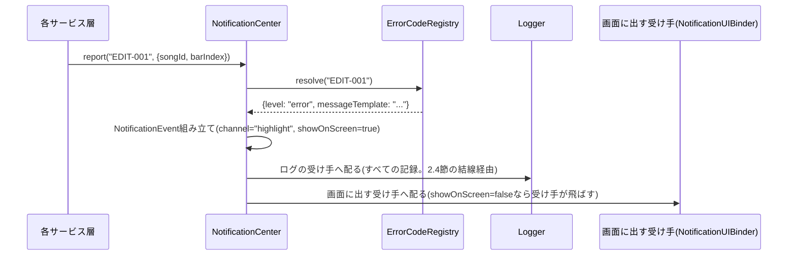
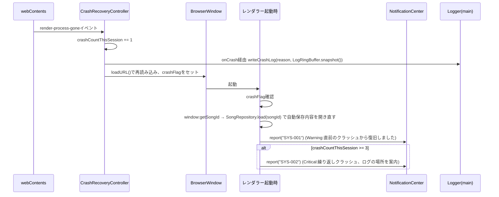
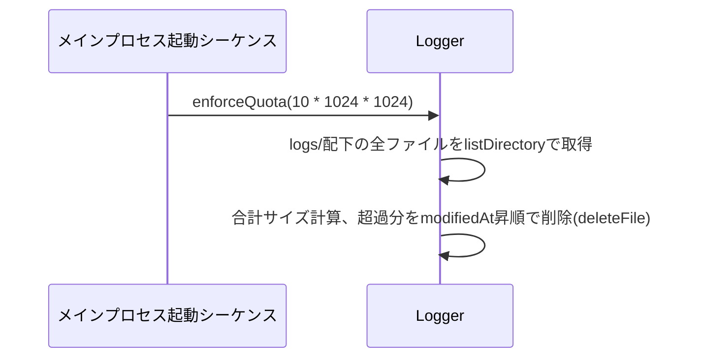

# 詳細設計書：エラー・ログ基盤

> **下書き**（08 の試走で直した文。章ごとに確かめ直す）。作り直す前の本書（`2759936` 時点）をそのまま写したもの。基本設計のどの節が本書のどこに降りるかは、[[00_reference.md#1]] の受け先表にある

- **対応作業パッケージ**：要件定義書9章「エラー・警告基盤」（S）＋「ログ基盤」（S）、実施順序3（[[../basic_design/13_design_decision_points.md#3]]B11。2件のSサイズパッケージを合わせて先に片付ける方針）
- **ブランチ名**：`feature/error-logging-foundation`
- **前提とする基本設計書**：[[../basic_design/08_error_logging.md]]、[[../basic_design/06_file_io_persistence.md#3]]（`logs/`フォルダ。**2026-09-02修正**：セルフレビューで発見、当該定義は同書§1ではなく§3にあるため訂正）、[[../basic_design/11_test_strategy.md#4]]
- **前提とする詳細設計書**：旧詳細設計 `web-core-foundation.md`（`2759936` 時点）（`FileSystemAdapter`）、旧詳細設計 `data-model-persistence.md`（`2759936` 時点）（`FileSystemAdapterFactory`、現アクティブルート用アダプタ）
- **本書の位置づけ**：[[../basic_design/15_development_process.md#1.2]]に基づく詳細設計書。

---

## 1. 目的・スコープ

[[../basic_design/08_error_logging.md#1]]の4段階メッセージ方式（Info/Warning/Error/Critical）を実装する`NotificationCenter`と、[[../basic_design/08_error_logging.md#2]]のログ基盤（日次ローテーション・10MB共有クォータ）を実装する。あわせて、前2パッケージ（旧詳細設計 `web-core-foundation.md`（`2759936` 時点）・旧詳細設計 `data-model-persistence.md`（`2759936` 時点））が「暫定ログ出力／例外をそのまま伝播」としていた箇所を、本パッケージの成果物に置き換える（9節）。

**スコープ外**：トースト・ハイライト・モーダルの実際のReact表示コンポーネント（→画面群・ナビゲーション。本パッケージは`NotificationCenter`が発行するイベントの契約までを定義し、購読側の見た目は次々パッケージ以降で実装する）。

## 2. クラス／インターフェース構成

### 2.1 `packages/core/src/errors`（新設）

| クラス/型 | 責務 | 主要メソッド/フィールド |
|---|---|---|
| `NotificationCenter` | 4段階のメッセージ方式の唯一の窓口。プラットフォーム非依存の純粋ロジック（[[../basic_design/08_error_logging.md#1.1]]） | `report(code: string, context?: Record<string, unknown>): void`／`subscribe(handler: (event: NotificationEvent) => void): () => void`（戻り値は購読解除関数）／`getRecentBuffer(maxEntries: number): NotificationEvent[]`（クラッシュログ用の直近ログバッファ取得、3節で使用）。**2026-09-24 改訂**：`report()` は記録（`NotificationEvent`）を 1 つ作って受け手へ配るだけにする（下の「受け手を分ける」） |
| `NotificationEvent`（型） | 発行されるイベント | `level: 'info'\|'warning'\|'error'\|'critical'`／`channel: 'toast'\|'highlight'\|'modal'`／`code: string`／`message: string`／`context?: Record<string, unknown>`／`timestamp: string`。**2026-09-24 追加**：`showOnScreen: boolean`（そのコードの `ErrorCodeDefinition.showOnScreen`、省略時 `true`。表示の受け手が見る）。`stack?: string`（Error／Critical のときだけ `report()` が取る。取り方は 2.2節「スタックトレースの取得元」） |
| `ErrorCodeRegistry` | エラーコード（`{ドメイン}-{連番}`）ごとに、固定のレベル・チャンネル・メッセージテンプレートを保持する（[[../basic_design/08_error_logging.md#1.2]]） | `register(code: string, def: ErrorCodeDefinition): void`／`resolve(code: string): ErrorCodeDefinition`（未登録コードで呼ばれた場合は`UnknownErrorCodeError`を投げる＝開発時に気づけるようにする）。**2026-09-24 追加**：`showOnScreen: false` なのに `logOnlyReason` が空の定義は `InvalidErrorCodeError` で拒否する（レベルは問わない。出さない理由を必ず書かせるだけ） |
| `ErrorCodeDefinition`（型） | フィールド：`level`、`channel`（`level`から`LEVEL_TO_CHANNEL`表で自動導出するため実質`level`のみ登録すればよい）、`messageTemplate: string`（`{context.xxx}`形式のプレースホルダ埋め込みに対応）。**2026-09-24 追記**：Critical のコードは、さらに `title: string`（見出し＝何が起きたか）と `buttons: { confirm: string; cancel?: string }`（肯定・否定をはっきりさせたボタンの文言。「OK」だけにしない）を持ち、`messageTemplate` を本文（原因の要約と選択肢）として使う（[[../basic_design/08_error_logging.md#5]]）。`NotificationEvent` にも `title?`・`buttons?` を載せてモーダルへ渡す。**2026-09-24 追加（本人決定）**：`showOnScreen?: boolean`（画面に出すか。**省略時 `true`＝今までどおりレベルから `LEVEL_TO_CHANNEL` で決まるチャンネルへ出す**。`false` ならログにだけ書く。レベルを問わず指定できる）と `logOnlyReason?: string`（`showOnScreen: false` のときの、出さない理由。[[00_reference.md#5]]の表にも同じ理由を書く） | - |
| `LEVEL_TO_CHANNEL`（定数表） | レベル→表示チャンネルの固定対応 | `info→toast`／`warning→toast`／`error→highlight`／`critical→modal`（[[../basic_design/08_error_logging.md#1]]の表をそのままコード化） |

**2026-09-02確定（基本設計からの実装レベルの精緻化）**：[[../basic_design/08_error_logging.md#1.1]]の図は`report(level, code, context)`という呼び出し例を示していたが、本パッケージでは**`report(code, context)`のみ**とし、`level`は`ErrorCodeRegistry`がコードから引く設計に変更する。理由：同じコードに呼び出し側ごとに異なるレベルを渡せてしまうと「重複配置は常にError」といった一貫性が呼び出し側の規律に依存してしまう。コードとレベルを1対1に固定することで、レベルの誤指定というクラスのバグをそもそも起こせない設計にする。

**2026-09-24 追記（bd->dd の試走で是正、[[../basic_design/08_error_logging.md#1]]）**：
- **レベルごとの操作の扱い**（全コード共通）：Info・Warning は操作を止めない。Error は該当する操作だけを拒否し、他の操作は続けられる（モーダルを出さない）。Critical は応答するまで他の操作を受け付けない。表示の仕方は [[screens-navigation.md#13.2]] の表示規則
- **ドメインは 8 つに限る**：`EDIT`・`PLAY`・`FILE`・`EXPORT`・`SYS`・`RENDER`・`TAG`・`SONG`（[[../basic_design/08_error_logging.md#1.2]]）。`ErrorCodeRegistry.register` はこれ以外のドメインのコードを `InvalidErrorCodeError` で拒否する（未登録コードの `UnknownErrorCodeError` と同じく、開発時に気づけるようにする）。採番の規則は 旧詳細設計 `00_reference.md` §7（`2759936` 時点）
- **文脈情報**：発生源に曲や小節があるときは、`report()` の `context` に `songId`・`barIndex`（パートがあれば `trackIndex`）を必ず入れる。曲や小節を発生源に持たない通知（`SYS-001` が該当）は入れなくてよい

**2026-09-24 追記（ログに書く受け手と画面に出す受け手を分ける、本人決定、[[../basic_design/08_error_logging.md#1.1]]）**：
- `report(code, context)` は、`ErrorCodeRegistry` から定義を引いて `NotificationEvent` を 1 つ作り（`showOnScreen` を載せる）、`subscribe` で登録された受け手へ登録順に配る**だけ**にする。受け手ごとの振る舞いを `report()` に書かない。受け手が増えても `report()` は変えない
- **ログの受け手**：`showOnScreen` を見ずに、すべての記録を受け取る。renderer の `errorLoggingBootstrap` のログ転送（2.4節の結線：`toLogEntry` → `log.append` → main の `Logger.append` と `LogRingBuffer.push`）と、`NotificationCenter` の直近バッファ（`getRecentBuffer`）・`setLogSink` の注入先がこれに当たる。直近バッファと `setLogSink` は、今は `report()` の中で直接書いている（`NotificationCenter.ts` の `this.recent.push(event)`・`this.writeToLog(event)`）ので、コンストラクタで登録する受け手に移す
- **画面に出す受け手**：`NotificationUIBinder`（[[screens-navigation.md#13.2]]）。`showOnScreen: false` の記録は、どのチャンネル（toast／highlight／modal）へも渡さずに飛ばす
- 画面に出さないコードの一覧と理由は [[00_reference.md#5]] の表が正（印「**画面に出さない**」をレベルの欄に付ける）。最初の例は `PLAY-003`（旧詳細設計 `playback-integration.md` §10.4（`2759936` 時点））

### 2.2 `packages/core/src/errors`（ログ基盤）

| クラス/型 | 責務 | 主要メソッド |
|---|---|---|
| `Logger` | `NotificationCenter`が発行する全イベントを永続ログとして記録する（[[../basic_design/08_error_logging.md#2]]）。`FileSystemAdapter`（旧詳細設計 `data-model-persistence.md` §3.3（`2759936` 時点）でルート解決済みのインスタンス）を注入して使う。**ログの組み立て（レベル・書式）は行わず、受け取った `LogEntry` を書き出すだけ**（2026-09-24 追記、[[../basic_design/08_error_logging.md#1.1]]。組み立ては 2.4節の結線どおり Webコア側） | `append(entry: LogEntry): Promise<void>`／`writeCrashLog(reason: string, recentBuffer: LogEntry[]): Promise<void>`／`enforceQuota(maxTotalBytes: number): Promise<void>`（`logs/`フォルダ合計サイズが上限を超えたら最終更新日時の古いファイルから削除）／`getLogFolderAbsolutePath(): string`（設定画面「アプリ情報」からエクスプローラーで開く用） |
| `LogEntry`（型） | フィールド：`timestamp`、`level`、`code`、`message`、`context`、`stack?: string`（Error/Critical時のみ） | - |
| スタックトレースの取得元（2026-09-24 追記、[[../basic_design/08_error_logging.md#2]]） | `report(code, context)` は Error を引数に取らないので、`stack` は `report()` が記録（`NotificationEvent`）を作るときに決める。レベルが Error／Critical のときだけ、(1) `context.error` が `Error` なら、その `stack` を使う（呼び出し側が捕まえた例外の発生地点）、(2) そうでなければ `report()` の中で `new Error().stack` を取る（`report()` を呼んだ地点）。取った値を `NotificationEvent.stack?` に載せ、`toLogEntry` はそれを `LogEntry.stack` へ写すだけにする（受け手の中で取ると、受け手自身の呼び出し地点になってしまうため）。`context.error` は JSON に書けないので、`toLogEntry` が `context.error` を `{ name, message }` に置き換えてから書く。Info／Warning では `stack` を持たない | - |
| ファイル命名規則 | 通常ログ：`logs/app-YYYYMMDD.log`（1行1JSON、追記形式）。クラッシュログ：`logs/crash-YYYYMMDD-HHMMSS.log` | - |
| クラッシュログの書式（2026-09-24 追記） | `writeCrashLog(reason, recentBuffer)` は、1 行目にクラッシュ理由（`render-process-gone` の `details.reason` と検知時刻）を書き、2 行目以降に `recentBuffer` の `LogEntry` を古い順に 1 行 1 JSON で書く | - |

**`NotificationCenter`と`Logger`の結線**：`Logger`自体は`NotificationCenter`の一機能ではなく独立したクラスとする。**2026-09-24 改訂**：`NotificationCenter.report()` は記録を作って受け手へ登録順に配るだけで（2.1節「ログに書く受け手と画面に出す受け手を分ける」）、`Logger` へはログの受け手（renderer のログ転送 → `log:append` → main の `Logger.append`、2.4節）を通して届く。同じプロセスで書く場合（テスト）は `setLogSink` の注入先がログの受け手になり、そこへモックの `Logger` を渡す。改訂前は「`report()`内部で、購読者への通知と`Logger.append()`呼び出しの両方を行い、`NotificationCenter`が`Logger`インスタンスを保持する」と書いていた。

### 2.3 `apps/desktop/src/main`（クラッシュ検知・復旧）

| クラス | 責務 | 主要メソッド |
|---|---|---|
| `CrashRecoveryController` | レンダラークラッシュの検知・再読み込み・繰り返しクラッシュの判定を行う（[[../basic_design/08_error_logging.md#3]]、[[../basic_design/06_file_io_persistence.md#9]]） | `attach(window: BrowserWindow): void`（`webContents.on('render-process-gone', ...)`を登録。`reason==='clean-exit'`はクラッシュ扱いしない。クラッシュ時は`crashCountThisSession`を+1し、破棄済みでなければ`webContents.loadURL()`（起動時と同じ URL）で再読み込みし、`onCrash({reason, crashCountThisSession})`フックを呼ぶ。**2026-09-24 改訂**：再読み込みの手段を基本設計 08:53 の方針どおり `loadURL` にそろえた。現行の実装は `webContents.reload()` で、実装の段で直す）／`consumeRecoveryState(): CrashRecoveryState`（renderer起動時にIPCで1回呼ばれ、`{recovered, repeatedCrash}`を返し`recovered`フラグを消費する。`repeatedCrash`は`crashCountThisSession >= REPEATED_CRASH_THRESHOLD(=3)`）／constructor は `{threshold?, onCrash?}` を受ける。`crashCountThisSessionValue` getter（診断用）。**通知（SYS-001/SYS-002）自体は出さず、renderer の `errorLoggingBootstrap` が状態を見て `report()` する**。**2026-09-24 追記（フラグの寿命、[[../basic_design/08_error_logging.md#3]]の「メインプロセスがセッション内で保持」）**：`recovered` フラグと `crashCountThisSession` は `CrashRecoveryController` のインスタンスの中（main プロセスのメモリ）にだけ持ち、ファイルにも設定にも書かない。アプリを終了すると消え、次に起動したときは `recovered: false`・回数 0 から始まる（クラッシュの記録として残るのは 2.2節のクラッシュログだけ） |

**2026-09-02確定（基本設計の記述を具体化）**：[[../basic_design/08_error_logging.md#3]]は「同一操作で3回等」と書いていたが、「同一操作」を判定するには編集コマンド層（タブ譜編集コアパッケージ、まだ未実装）が持つ「直前の操作種別」の情報が必要になる。本パッケージの時点ではその情報がないため、**暫定的に「同一ウィンドウ・同一アプリセッション内で3回」**に簡略化して実装する。タブ譜編集コアパッケージ完了後、直前操作のコンテキストを`CrashRecoveryController`に渡せるようになった時点で、要件通りの「同一操作で3回」判定に精緻化することを次パッケージ以降へ申し送る（9.4節）。

**2026-09-24 追記（フリーズの検知、[[../basic_design/08_error_logging.md#3]]、[[../basic_design/13_design_decision_points.md#3]]B43、[[00_reference.md#8.1]] G57）**：基本設計は `render-process-gone`（クラッシュ）に加えて、フリーズ（プロセスは生きているが応答しない）を `webContents.on('unresponsive', ...)` で検知し、`responsive` で解除することを定めている。`CrashRecoveryController.attach` はこの 2 つのイベントも購読する。**未実装**（「Phase 1 完成・製品化」サブ機能 I1、G57）。

**2026-09-24 改訂（フリーズの扱い、本人決定：案 A・5 秒）**：扱いの正は基本設計 08 §3 の表で、本書はその実現手段を決める。
- `unresponsive` を受けても再読み込みはせず、main が `FREEZE_CONFIRM_DELAY_MS`（=5000）のタイマーを始める。フリーズ中は renderer に何も出さない（ウィンドウには OS の「応答なし」が出るだけ）
- `responsive` を受けたらタイマーを止め、renderer へ `freeze:recovered` を送る。renderer の `errorLoggingBootstrap` がこれを受けて `notificationCenter.report('SYS-003')`（Warning「一時的に応答が停止していました」）を出す
- タイマーが満了したら、main が `dialog.showMessageBox` で Critical のネイティブダイアログを出す（ボタン「待つ」「再読み込み」、既定は「待つ」）。「待つ」ならタイマーを始め直し、さらに 5 秒応答が無ければもう一度出す。「再読み込み」なら `recovered` を立てて `loadURL()` で再読み込みする
- **ダイアログの中身（2026-09-24 追記、本人決定：基本設計 08 §5 に沿う）**：`dialog.showMessageBox(window, options)` に親のウィンドウを渡し、`options` は次のとおり。`message`（見出し）＝「画面が応答していません」。`detail`（本文）＝「画面の処理が 5 秒以上止まっています。大きな曲の描画や保存など、重い処理の途中で一時的に止まっているだけのこともあります。このまま待つか、画面を再読み込みしてください。再読み込みすると最後に自動保存した内容で開き直すため、自動保存されていない直前の編集は失われます。」。`buttons`＝`['待つ', '再読み込み']`、`defaultId: 0`、`cancelId: 0`（Esc は「待つ」＝再読み込みしない側）、`noLink: true`（Windows でボタンをコマンドリンクに変えない）、`title`＝アプリ名
- **表示中に応答が戻ったとき（2026-09-24 追記、本人決定の案 A「5 秒タイマーと出しているダイアログを止める」）**：ダイアログを出すたびに `AbortController` を 1 つ作り、その `signal` を `options.signal` に渡す。`responsive` を受けたら、タイマーを止めるのに加えて `controller.abort()` でダイアログを閉じ、`freeze:recovered` を送る。閉じられたダイアログの Promise は `cancelId`（0＝「待つ」）で解決するので、`showMessageBox` の戻りを見る処理は**先に `controller.signal.aborted` を確かめ**、真なら「待つ」として扱わずに何もしない（タイマーを始め直さない・再読み込みしない）。確かめた根拠：実装で使っている Electron 44.2.0 の型定義 `electron.d.ts` の `MessageBoxOptions` に `signal?: AbortSignal;` があり、説明は「Pass an instance of AbortSignal to optionally close the message box, the message box will behave as if it was cancelled by the user. On macOS, `signal` does not work with message boxes that do not have a parent window」。親のウィンドウを渡すので、macOS（Phase 3）でもこの制限には当たらない
- 再読み込み後の復元はクラッシュ時と同じ経路：renderer が起動時に `crash:getRecoveryState` を引き、`recovered` なら下記の復元手順と `SYS-001` に入る
- 無確認では再読み込みしない（基本設計 08 §3、B43）

**2026-09-24 追記（再読み込み後の復元手順、[[../basic_design/08_error_logging.md#3]]の 3.）**：main の `WindowManager`（旧詳細設計 `screens-navigation.md` §4.9.8（`2759936` 時点））はウィンドウごとに開いている `songId` を持っている。再読み込み後の renderer は、`crash:getRecoveryState` の結果が `recovered` のとき、自分のウィンドウの `songId` を `window:getSongId` IPC で受け取り、`SongRepository.load(songId)` で自動保存済みの内容を開き直す。自動保存されていなかった編集は戻らない（クラッシュ時はプロセスが失われているため）。**未実装**（`SongRepository.load` の renderer 結線そのものが G31 で未。I1）。

### 2.4 プロセス配置と結線（2026-09-08確定、[[../basic_design/13_design_decision_points.md#3]]B32）

基本設計 [[../basic_design/08_error_logging.md#1.1]] は `NotificationCenter` を「Webコア内シングルトン」とだけ述べていたが、`Logger` が `FileSystemAdapter` を要する（2.2節）ため、Electron の main/renderer 分割上の実体を実装時に確定した。

| 要素 | プロセス | 実体 |
|---|---|---|
| `NotificationCenter` | renderer（Webコア） | `packages/core/src/errors` の共有シングルトン `notificationCenter`（コア8コード登録済みの `errorCodeRegistry` を保持）。テストは `NotificationCenter` クラスを直接 `new` する |
| `Logger` | main プロセス | `apps/desktop/src/main/main.ts` が `ElectronFileSystemAdapterFactory` のアクティブルート用アダプタを注入して生成。起動シーケンスで `enforceQuota(DEFAULT_LOG_QUOTA_BYTES=10MB)` を1回呼ぶ（3.3節） |
| 結線 | — | renderer の `errorLoggingBootstrap` が `notificationCenter.subscribe(...)` で全イベントを受け、`toLogEntry(event)`（`packages/core/src/errors`）で `LogEntry` に組み立ててから `window.riffLineApi.log.append(entry)` へ送る。main の `registerLogHandlers` は受けた `LogEntry` をそのまま `Logger.append(entry)` と `LogRingBuffer.push(entry)` に渡すだけで、組み立ては行わない。`setLogSink` は同一プロセス（テスト・将来）向けに `NotificationCenter` へ残す。**2026-09-24 追記**：このログ転送は 2.1節の「ログの受け手」なので、`showOnScreen` を見ずにすべての記録を送る（画面に出さないコードの記録もログには残る）。**2026-09-24 改訂**：[[../basic_design/08_error_logging.md#1.1]]の「main側の`Logger`が持つのは、①ファイルへの書き出しと⑦クラッシュ後の記録の2つだけで、ログの組み立て（レベル・書式）はWebコア側に置く」に合わせた。改訂前は main の `registerLogHandlers` が `Logger.append(toLogEntry(event))` と `LogRingBuffer.push(event)` を行う設計で、現行の実装（`apps/desktop/src/main/main.ts`）もそのまま。実装の移動は実装の段で行う |
| `LogRingBuffer`（新設、main） | main プロセス | `render-process-gone` で renderer 側バッファが失われるため、クラッシュログに添える直近 `LogEntry` 履歴を main 側でも保持する（既定200件、`NotificationCenter.getRecentBuffer` と同方式）。**2026-09-24 改訂**：`log:append` で届くのが組み立て済みの `LogEntry` になったため、保持する型を `NotificationEvent` から `LogEntry` に変えた（`Logger.writeCrashLog` の `recentBuffer` も同じ） |
| クラッシュ復旧通知 | — | `CrashRecoveryController` は通知を出さず、`crash:getRecoveryState` IPC で `{recovered, repeatedCrash}` を返す。renderer の `errorLoggingBootstrap` が起動時に1回引き、`repeatedCrash`→`SYS-002`、`recovered`→`SYS-001` を `notificationCenter.report()` する |
| 購読の順番（2026-09-24 追記） | — | 「すべてのメッセージはまずログ基盤に記録される」（[[../basic_design/08_error_logging.md#1.1]]）を守るため、renderer の `errorLoggingBootstrap` はログ転送の購読を、表示側（`NotificationUIBinder`）の購読より**先に**登録する。`NotificationCenter` は購読を登録順に呼ぶ |
| クラッシュログの結線（2026-09-24 追記） | main プロセス | `main.ts` は `CrashRecoveryController` の `onCrash({reason})` を `Logger.writeCrashLog(reason, LogRingBuffer.snapshot())` へつなぐ。これで `render-process-gone` を検知するたびに `logs/crash-YYYYMMDD-HHMMSS.log` が書かれる（書式は 2.2節） |
| フリーズの確認と復帰の通知（2026-09-24 追記） | main プロセス | 2.3節の案 A。タイマー・ネイティブダイアログ・`loadURL` は main、`SYS-003` の発行は renderer |

IPC は既存チャンネル不変の**非破壊追加**：`log:append`（`LOG_CHANNELS.append`）／`crash:getRecoveryState`（`CRASH_CHANNELS.getRecoveryState`）。**2026-09-24 追加（未実装）**：`freeze:recovered`（main→renderer、フリーズからの復帰）／`window:getSongId`（renderer→main、復元する曲の ID）／`app:openLogFolder`（renderer→main、`Logger.getLogFolderAbsolutePath()` のフォルダを `shell.openPath` で開く。設定ダイアログの「アプリ情報」と `SYS-002` のダイアログから呼ぶ）。型（`NotificationEvent`／`LogEntry`／`CrashRecoveryState`）は `@riff-line/shared-types` が単一の真実源とし、`packages/core/src/errors/types.ts` は re-export に留める。

`Logger.append` は `FileSystemAdapter` に追記APIが無く read→concat→write のため、連続呼び出しで行が失われないよう内部の直列化キューで1件ずつ処理する。キューの掃きだしを待つ `flush(): Promise<void>` を持つ（アプリ終了処理・テスト用、公開シグネチャの非破壊追加）。

## 3. 主要シーケンス

### 3.1 通常のエラー/警告発行

### 3.2 クラッシュ検知・復旧

### 3.3 ログローテーション・クォータ適用（起動時）

## 4. エラーコードレジストリの初期登録（本パッケージで確定する分だけ）

前2パッケージの暫定処理を置き換えるために必要な最小セットを、本パッケージで登録する（以降のパッケージが自分の担当領域のコードを追加登録していく）。

| コード | レベル | 発生源 | メッセージ概要 |
|---|---|---|---|
| `FILE-001` | Error | 旧詳細設計 `data-model-persistence.md` §3.2（`2759936` 時点） `AutoSaveScheduler`のリトライ全滅（**2026-09-02修正**：セルフレビューで発見、`SongRepository.save()`自体ではなく、それを呼び出す`AutoSaveScheduler`のリトライループが発生源。9.2節の記載と統一） | 「保存に失敗しました。保存先の空き容量・アクセス権を確認してください」 |
| `FILE-002` | Critical | 旧詳細設計 `data-model-persistence.md` §4.2（`2759936` 時点） `IntegrityCheckFailedError` | 「データの整合性エラーを検知しました。直前の自動保存内容から復元しますか？」（[[../basic_design/08_error_logging.md#5]]の文言方針に従う）。**2026-09-08追記**：文言の「復元」に対応する実手段は`LocalBackupService.restore(songId)`（[[../basic_design/13_design_decision_points.md#3]]B25、[[00_reference.md#8.1]]G13）。`SongRepository.load`がチェックサム不一致検知時に`report('FILE-002', {songId})`を呼ぶ。**2026-09-24 追記**：見出し「データの整合性エラーを検知しました」、ボタン「復元する」／「キャンセル」。**2026-09-24 改訂（本人決定：原因の要約を入れ、戻る先を正確に）**：本文「このファイルの中身が、保存したときの記録と一致しません。保存の途中で書き込みが止まったか、ほかのアプリで書き換えられた可能性があります。ひとつ前に保存した内容（自動保存を含む）を復元しますか？」。戻る先は `LocalBackupService` が保存の直前に退避した 1 世代で、最後の保存のひとつ前に保存した内容（自動保存を含む）にあたる（旧詳細設計 `data-model-persistence.md` §3.2（`2759936` 時点）の `rotate`・`restore`、9.5節）。改訂前の本文は「直前の自動保存内容から復元しますか？」で、原因の要約が無く、戻る先の言い方も実際と合っていなかった |
| `FILE-003` | Error | 旧詳細設計 `data-model-persistence.md` §6（`2759936` 時点） オンデマンドダウンロードのリトライ全滅 | 「クラウド同期フォルダ内のファイルにアクセスできません。同期状況を確認してください」 |
| `FILE-004` | Critical | 旧詳細設計 `data-model-persistence.md` §3.2（`2759936` 時点） `SchemaMigrator`の`UnsupportedSchemaVersionError` | 「このファイルは新しいバージョンのアプリで作成されたため開けません」。**2026-09-24 改訂（本人決定：基本設計 08 §5 に沿う）**：見出し「このファイルは開けません」、本文「このファイルは、今のアプリより新しいバージョンのアプリで保存されているため、読み込めません。ファイルは変更していません。アプリを最新版に更新してから、もう一度開いてください。」、ボタン「閉じる」（選べることは本文の「更新してから開き直す」だけで、ダイアログの中で選ぶものは無いため 1 つ） |
| `FILE-005` | Warning | 旧詳細設計 `data-model-persistence.md` §3.2（`2759936` 時点） `MirrorSyncService`のミラー書き込み失敗 | 「ミラー先への保存に失敗しました（主保存は正常です）」 |
| `FILE-008` | Critical | 旧詳細設計 `data-model-persistence.md` §3.2（`2759936` 時点） `CorruptSongFileError`（壊れたファイル：（1）ファイルが JSON として読めない、（2）最上位がオブジェクトでない、（3）`schemaVersion` が空でない文字列でない、の 3 つ。**2026-09-24 追加、G39**） | 見出し「このファイルは壊れているため開けません」、本文「このファイルは中身が壊れていて、曲のデータとして読み込めません。保存の途中で書き込みが止まったか、ほかのアプリで書き換えられた可能性があります。ひとつ前に保存した内容（自動保存を含む）を復元しますか？」（2026-09-24 改訂：戻る先の言い方を `FILE-002` と同じく実際に合わせた。戻る先は `LocalBackupService` が保存の直前に退避した 1 世代で、最後の保存のひとつ前に保存した内容（自動保存を含む）にあたる（旧詳細設計 `data-model-persistence.md` §3.2（`2759936` 時点）の `rotate`・`restore`、9.5節））、ボタン「復元する」／「キャンセル」（[[../basic_design/08_error_logging.md#5]]に沿う。「復元する」は `FILE-002` と同じ `LocalBackupService.restore(songId)`） |
| `SYS-001` | Warning | 2.3節 クラッシュ復旧成功 | 「直前のクラッシュから復旧しました」 |
| `SYS-002` | Critical | 2.3節 繰り返しクラッシュ | 「クラッシュが繰り返し発生しています。ログフォルダを確認してください」。**2026-09-24 改訂（本人決定：基本設計 08 §5 に沿う）**：見出し「画面の処理が繰り返し異常終了しています」（本人決定で、本文の「異常終了」と言葉をそろえた。一度「クラッシュが繰り返し発生しています」と書いた）、本文「画面の処理が、アプリを起動してから 3 回以上、異常終了して開き直されました。原因はログに記録してあります。ログフォルダを開いて確認するか、閉じて作業を続けてください。ログの場所：{context.logFolder}」（「3 回以上」は `REPEATED_CRASH_THRESHOLD`（=3）と同じ数で、`messageTemplate` を登録するときにこの定数から埋め込む。`context` は今までどおり `{logFolder}`＝`getLogFolderAbsolutePath()` のパス）、ボタン「ログフォルダを開く」（`app:openLogFolder`）／「閉じる」。改訂前の本文は「詳しいログは次の場所にあります：{context.logFolder}」で、原因の要約が無かった |
| `SYS-003` | Warning | 2.3節 フリーズからの復帰（**2026-09-24 追加**、案 A） | 「一時的に応答が停止していました」 |
| `RENDER-001` | Error | 旧詳細設計 `web-core-foundation.md` §3.1（`2759936` 時点） `ScoreRenderHost`の`renderError` | 「譜面の描画に失敗しました」 |

## 5. テーマトークンとの関係

色トークンの具体値は[[../basic_design/14_visual_design_system.md#3]]で確定済みであり、本パッケージは関与しない。`NotificationEvent.level`／`channel`が、画面群パッケージで実装される表示コンポーネントがどのトークンを参照するかを決定する入力になる、という契約のみをここで確定する。レベルから 14 章 3 節の表のどのトークンを使うかの対応は、申し送り先の [[screens-navigation.md#13.2]] の表示規則に書く（2026-09-24 追記）。

## 6. 単体テスト観点（[[../basic_design/11_test_strategy.md#2]]のC2対象）

- `NotificationCenter.report()`：コードからレベル・チャンネルが正しく解決されること、未登録コードで例外が投げられること（C0/C1/C2：レベル×チャンネルの組み合わせ網羅）。
- `Logger.enforceQuota()`：ちょうど境界値（10MB前後）でのC1判定。
- `CrashRecoveryController`：`crashCountThisSession`が2回目・3回目でのC1分岐（Critical発火有無）。
- `ErrorCodeRegistry.resolve()`：登録済み／未登録コードのC0/C1。
- **2026-09-24 追加**：`report()` から `toLogEntry` を通したログ記録内容（`timestamp`／`level`／`code`／`message`／`context`、Error/Critical のときだけ `stack`）を、`setLogSink` にモックを渡して単体テストで検証する。
- **2026-09-24 追加**：`ErrorCodeRegistry.register()` が 8 ドメイン以外のコードを `InvalidErrorCodeError` で拒否すること（C0/C1）。
- **2026-09-24 追加**：`showOnScreen: false` の定義で `report()` したとき、ログの受け手（`setLogSink` のモック・直近バッファ）には記録が届き、`NotificationEvent.showOnScreen` が `false` になること。`showOnScreen` を省略した定義では `true` になること。`showOnScreen: false` で `logOnlyReason` が空の定義を `register()` が `InvalidErrorCodeError` で拒否すること（C0/C1）。
- **2026-09-24 追加**：`CrashRecoveryController` のフリーズ処理（2.3節）：`unresponsive` のあと 5 秒以内に `responsive` が来ればダイアログを出さず `freeze:recovered` を送る／来なければダイアログを出す／「待つ」ならタイマーを始め直す／「再読み込み」なら `loadURL` する、の C1。タイマーは差し替えて検証する。

## 7. 結合テスト観点

- 実際の`FileSystemAdapter`を使い、`Logger.append()`→ファイル生成→`enforceQuota()`での削除までの一連の流れ（[[../basic_design/11_test_strategy.md#5]]）。
- 旧詳細設計 `data-model-persistence.md`（`2759936` 時点）の`SongRepository`・`SchemaMigrator`から実際に`NotificationCenter.report()`が呼ばれ、対応するコードでログ記録されることを結合テストで確認する（4節のコード対応表通りに配線されているかの検証）。
- **2026-09-24 追加（フォールトインジェクション、[[../basic_design/08_error_logging.md#1.1]]）**：Critical の発生条件を結合テストで再現する。`.tabapp` のバイトを書き換えてチェックサムを壊す→`FILE-002`、未来の `schemaVersion` を持つファイルを置く→`FILE-004`、`CrashRecoveryController` に `render-process-gone` を 3 回送る→`SYS-002`。**2026-09-24 追加（G39）**：壊れた `.tabapp`（JSON として読めない・最上位がオブジェクトでない・`schemaVersion` が無いか空、の 3 種）を置く→`FILE-008`（`FILE-004` は出ない）。それぞれ対応するコードがログに記録され、モーダルへ届くことを確かめる。

## 8. 完了基準（Definition of Done）

| # | 基準 | 本パッケージでの具体的な確認内容 |
|---|---|---|
| 1 | 基本設計の記載内容を満たしている | [[../basic_design/08_error_logging.md]]全節との対応を確認 |
| 2 | 詳細設計書と実装が整合している | 2節のクラス構成・4節のコード表通りに実装されていること |
| 3 | 単体・結合テスト | 6・7節の観点を実施 |
| 4 | セルフレビュー | **2026-09-03修正**：[[../basic_design/15_development_process.md#6]]は2026-09-02にセルフレビュー対象を「L/XLサイズのみ」から「サイズ問わず全件」へ改訂済みであり、本行の「Sサイズ2件のため対象外」という記載は旧方針のまま取り残されていた（[[../review/design_review_2026-09-03.md]]A-2）。新方針のもとで対象パッケージとして扱う |
| 5 | 手動シナリオ確認 | 意図的に保存先フォルダを読み取り専用にして`FILE-001`のError表示を確認、意図的にレンダラーをクラッシュさせて`SYS-001`の復旧通知を確認する。**2026-09-08 実施**：production ビルドを CDP でヘッドレス起動し、`Page.crash` → main の `render-process-gone` 検知 → `CrashRecoveryController` によるウィンドウ再読み込み → 復帰後シェルの通知一覧に `SYS-001`（warning/toast「直前のクラッシュから復旧しました。」）表示、かつ `logs/app-YYYYMMDD.log` へ同 SYS-001 行が記録、`logs/crash-YYYYMMDD-HHMMSS.log` も生成、を確認。`FILE-001` は現シェルに保存フローが無い（編集コアは WP4）ため、UT（`AutoSaveScheduler` リトライ全滅→`report('FILE-001')`）＋ IT（実ログファイルへの書き出し）と、`SYS-001` で実証済みの同一表示経路で担保。ウィンドウ内の最終目視、および保存フロー実装後（パッケージ4以降）の `FILE-001` 実表示確認は[[00_reference.md#8.1]] G23 としてパッケージ8着手時の繰り越し項目に登録済み（旧詳細設計 `screens-navigation.md` §9（`2759936` 時点） P3-a・P3-b） |
| 6 | `main`へマージ済みで起動可能 | 上記5のシナリオが動作する状態 |

## 9. 前パッケージの暫定実装の置き換え・次パッケージへの申し送り

**2026-09-08 実装時の実施状況**：9.1・9.2 は本パッケージで実施済み（下記各項に「実施」を追記）。9.3（`FILE-003`）はコード登録のみ行い、`report()` 呼び出しは `SongRepository.load` を実際に配線するパッケージ（bootstrap）へ申し送る。

### 9.1 旧詳細設計 `web-core-foundation.md` §3.1（`2759936` 時点）への反映
`ScoreRenderHost`の`renderError`イベントハンドラ（暫定で`console.error`相当としていた箇所）を、`NotificationCenter.report('RENDER-001', context)`の呼び出しに置き換える。**実施（2026-09-08）**：`ScoreRenderHost`自体は alphaTab の Host として `NotificationCenter` に依存させず `renderError` イベントを発火するのみに留め、購読側（renderer 起動配線＝現状は最小シェル `App.tsx`、将来は画面群パッケージの `NotificationUIBinder`）が `report('RENDER-001', {detail})` を呼ぶ。`ScoreRenderHost` 内の `console.error` は開発時診断として残置。

### 9.2 旧詳細設計 `data-model-persistence.md` §3.2（`2759936` 時点）への反映
`SchemaMigrator`の`UnsupportedSchemaVersionError`、`SongRepository.load()`の`IntegrityCheckFailedError`、`AutoSaveScheduler`のリトライ失敗、`MirrorSyncService`の失敗ログを、それぞれ4節の対応コード（`FILE-004`／`FILE-002`／`FILE-001`／`FILE-005`）での`NotificationCenter.report()`呼び出しに置き換える。**実施（2026-09-08）**：`packages/core/src/errors` の共有シングルトン `notificationCenter` を各サービスから直接呼ぶ形で置き換えた。`SchemaMigrator` は `UnsupportedSchemaVersionError` を組み立てる私設ヘルパー内で `report('FILE-004')` を呼び throw も継続（呼び出し元は型付きエラーで制御フロー）。`SongRepository.load` はチェックサム不一致で `report('FILE-002')` 後に throw。`AutoSaveScheduler` はリトライ全滅で `report('FILE-001')`（既存の `hooks.onError` も維持）。`MirrorSyncService` はミラー書き込み失敗・コピー元読み込み失敗で `report('FILE-005')`。エラーコードを持たない内部回復警告（`index.json` 再構築等）は従来どおり `log.ts` の `warnProvisional`（console）に残す。

**既知の粗さ（follow-up）**：`SchemaMigrator` は `(オブジェクトでない)` `(schemaVersion 欠落)` といった破損ファイルでも `UnsupportedSchemaVersionError` を投げる設計であり、実装もそれらで `FILE-004`（「新しいバージョンのアプリで作成されたため開けません」）を発行する。文言と実状（＝単なる破損）がずれるが、これは本置き換え以前から `UnsupportedSchemaVersionError` に一本化されていた挙動で、9.2 節のマッピング（同エラー → `FILE-004`）に区別を設けていないため踏襲した。破損とバージョン非対応を別コードに分けるかはデータモデル・永続化側の課題として持ち越す。**2026-09-24 設計で解消（G39、本人決定の前提）**：壊れたファイル（（1）ファイルが JSON として読めない、（2）最上位がオブジェクトでない、（3）`schemaVersion` が空でない文字列でない、の 3 つ）は `CorruptSongFileError` とし、`FILE-008` を出す。`FILE-004` は `schemaVersion` が読めて、そこから今の版へ移す経路が無いときだけ出す（旧詳細設計 `data-model-persistence.md` §3.2（`2759936` 時点）の `SchemaMigrator`・`SongRepository`）。**未実装**（I1）

### 9.3 旧詳細設計 `data-model-persistence.md` §6（`2759936` 時点）への反映
オンデマンドダウンロード対策のリトライ全滅時の例外伝播を`FILE-003`での`report()`に置き換える。**2026-09-08時点**：`FILE-003` はレジストリへ登録済み。ただしオンデマンドDLのリトライは main プロセスの `retryOnEmptyRead`（旧詳細設計 `data-model-persistence.md` §6（`2759936` 時点））にあり、失敗は `ElectronFileSystemAdapter` で `FileReadError` に正規化されて renderer へ渡る。この時点で「オンデマンドDL全滅」と「その他の読み取り失敗」を区別する情報は失われており、かつ `SongRepository.load` を実際に呼び出す配線がまだ存在しない（パッケージ8）。よって `report('FILE-003')` の呼び出し箇所は、`SongRepository.load` を配線する bootstrap 側で「読み取り失敗をユーザー向けに通知する」処理の一部として実装することを申し送る（`FILE-002`/`FILE-004` の Critical と異なり `FILE-003` は Error なので、read 経路の失敗ハンドリングにまとめてよい）。

**2026-09-10 申し送り先の更新（監査 MJ-C1）**：本申し送りの宛先はパッケージ8（bootstrap）だったが、パッケージ8 完了時点でも**`SongRepository.load` を renderer から呼ぶ経路自体が実装されていない**（曲を開く導線が未結線）ため、未履行のまま残った。宛先を「Phase 1 完成・製品化」サブ機能 I1（機能の全結線）へ移す（旧詳細設計 `phase1-productization.md` §3（`2759936` 時点） G-I1、[[00_reference.md#8.1]] G31）。判定条件＝曲一覧から曲を開く経路が `SongRepository.load` に結線され、読み取り失敗時に `FILE-003` の `report()` が呼ばれることが結合テストで確認できること。

### 9.4 次パッケージ（タブ譜編集コア）への申し送り
- 2.3節で暫定化した「同一操作で3回」判定の精緻化（コマンド層が持つ直前操作コンテキストを`CrashRecoveryController`へ渡す配線）。
- あわせて、`CrashRecoveryController.attach` は現状クラッシュのたび無条件で `webContents.reload()` する（`REPEATED_CRASH_THRESHOLD`=3 は SYS-002 通知の判定にのみ使い、再読み込み自体は打ち切らない）。起動直後クラッシュが連続する状況での再読み込み回数の上限（例：しきい値到達後は reload を止めて Critical モーダルのみ表示）も、直前操作コンテキストの配線と同時に検討する。
- タブ譜編集コアのバリデーションエラー（重複配置、フレット範囲外等）は`EDIT-xxx`のコードとして本パッケージの`ErrorCodeRegistry`に追加登録する（登録自体は当該パッケージの詳細設計で行う）。

**2026-09-10 申し送り先の更新（監査 MJ-C2）**：上記3点のうち3点目（`EDIT-xxx` の登録）はパッケージ4で履行済みだが、**1点目（直前操作コンテキストの配線）と2点目（起動直後の連続クラッシュ時の reload 打ち切り上限）は未履行のまま**パッケージ4〜8 を通過した。宛先を「Phase 1 完成・製品化」サブ機能 I1 へ移す（[[00_reference.md#8.1]] G32）。判定条件＝`CrashRecoveryController` が直前に実行された `Command.kind` を受け取り、同一 kind の連続クラッシュ 3 回で `SYS-002` を発行すること、および reload の打ち切り上限が実装され UT で検証されていること。
